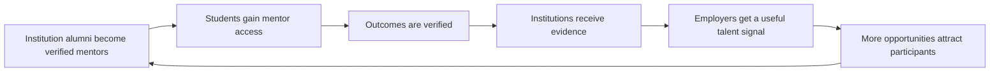
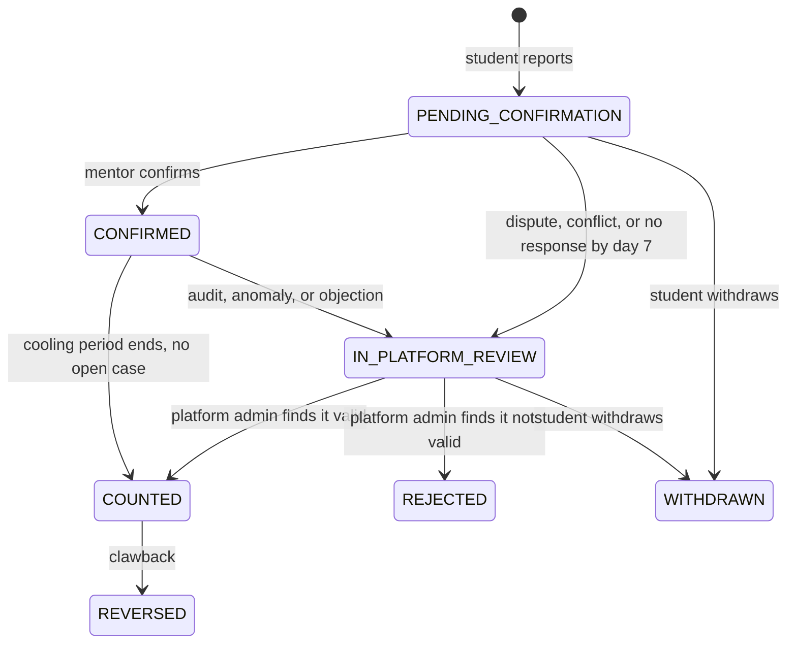
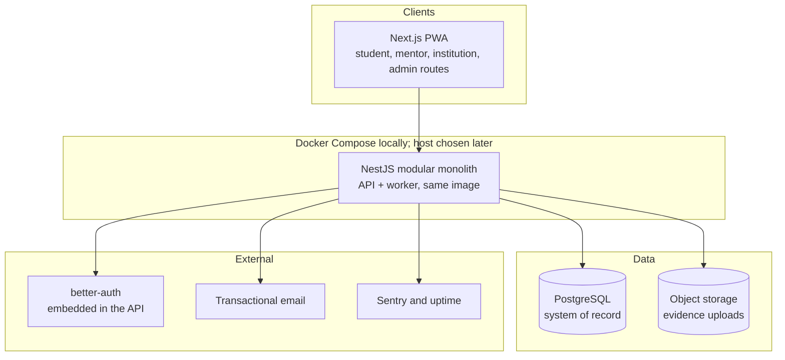
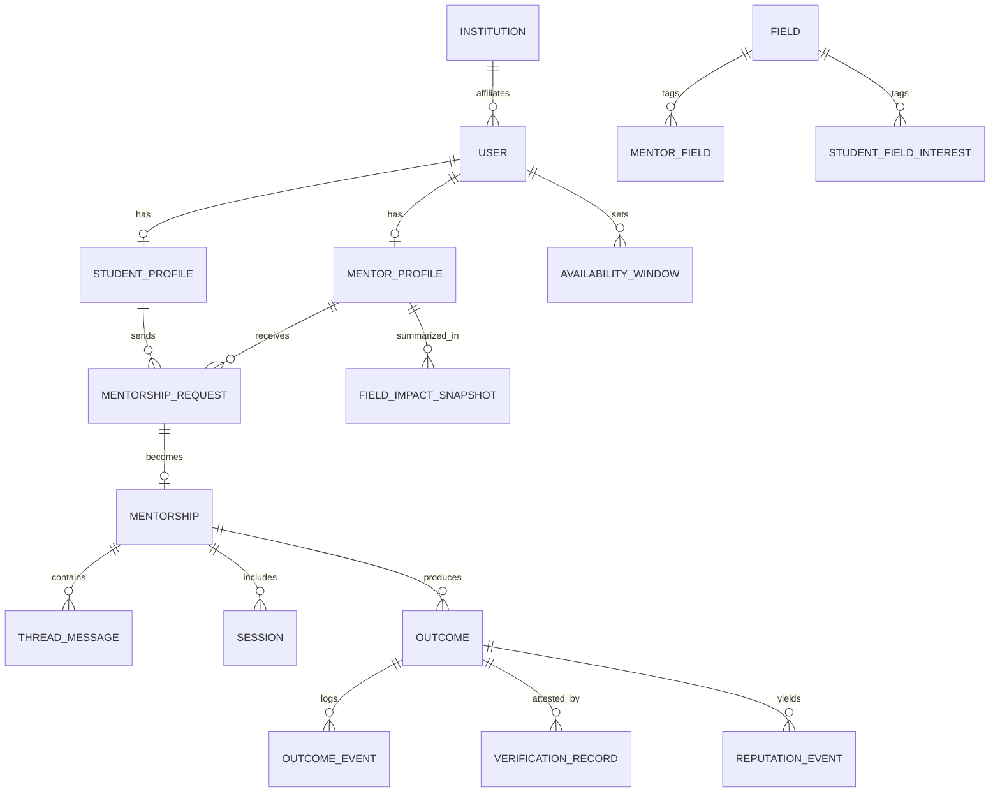

# connect

> **From mentorship to measurable outcomes.**
> A structured mentorship and reputation operating system for the academic-to-career transition, where confirmed progress builds credible professional reputation.

| | |
|---|---|
| **Status** | **MVP baseline approved (owner decision, 2026-10-29).** Sprint 0 platform baseline implemented: pnpm monorepo, containerized local stack, operational endpoints, CI gates. No product capability or deployment yet |
| **Document role** | **Master README, the main source of truth** for the connect project |
| **Audience** | Builder, future engineers, designers, advisors, pilot institutions, AI coding agents |
| **Last reviewed** | 2026-10-29 |

---

## Table of Contents

1. [How to use this document](#1-how-to-use-this-document)
2. [Plain-language summary (non-technical)](#2-plain-language-summary-non-technical)
3. [Product scope](#3-product-scope)
4. [Business overview](#4-business-overview)
5. [Core product mechanics](#5-core-product-mechanics)
6. [Platform surfaces: Web PWA and Admin](#6-platform-surfaces-web-pwa-and-admin)
7. [Technical architecture](#7-technical-architecture)
8. [Authentication](#8-authentication)
9. [Real-time, audio and video calls](#9-real-time-audio-and-video-calls)
10. [Data layer: PostgreSQL and storage](#10-data-layer-postgresql-and-storage)
11. [Analytics and reporting](#11-analytics-and-reporting)
12. [Security, privacy and compliance](#12-security-privacy-and-compliance)
13. [Non-functional targets](#13-non-functional-targets)
14. [Engineering workflow and environments](#14-engineering-workflow-and-environments)
15. [Roadmap and phases](#15-roadmap-and-phases)
16. [Documentation map](#16-documentation-map)
17. [Additional documents recommended for this project](#17-additional-documents-recommended-for-this-project)
18. [Open decisions](#18-open-decisions)
19. [Glossary](#19-glossary)
20. [Repository status](#20-repository-status)

---

## 1. How to use this document

This README is the **single entry point** and the **source of truth**. Detailed documents live in `docs/` and expand sections of this file. If a detailed document and this README disagree, **resolve the conflict explicitly and update both**. Never let them drift silently.

### 1.1 Truth labels

Every number, rule, or claim in connect documentation must carry one of these labels when it matters.

| Label | Meaning |
|---|---|
| **Plan target** | A value stated in the owner's plan (for example, match acceptance above 40%). A goal, not a result. |
| **Proposed default** | A starting value or design choice that is editable and **not validated** (for example, reputation weights). |
| **Illustrative** | Fictional sample data used to explain a concept. Never real customer or market data. |
| **Open decision** | Not decided yet. Must not be treated as policy. |
| **Deferred (owner decision)** | Deliberately postponed to a named later gate. Not a blocker. |
| **Verified** | Confirmed by pilot data, a contract, or a primary source. |

### 1.2 Rules for writing in this project

- Never invent real university names, mentor identities, customer numbers, or validated statistics.
- Never describe a feature as built if it is only designed.
- Unresolved questions stay in [Open decisions](#18-open-decisions) until the owner resolves them.
- Architecture choices are recorded as ADRs in `docs/architecture-decisions.md`; product and process decisions in `docs/decision-log.md`.
- Code is written spec-first. Each change starts as an OpenSpec proposal (see `docs/mvp-build-plan.md`).

---

## 2. Plain-language summary (non-technical)

### The problem

A student finishing university often does not know whom to ask for career guidance. When they find a mentor, messages go unanswered. Mentors are busy and have no structure for how to help. Nobody can tell afterward whether mentorship actually led to anything: an internship, an admission, a new skill.

### The idea

connect turns mentorship into a **structured process with proof**:

1. A student describes what they need in a short structured request.
2. A mentor accepts, redirects, or recommends someone else.
3. After guidance, the student reports a result (for example, "I got an internship").
4. The mentor **confirms** it. Only confirmed results count.
5. Confirmed and counted results build the mentor's **reputation** in that specific field.
6. Universities and employers see **evidence**, not claims.

### An analogy

An outcome is like a **receipt**. A receipt written by the buyer alone is weak. A receipt countersigned by the seller is valid. In connect, a result becomes real only when the mentor countersigns it.

### Who is involved

| Stakeholder | Color in diagrams | What they get | What they give |
|---|---|---|---|
| **Students** | Cyan | Clarity, mentor access, visible progress | Goals, time, honest outcome reports |
| **Mentors** | Violet | Structured authority, manageable workload, verified impact | Experience, guidance, outcome confirmation |
| **Institutions** | Green | Evidence of career outcomes, alumni engagement, dashboards | Subscription revenue, alumni mentors |
| **Employers** | Amber | Filtered talent signal backed by verified progress | Opportunities, analytics revenue |

### Where the money comes from

The **primary proposed revenue stream is institutional subscriptions**. Secondary streams are paid mentor office hours, employer analytics, and sponsored skill programs. See [Business overview](#4-business-overview).

---

## 3. Product scope

### 3.1 What connect is

- A mentorship workflow with structured requests, clear decisions, and outcome tracking.
- A reputation system based on verified impact, scoped per field.
- An evidence layer for institutions and employers.

### 3.2 What connect is not

- Not a social network and not a follower or like economy.
- Not a generic content-sharing platform.
- Not a motivational-posting feed.
- Not a global student ranking.

### 3.3 Product principles

1. **Outcomes over activity.** Measure progress, not engagement time.
2. **Reputation is earned.** Likes and follower counts never contribute.
3. **Unconfirmed means uncounted.** Pending outcomes never affect reputation.
4. **Fields are separate.** Scores in different domains are not interchangeable.
5. **Protect mentor capacity.** Controlled capacity reduces overload and ghosting.
6. **Simple first.** Use managed services and simple rules until pilot data justifies complexity.

---

## 4. Business overview

### 4.1 Revenue model (all figures are Proposed unless stated)

| Tier | Payer | Proposed rationale | Status |
|---|---|---|---|
| **1. Institutional subscriptions** | Universities, bootcamps, training institutes | Evidence of career outcomes, alumni engagement, impact reporting | **Primary proposed stream** |
| **2. Paid mentor office hours** | Participants booking paid sessions | Direct access to verified mentors | **Later (Phase 3).** Not in the MVP or pilot; `mentorships.is_paid` is reserved and always false |
| **3. Employer analytics** | Employers | Structured talent and outcome insights | Proposed (Phase 3) |
| **4. Sponsored skill programs** | Industry sponsors | Sponsored development and mentorship programs | Proposed (Phase 3 or later) |

**Payments are added last (owner decision, 2026-10-29).** No payment code, gateway, price, or payout exists in the MVP or the pilot. See `docs/business-model-and-pricing.md` section 3.3, which is Phase-3-only content.

**Platform revenue is not the same as money processed.** If 20 office hours at $50 are sold with a 30% platform share, money processed is $1,000 but platform revenue is $300. Always label which number is shown.

**Illustrative starting example (not market data):**
3 institutions × $5,000/month = $15,000; 20 office hours × $50 × 30% = $300; total = **$15,300/month**; annualized = monthly × 12.

### 4.2 Monetization the business refuses

- No dependence on banner advertising.
- No selling of user data.
- No engagement traps built around gamification.

### 4.3 Pilot plan (Plan target)

- **1 university, 30 mentors, 100 students.**
- Match acceptance rate: **greater than 40%**.
- Response-time KPI: **decisions within 48 hours** (per the KPI table below).
- Seek letters of intent from **3 to 5 institutions** after the pilot.
- Introduce employers and internships afterward.
- Explore AI-assisted matching **only after** the basic workflow is validated.

### 4.4 Flywheel and cold start



The marketplace can fail if any side is missing: no mentors means nothing for students; no students means no reason for mentors; no institutions means no revenue. The pilot is deliberately small and controlled for this reason.

### 4.5 KPIs

| KPI | Definition and formula | Target |
|---|---|---|
| Match acceptance rate | Accepted requests ÷ requests sent to mentors, per period | **Plan target: greater than 40%** |
| Response-time KPI | Share of requests decided within **48 hours**, per period. Report the mean and median beside it | **Plan target: a decision within 48 hours** |
| Outcome conversion rate | Counted outcomes ÷ active mentees over 90 days | **Proposed default: 15%** |
| Mentor retention | Mentors active this quarter ÷ mentors active last quarter | **Proposed default: 80% quarterly** |
| Institutional renewal | Renewed institutions ÷ institutions up for renewal | **Proposed default: 90%** |
| Revenue per institution | Monthly recurring revenue ÷ active institutions | Not set |
| Outcome reporting rate | Mentorships with an outcome reported ÷ completed mentorships | Not set |

Full definitions, measurement windows, and what each KPI protects against live in `docs/kpis-and-metrics.md` (**Planned, not yet created**). Until it exists, the definitions above and in `docs/pilot-plan.md` section 8 are the working definitions. Downloads, impressions, and follower counts are **not** KPIs.

**Mentor recognition (owner decision):** mentors are volunteers and receive an **institution-signed certificate**. Students are free. Nobody pays to verify an outcome.

### 4.6 Top risks

Two-sided market failure, low mentor quality, reputation gaming, passive student usage, moderation overload, and outcomes that mentors never confirm. Likelihood and impact ratings are **Proposed** and live in `docs/risk-register.md` (**Planned, not yet created**).

---

## 5. Core product mechanics

### 5.1 Mentorship lifecycle (nine steps)

1. Student onboarding
2. Profile creation
3. Mentor matching
4. Structured mentorship request
5. Mentor decision (accept or decline; redirect and recommendations are Phase 1b)
6. Mentorship session or asynchronous guidance
7. Student reports an outcome
8. Mentor confirms or disputes the outcome
9. Reputation is updated

**Structured request fields:** specific question, context summary, target outcome, expected timeframe.

**Interaction types:** asynchronous thread, scheduled one-to-one session, group office hours.

**Proposed onboarding rule:** the first mentorship request is made within 48 hours of onboarding. This is a proposed rule, not a guaranteed response time.

### 5.2 Matching (rule-based, v1)

```
Match Score = w1 × AlumniConnection
            + w2 × FieldOverlap
            + w3 × GoalAlignment
            + w4 × AvailabilityMatch
```

| Factor | Proposed default weight |
|---|---|
| Alumni connection | 30% |
| Field overlap | 30% |
| Goal alignment | 25% |
| Availability match | 15% |

Rules: weights are normalized when they do not total 100; zero weights and all-zero weights are handled safely; the score never claims to predict mentorship success. Better weights require pilot data. AI-assisted matching is a later phase.

### 5.3 Outcome verification state machine

The authoritative machine lives in `docs/data-model.md` section 4.4. It has **seven states**; evidence, disputes, and audits are events or review cases, not states.



- Evidence uploads are optional but encouraged; evidence raises the evidence tier without changing state.
- **Unconfirmed outcomes remain pending and never contribute to reputation.**
- Reminders and escalation, **Proposed default**: reminder on day 3, reminder on day 5, escalation to platform review on day 7.
- A **platform admin** (never an institution admin) decides a case with a written reason. **Appeals are Deferred (owner decision)** until after a successful pilot.
- The policy must discourage fabricated success claims (see `docs/reputation-and-verification-policy.md`).

### 5.4 Reputation (field-specific)

Inputs: counted outcomes weighted by difficulty, response reliability, peer endorsements, long-term mentee retention. Displayed as counts and a confidence tier per field; the numeric 0 to 100 score stays internal until sample thresholds are met. The pair factor is `1 / (1 + n)`, where `n` is the number of earlier counted outcomes between the same mentor and student.

Outcome difficulty order from the plan: **Admission > Internship > Skill milestone > Interview.** Numeric weights are **Proposed defaults**, editable, and stored in one shared configuration. Likes are never a signal. Scores across fields are not interchangeable.

### 5.5 Mentor authority and controlled capacity

Mentor profile shows verified affiliation, expertise, scope, verified impact metrics, outcome history, response reliability, office-hour availability, and a weekly capacity cap. No follower or like counts. Access states: **Available**, **Full**, **Application-only**. The verified badge must not imply independent audit of every outcome unless an audit actually occurred.

### 5.6 Structured community

Organized spaces, not an infinite feed: field-based circles (for example AI, medicine, finance), institution-based circles, and industry-transition groups. Each offers curated guides, verified mentor discovery, and structured discussions. Community supports mentorship and never replaces outcome tracking.

---

## 6. Platform surfaces: Web PWA and Admin

### 6.1 Feature availability by phase

| Capability | Web PWA | Admin routes | Phase |
|---|---|---|---|
| Sign-in, profile | Yes | n/a | MVP |
| Mentor discovery and matching | Yes | n/a | MVP |
| Structured request and mentor decision | Yes | n/a | MVP |
| Async thread messaging | Yes | n/a | MVP |
| Session record with a mentor-provided meeting link | Yes | n/a | MVP |
| Outcome report, confirmation, withdraw | Yes | n/a | MVP |
| Reputation and mentor profile | Yes | Read | MVP |
| Email notifications and in-app list | Email + in-app | n/a | MVP |
| Institution dashboard (aggregates, suppression) | Yes | Yes | Phase 1b (first cut candidate), Phase 2 (full) |
| Platform review queue | n/a | Yes | MVP |
| Structured community circles | Yes | Moderation | Phase 2 |
| Employer portal | Yes | Yes | Phase 3 |
| Paid office hours and payments | Yes | Yes | Phase 3 (last) |
| Native mobile app (Flutter) | n/a | n/a | Later |
| AI-assisted features | n/a | n/a | Later |

**Not built:** Flutter, push notifications, WebSocket real-time, Zoom API integration, Redis, AI, phone OTP, SAML, Microsoft login.

### 6.2 Web (Next.js PWA)

- **Next.js (App Router) with TypeScript**, installed as a PWA on mobile. Styling: Tailwind CSS and design tokens. Forms: React Hook Form with Zod. Server state: TanStack Query. Local UI state: Zustand only if needed.
- Accessibility target: WCAG 2.1 AA.
- UI strings go through a string catalog; the UI is English only.

### 6.3 No native app in the MVP

There is no Flutter or native client. The PWA covers Android and iOS browsers. A native app is revisited only if a measured need appears (push reliability, store presence, an institution request), and the OpenAPI contract keeps that option open.

### 6.4 Admin console

Admin is a route group inside the web app, used by the owner: affiliation attestation review, platform review cases, moderation, institution configuration, and reports. Access is role-restricted and fully audited.

---

## 7. Technical architecture

### 7.1 High-level architecture (MVP)



### 7.2 Technology stack

| Layer | Choice | Notes |
|---|---|---|
| Web frontend | Next.js (App Router), TypeScript, Tailwind, installable PWA | Section 6.2 |
| Mobile | None in the MVP | Native app is Later (section 6.3) |
| Backend | **NestJS** (TypeScript) modular monolith | API and worker from one image |
| Database | **PostgreSQL** with **Drizzle ORM** | Single system of record; the schema is TypeScript and `drizzle-kit` owns migrations |
| Jobs | **pg-boss** (Postgres-backed, provisional) | Reminders, expiry, retention sweeps |
| Object storage | S3-compatible, private bucket | Evidence, export files |
| Identity | **better-auth**, embedded behind `IdentityService` | Google plus email/password; no SAML in the MVP |
| Meetings | Mentor-provided link | No Zoom API, no video SDK |
| Email | Transactional provider | Primary notification channel |
| Real-time | None | Email plus page refresh/polling |
| Cache | None (no Redis) | Postgres is enough at pilot scale |
| Observability | Sentry, structured logs, uptime check | OpenTelemetry is Later |
| CI/CD | GitHub Actions, Docker, Docker Compose | Lint, type-check, tests, build |

### 7.3 One backend, and why

There is **one backend**: the NestJS modular monolith. FastAPI and any "intelligence" service are **Later**, after a measured AI or heavy-analytics need. NestJS owns the product, the schema, and migrations. If a second service is ever added, it reads through read-only roles or calls NestJS over internal HTTP, and never migrates the same tables.

### 7.4 Backend design guidelines

- Modular monolith in NestJS first (modules: identity, profiles, fields, matching, requests, mentorships, outcomes, reputation, notifications, institutions, admin, audit). Split into services only when there is a measured reason.
- Business rules (match score, reputation, revenue calculations) live in **pure, unit-tested functions**.
- Domain events (`OutcomeConfirmed`, `RequestAccepted`, and so on) are published through an outbox table and processed by background workers.
- All write endpoints that can be retried are **idempotent**.

### 7.5 Suggested repository layout

```
connect/
  apps/
    web/                # Next.js PWA
  services/
    api/                # NestJS API + worker entrypoints
  packages/
    domain/             # pure business rules
    contracts/          # OpenAPI spec, shared schemas, generated client
    config/             # shared constants, formulas, labels
  infra/docker/         # Dockerfiles for the API and web images
  compose.yaml          # local stack (Compose discovers it at the root)
  compose.dev.yaml      # hot-reload overlay
  .github/workflows/    # CI gates
  docs/                 # All documents listed in section 16
  AGENTS.md             # Instructions for AI coding agents
  README.md             # This file
```

---

## 8. Authentication

### 8.1 Requirements specific to connect

- Email and password with verification and forgot-password, plus Google sign-in.
- Works for the web PWA and one backend.
- Role-based access: Student, Mentor, Institution Admin, Employer (Later), Platform Admin.
- MFA available for mentors, admins, and institution admins.
- Verified affiliation: proof that a mentor belongs to an institution.
- **Not in the MVP:** Facebook and LinkedIn sign-in (Later), Microsoft sign-in (removed), phone OTP (removed), SAML (Later).

### 8.2 Options compared

| Option | Strengths | Weaknesses | Fit |
|---|---|---|---|
| **better-auth** (embedded TypeScript) | No extra service, typed, Google and email/password built in, runs inside the API | You own session and cookie configuration | **Chosen (ADR-003)** |
| **Keycloak** (self-hosted) | Free license, OIDC and SAML SSO, MFA, roles | You operate a Java service (upgrades, backups, scaling) | Only if SAML is ever required |
| **WorkOS** (managed) | Excellent enterprise SSO | Paid per connection | Later, SSO only |
| **Auth0** | Mature, broad features | Costs rise with scale | Fallback if zero operations is preferred |
| **Clerk** | Fast web developer experience | Weaker fit for the identity seam | Not chosen |
| **Build it yourself** | Full control | You own all security risk | Not recommended |

### 8.3 Decision (ADR-003, approved)

**Use `better-auth`, embedded in the NestJS API, behind an internal `IdentityService` interface.**

1. **MVP:** better-auth handles Google, email/password, email verification, forgot-password, sessions, and MFA. NestJS validates the session and resolves roles from the database on every request.
2. **Keycloak or WorkOS only if SAML is ever needed.** The OIDC boundary and the stable user UUID make that a configuration and adapter change, not a rewrite.
3. **Authorization is separate from authentication.** Roles come from the database; fine-grained permissions (for example "this mentor may confirm this outcome") are enforced in NestJS and tested.
4. **Wrap the provider behind `IdentityService`** so a vendor change does not touch domain code.

The full rules live in `docs/auth-and-access-control.md`.

---

## 9. Real-time, audio and video calls

### 9.1 Notifications and freshness (no WebSocket)

- **No WebSocket and no real-time layer in the MVP** (ADR-006). Thread messages and state changes are stored in PostgreSQL.
- Delivery is **email plus normal page refresh/polling**. An open thread refetches within about 30 seconds; email is the fallback for offline users.
- The client refetches on focus and on a short interval. There is no typing indicator and no presence.

### 9.2 Calls: mentors paste their own link

**MVP:** the mentor pastes any meeting link (Google Meet, Zoom, and so on). connect records the link, the time, and the "session held" confirmations from both sides.

- There is **no Zoom API integration**, no video SDK, no recording, and no transcription.
- The link is shown as an untrusted external URL; users choose whether to open it.
- A `VideoProvider` interface (`createMeeting`, `cancelMeeting`, `getJoinInfo`) is introduced only when an integration is actually built (Later).

### 9.3 Consent and privacy for calls

Recording and transcription are not built. If a later phase adds them, they will be off by default and require explicit consent from all participants (see `docs/data-privacy-and-retention.md`).

---

## 10. Data layer: PostgreSQL and storage

### 10.1 PostgreSQL (system of record)

- Single primary database, managed hosting chosen after the MVP. Use UUID primary keys, `created_at` and `updated_at` on every table, soft delete only where legally required, and **append-only history tables** for verification and reputation changes.
- Row-level multi-tenancy by `institution_id` where a record belongs to an institution; enforce in application code and consider Postgres row-level security for institutional dashboards (open decision).
- Reputation is **derived data** and can be recomputed from counted outcomes. Store computed scores, but keep the inputs auditable.
- **Drizzle ORM** owns the schema. Tables, columns, indexes, and constraints are declared in TypeScript (Drizzle `pgTable` definitions) inside the API service, and **`drizzle-kit`** generates the SQL migration files. Triggers, role grants, and ledger constraints are hand-written SQL in those same migrations; raw SQL for a query lives in the code that runs it (ADR-018).

### 10.2 Entity overview (Proposed design, details in `docs/data-model.md`)



Core entities: `User`, `StudentProfile`, `MentorProfile`, `Institution`, `Field`, `MentorshipRequest`, `Mentorship`, `Session`, `Outcome`, `OutcomeEvent`, `VerificationRecord`, `ReputationEvent`, `FieldImpactSnapshot`, `AvailabilityWindow`. Relationship details are **proposed design decisions**.

### 10.3 No Redis

Redis is **not used in the MVP**. Rate limiting runs in-process on one API instance; jobs and timers use PostgreSQL (`pg-boss`); sessions live in the auth library's schema. Add Redis only on a measured trigger (multiple API instances, a real cache need, or a real-time layer).

### 10.4 Object storage

Outcome evidence uploads and generated export files go to S3-compatible storage with private buckets, signed URLs, file-type and size limits, malware scanning before a file is made available, and retention rules.

---

## 11. Analytics and reporting

### 11.1 Layers

| Layer | Purpose | Approach |
|---|---|---|
| **Operational reporting** | Institution and admin dashboards | SQL views and materialized views over PostgreSQL, refreshed by scheduled jobs |
| **Product analytics** | How people use the product | Event tracking with a privacy-respecting tool (for example self-hosted PostHog) or an internal `analytics_events` table; no selling of data |
| **Business reporting** | KPI board, revenue | Scheduled queries and exports, matched to [KPIs](#45-kpis) |
| **Heavy analytics (later)** | Cohorts, funnels at scale | FastAPI jobs or a dedicated analytics store once volume justifies it |

### 11.2 Institution reports (Phase 1b basic, Phase 2 full)

Verified alumni and mentor participation, mentorship requests, match acceptance, first-response time, outcome reporting and confirmation rates, counted outcomes by domain, student progress cohorts, and an outcome funnel (funnel in Phase 1b). Exports as CSV (PDF is Later).

### 11.3 Employer analytics (Phase 3)

Opportunities, mentors available for office hours, candidates with verified progress, domain and skill filters, mentor-endorsed signals. **The employer signal is built on verified progress and relevant endorsements, not a global student ranking.**

### 11.4 Reporting principles

- Every metric has a documented definition, numerator, denominator, and window.
- Student-level data shown to institutions or employers requires explicit consent and a purpose limitation.
- Small-cohort protections: aggregates below **5** individuals are suppressed (owner decision).

---

## 12. Security, privacy and compliance

> This section is an engineering checklist, **not legal advice**. Launch-country laws must be reviewed with qualified counsel.

### 12.1 Application security

- OWASP ASVS as a baseline; input validation on every endpoint; output encoding on web.
- Role-based access control plus object-level authorization (a mentor can only act on their own requests and outcomes).
- Rate limiting, brute-force protection, and bot protection on sign-up and request creation.
- Secrets in a secrets manager, never in the repository.
- Dependency and container scanning in CI.
- Signed, short-lived URLs for file access. Virus scanning for uploads.
- Full audit log for verification, dispute resolution, admin actions, and data exports.

### 12.2 Privacy

- Data minimization: collect only what the workflow needs.
- Consent records for data sharing with institutions and employers.
- Retention and deletion policy, with account export and deletion flows.
- No sale of user data (a stated business principle).

### 12.3 Trust and safety

- Anti-harassment and exploitation terms, reporting tools, and a moderation queue.
- Identity verification policy for mentors: **Level 1 affiliation** (institutional email or institution admin attestation); Level 2 employer check for industry mentors. No government ID is ever collected (ADR-010).
- Outcomes and disputes are decided by a **platform admin**, never an institution admin, with a written reason. **Appeals are Deferred (owner decision).**
- Outcome verification disclaimer: connect confirms that a mentor countersigned, not that every claim was independently audited, unless an audit is shown.

### 12.4 Legal checklist (from the plan)

Data protection, consent agreements, anti-harassment and exploitation terms, identity verification policy, outcome verification disclaimer, and applicable launch-country laws reviewed with qualified counsel.

---

## 13. Non-functional targets

All numbers below are **Proposed defaults** for planning, to be validated. Details in `docs/non-functional-requirements.md`.

| Area | Proposed default |
|---|---|
| Availability (pilot) | 99.5% monthly for core API |
| API latency | p95 under 500 ms for standard reads, under 1 s for writes |
| Update freshness (replaces the WebSocket target) | An open thread shows a new message within about 30 seconds by refetch; email is handed to the provider within 5 minutes |
| Recovery | Daily backups, point-in-time recovery enabled, restore tested before pilot |
| Accessibility | WCAG 2.1 AA |
| Browser and device support | Latest two versions of major browsers; Android and iOS minimum versions to be decided |
| Scalability starting point | Sized for the pilot (1 institution, 30 mentors, 100 students) with headroom, not for hypothetical scale |
| Localization | **English only** (owner decision); Unicode text from users is displayed correctly |
| Cache and rate limiting | No Redis in the MVP; in-process rate limiting and Postgres-backed jobs |

---

## 14. Engineering workflow and environments

- **Repository:** a GitHub repository is created at the start, with CI (lint, type-check, tests, build). Domain from the GitHub Student Pack.
- **Local setup:** one Compose command after copying `.env.example` to `.env`; see [`docs/local-setup.md`](docs/local-setup.md).
- **Environments:** local (Docker Compose with PostgreSQL, an S3-compatible object store, and a mail catcher), then staging and production once a host is chosen.
- **Method:** spec-driven development with **OpenSpec**, run through OpenCode or Claude Code. Sprints are **1 week** until the MVP/pilot launches and **2 weeks** during the pilot, at about 3 working days per week.
- **Branching:** trunk-based with short-lived feature branches and mandatory review.
- **CI (GitHub Actions):** lint, type-check, unit tests, contract tests, build, dependency scan.
- **Testing pyramid:** unit tests for pure business logic (match, reputation), integration tests for API and database, end-to-end tests (Playwright for the PWA). No mobile widget tests in the MVP.
- **Contract-first API:** OpenAPI spec is the source for the generated client and for contract tests.
- **Observability:** structured logs with request IDs, error tracking (Sentry), uptime checks, and alerting. OpenTelemetry is Later.
- **Deployment:** containerized from day one. The host (Heroku, Render, or Azure) is chosen after the MVP; avoid Kubernetes.
- **AI coding agents:** `AGENTS.md` defines how agents work here (docs are the source of truth, spec-first, forbidden actions such as pushing to `main` or touching secrets).

---

## 15. Roadmap and phases

No confirmed dates or delivery guarantees. Each gate lists the **evidence to review** before moving on. Details in `docs/milestones-and-phases.md`.

| Phase | Name | Main scope | Gate to proceed |
|---|---|---|---|
| **0** | Documentation and decisions | This documentation set, the decision log, `AGENTS.md`, `docs/mvp-build-plan.md` | **Gate 0:** contradictions fixed, the MVP baseline docs approved, and the setup files in place |
| **1a** | MVP build | About 8 one-week sprints at 3 days/week: auth, profiles, dynamic fields, matching, requests, decisions, threads, meeting link, outcomes, reputation, platform review, basic institution dashboard. Docker from day one | **Gate 1: MVP acceptance** |
| **1b** | Pilot readiness | Cut items, accessibility, Terms, Privacy Notice, consent screens, backup-restore test, runbook | **Gate 2: before real users** |
| **Pilot** | Controlled pilot | 1 partner, 30 mentors, 100 students, 12 to 16 weeks | **Gate 3:** KPIs compared with plan targets |
| **2** | Measurement and validation | Instrument KPIs, review match acceptance and response time, tune weights with data, structured community, full institution reports | Evidence supports the model; letters of intent sought |
| **3** | Institutional expansion and employers | More institutions, SSO on demand, employer portal and analytics, **payments last** | Renewal signals and revenue assumptions reviewed |
| **4** | Own the call layer (as needed) | WebRTC (LiveKit direction) | Meeting-link cost or experience justifies it |
| **5** | AI-assisted features | AI assist, then embeddings, behind human review | Basic workflow validated; consent and retention approved |

---

## 16. Documentation map

All detailed documents live in `docs/`. This README links to them and stays authoritative at the summary level.

### 16.1 Documents requested for the project

| Document | Purpose | Status |
|---|---|---|
| [`docs/production-requirements.md`](docs/production-requirements.md) | What must be true for the real product to launch: scope, constraints, launch criteria, dependencies | Draft |
| [`docs/functional-requirements.md`](docs/functional-requirements.md) | What the system does, per role, as numbered testable requirements (FR-001 and so on) | **Approved (MVP baseline)** |
| [`docs/non-functional-requirements.md`](docs/non-functional-requirements.md) | Performance, availability, accessibility, scalability, usability, maintainability targets | Draft |
| [`docs/system-architecture.md`](docs/system-architecture.md) | Components, boundaries, deployment views, data flows, Now versus Later | Draft |
| [`docs/architecture-decisions.md`](docs/architecture-decisions.md) | ADR log: context, decision, alternatives, consequences, status | Draft (decided ADRs are Approved) |
| [`docs/data-model.md`](docs/data-model.md) | Entities, fields, relationships, constraints, indexes, retention | **Approved (MVP baseline)** |
| [`docs/api-contracts.md`](docs/api-contracts.md) | REST contracts, error format, pagination, versioning, OpenAPI reference | **Approved (MVP baseline)** |
| [`docs/security-requirements.md`](docs/security-requirements.md) | Threat model, access control matrix, data protection, audit requirements | **Approved (MVP baseline)** |
| [`docs/milestones-and-phases.md`](docs/milestones-and-phases.md) | Phase scope, entry and exit gates, deliverables, dependencies | **Approved (MVP baseline)** |

### 16.2 Core documents also in `docs/`

`glossary.md` and `assumptions-and-open-questions.md` are **Approved (MVP baseline)**; `auth-and-access-control.md` is **Approved (MVP baseline)**. The remaining documents (`business-model-and-pricing`, `data-privacy-and-retention`, `legal-and-compliance-checklist`, `matching-algorithm-spec`, `personas-and-user-journeys`, `pilot-plan`, `reputation-and-verification-policy`, `production-requirements`, `non-functional-requirements`, `system-architecture`, `architecture-decisions`) stay **Draft** and are refined while building.

---

## 17. Additional documents recommended for this project

Priority: **P0** create before writing production code; **P1** create during Phase 1; **P2** create when the topic becomes active.

### 17.1 Product and business

| Document | Why connect needs it | Priority |
|---|---|---|
| `docs/product-vision-and-principles.md` (Planned, not yet created) | Keeps decisions aligned with "outcomes over activity" as the team grows | P0 |
| `docs/glossary.md` | One definition for Outcome, Confirmed outcome, Counted outcome, Pending outcome, Match Score, Platform Revenue, Money Processed, and others | P0 |
| `docs/assumptions-and-open-questions.md` | Tracks every Proposed default and Open decision with an owner and a due gate | P0 |
| `docs/personas-and-user-journeys.md` | Student, Mentor, Institution Admin, Employer journeys and pain points | P0 |
| `docs/business-model-and-pricing.md` | Revenue tiers, pricing hypotheses, revenue split, simulator assumptions | P0 |
| `docs/kpis-and-metrics.md` (Planned, not yet created) | Precise formula, window, and denominator for each KPI | P0 |
| `docs/risk-register.md` (Planned, not yet created) | Likelihood, impact, mitigation, early-warning metric per risk | P1 |
| `docs/pilot-plan.md` | Recruitment, onboarding, success criteria, feedback loops, exit criteria for the first university | P0 |
| `docs/go-to-market-and-institution-sales.md` (Planned, not yet created) | Approaching institutions, letters of intent, pitch evidence | P1 |

### 17.2 Core domain policy (the differentiator)

| Document | Why connect needs it | Priority |
|---|---|---|
| `docs/reputation-and-verification-policy.md` | State machine rules, evidence requirements, dispute process, anti-gaming, audit triggers. The heart of the product | P0 |
| `docs/matching-algorithm-spec.md` | Formula, normalization, edge cases, explanation text, evaluation plan | P0 |
| `docs/mentor-capacity-and-quality-policy.md` (Planned, not yet created) | Capacity rules, mentor onboarding, quality review, removal policy | P1 |
| `docs/moderation-and-trust-safety.md` (Planned, not yet created) | Harassment, exploitation, reporting, escalation, moderator workload | P1 |
| `docs/community-spaces-spec.md` (Planned, not yet created) | Circle types, curation rules, moderation boundaries | P2 |

### 17.3 Design and experience

| Document | Why connect needs it | Priority |
|---|---|---|
| `docs/design-system.md` (Planned, not yet created) | Tokens (colors per stakeholder), typography, components, motion rules | P1 |
| `docs/ux-flows-and-wireframes.md` (Planned, not yet created) | Screens and flows for web and mobile, empty and error states | P1 |
| `docs/mobile-app-spec.md` (Planned, not yet created) | Native app plan (Later, only if a measured need appears): navigation, offline, push, release process | P2 |
| `docs/notification-and-communication-spec.md` (Planned, not yet created) | Every email, push, and in-app message, triggers, timing, templates | P1 |
| `docs/accessibility-and-localization.md` (Planned, not yet created) | WCAG checklist, language support, right-to-left and Bangla considerations | P2 |

### 17.4 Technical

| Document | Why connect needs it | Priority |
|---|---|---|
| `docs/auth-and-access-control.md` | Identity provider setup, roles, permissions matrix, SSO onboarding steps | P0 |
| `docs/realtime-and-calls-spec.md` (Planned, not yet created) | Refetch and email freshness rules, meeting-link handling, future WebRTC direction (Phase 4). No WebSocket, no Zoom integration | P1 |
| `docs/integrations.md` (Planned, not yet created) | Email, push, payment provider, SSO, and analytics tools and their contracts | P1 |
| `docs/analytics-and-reporting-spec.md` (Planned, not yet created) | Event taxonomy, dashboards, export formats, aggregation and privacy rules | P1 |
| `docs/payments-and-billing-spec.md` (Planned, not yet created) | Subscriptions, office-hour payments, splits, refunds, invoicing, tax. Required before money moves | P2 |
| `docs/ai-features-spec.md` (Planned, not yet created) | AI matching and briefing summaries, data used, consent, evaluation, human oversight | P2 |
| `docs/testing-strategy.md` (Planned, not yet created) | What is tested at each level, contract tests, test data, release criteria | P1 |
| `docs/devops-and-deployment.md` (Planned, not yet created) | Environments, CI/CD, infrastructure, backups, rollback | P1 |
| `docs/observability-and-incident-response.md` (Planned, not yet created) | Logging, alerts, on-call, severity levels, post-incident reviews | P2 |
| `docs/cost-model-and-infrastructure-budget.md` (Planned, not yet created) | Monthly cost of services at pilot and growth stages; mentor-provided meeting link versus an own call layer | P1 |

### 17.5 Legal and data governance

| Document | Why connect needs it | Priority |
|---|---|---|
| `docs/legal-and-compliance-checklist.md` | The plan's legal checklist with owners and review status (not legal advice) | P0 |
| `docs/data-privacy-and-retention.md` | Data inventory, consent, retention, deletion, sharing with institutions and employers | P0 |
| `docs/terms-and-policies-drafts.md` (Planned, not yet created) | Terms of use, consent agreements, community guidelines, outcome verification disclaimer (drafts for counsel) | P1 |

### 17.6 Repository and team operations

| File | Why connect needs it | Priority |
|---|---|---|
| `AGENTS.md` | Rules for AI coding agents: commands, architecture limits, forbidden actions, definition of done | P0 |
| `CONTRIBUTING.md` (Planned, not yet created) | Branching, commit conventions, review checklist, local setup | P1 |
| `CHANGELOG.md` (Planned, not yet created) | Human-readable release history | P2 |
| `docs/runbooks/` (Planned, not yet created) | Step-by-step operational procedures (restore backup, rotate keys, handle a dispute backlog) | P2 |
| `docs/decision-log.md` | Lightweight record of product (non-architectural) decisions and resolved open questions | P1 |

### 17.7 Recommended order of writing

1. This README, then `glossary.md`, `assumptions-and-open-questions.md`, `personas-and-user-journeys.md`.
2. `reputation-and-verification-policy.md`, `matching-algorithm-spec.md`, `business-model-and-pricing.md`.
3. `functional-requirements.md`, `non-functional-requirements.md`, `data-model.md`.
4. `system-architecture.md`, `architecture-decisions.md`, `auth-and-access-control.md`, `security-requirements.md`.
5. `api-contracts.md`, `production-requirements.md`, `milestones-and-phases.md`, `pilot-plan.md`.
6. `legal-and-compliance-checklist.md`, `data-privacy-and-retention.md`, `AGENTS.md`.

---

## 18. Open decisions

None of the following is policy. Each must be resolved, recorded in `docs/decision-log.md` or an ADR, and then reflected here. Decisions already taken on 2026-10-29 are recorded there, not listed as open.

| # | Decision | Status |
|---|---|---|
| 1 | Mentor compensation: unpaid, stipend, or revenue share | **Decided:** volunteers, recognition by institution-signed certificate |
| 2 | Office-hour payment behavior: who pays, when, refunds, no-shows | **Deferred (owner decision):** payments are added last, Phase 3 |
| 3 | Student pricing: free, institution-covered, or paid | **Decided:** students are free |
| 4 | Verification responsibilities: who audits, who resolves disputes | **Decided:** platform admin decides with a written reason; institution admin only attests affiliation |
| 5 | Score calibration: reputation component and difficulty weights | **Proposed defaults**, tuned from pilot data |
| 6 | Institutional pricing and contract structure | **Deferred (owner decision)** until after the pilot |
| 7 | Outcome evidence requirements: what counts, retention, privacy | **Decided:** three evidence tiers, 90-day file retention |
| 8 | Identity provider | **Decided:** better-auth (ADR-003) |
| 9 | Zoom account model | **Decided:** no integration; mentors paste a link |
| 10 | Whether to start with NestJS only | **Decided:** yes; FastAPI is Later |
| 11 | Mentor identity verification level | **Decided:** Level 1 (Level 2 for industry mentors) |
| 12 | Launch country and applicable legal requirements | **Decided:** Bangladesh only; legal review Deferred |
| 13 | Languages supported at launch | **Decided:** English only |
| 14 | Hosting provider and region | **Open:** after the MVP; not a blocker |
| 15 | Pilot partner type (university, bootcamp, small department) | **Open:** not a Gate 0 blocker |
| 16 | Trust-and-safety reviewer and response targets | **Deferred (owner decision)** until after the pilot |
| 17 | Legal entity and payments structure | **Deferred (owner decision)** until Phase 3 |
| 18 | Data residency | **Deferred (owner decision)** until after the pilot |

---

## 19. Glossary

| Term | Meaning |
|---|---|
| **Outcome** | A reported result of mentorship (for example admission, internship, skill milestone, interview) |
| **Confirmed outcome** | An outcome the mentor countersigned. Replaces the old public phrase "verified outcome" |
| **Counted outcome** | A confirmed outcome that passed the cooling period and has no open case. Only counted outcomes affect reputation |
| **Pending outcome** | Reported but not confirmed; never contributes to reputation |
| **Match Score** | Rule-based score combining alumni connection, field overlap, goal alignment, and availability |
| **Field** | A domain users can pick or create (dynamic, not a fixed taxonomy) |
| **Field-specific impact score** | A mentor's reputation within one domain, not comparable across domains. Shown as counts and a confidence tier |
| **Controlled capacity** | A weekly cap on mentorship slots set by the mentor |
| **Pair factor** | `1 / (1 + n)` for repeated counted outcomes between the same mentor and student |
| **Platform revenue** | The share of money the platform keeps (Later; no payments in the MVP) |
| **Money processed** | Total payments passing through the platform, including the mentor's share (Later) |
| **Circle** | A structured community space (field, institution, or industry transition). Phase 2 |
| **Plan target / Proposed default / Illustrative / Deferred** | Truth labels defined in [section 1.1](#11-truth-labels) |

---

## 20. Repository status

The **Sprint 0 platform baseline** is implemented: a pnpm workspace (`apps/web`, `services/api`, `packages/{domain,contracts,config}`), a containerized local stack started with one Compose command, the unversioned operational endpoints `GET /healthz` and `GET /readyz`, and GitHub Actions gates for lint, type-check, tests, build, image build, dependency scan, image scan, and secret scan.

**Not built yet:** product capability (auth, profiles, matching, requests, outcomes, reputation, notifications, admin), the Drizzle schema and `drizzle-kit` migrations, pg-boss queues, the email adapter, malware-scan integration, and any deployment, staging, or production environment.

Local setup: [`docs/local-setup.md`](docs/local-setup.md). The MVP build plan, the sprint sequence, and the first ten OpenSpec change proposals live in [`docs/mvp-build-plan.md`](docs/mvp-build-plan.md). Rules for AI coding agents live in [`AGENTS.md`](AGENTS.md). Decisions taken on 2026-10-29 are recorded in [`docs/decision-log.md`](docs/decision-log.md).

When a change adds product code, it goes into the structure described in [section 7.5](#75-suggested-repository-layout), and every change begins as an OpenSpec proposal.

---

_This README is the source of truth. When something changes, update this file first, then the detailed documents._
