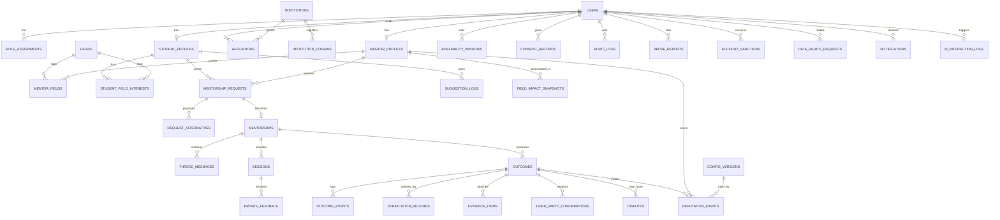
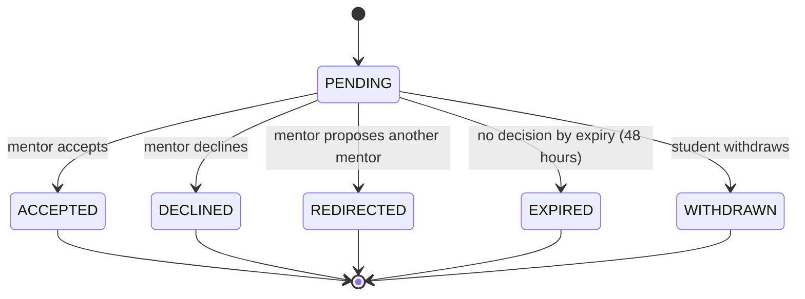
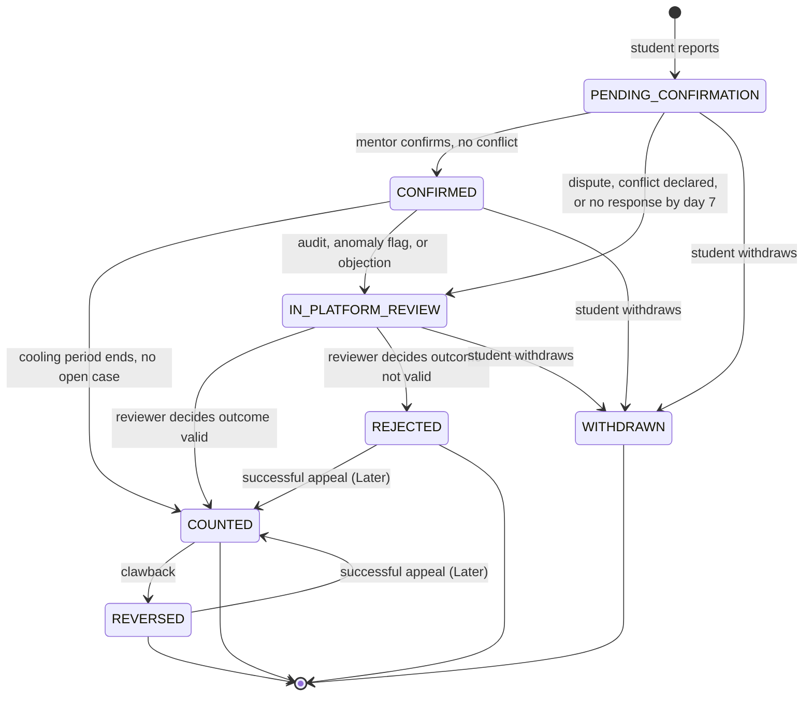

---
title: Data Model
status: Approved (MVP baseline, owner decision)
owner: Owner / CTO
date: 2026-10-29
version: 1.0
sources: [README.md (sections 5, 10, 12), connect-research-report.md v1.1 (sections 3, 5.7, 7 docs 4, 9, 19)]
---

# Data Model

> **Purpose.** The entities, fields, relationships, constraints, statuses, sensitivity classes, retention, and deletion behavior of connect. It is the contract between the policy documents (what must be true) and the code (what is stored). Every status referenced in [functional-requirements.md](functional-requirements.md) exists here as an enum.

| | |
|---|---|
| **Authority** | Subordinate to [README.md](../README.md) section 10. Rules about reputation and verification come from `reputation-and-verification-policy.md`; if they differ, **the policy wins** and this file is updated. |
| **Companion documents** | [system-architecture.md](system-architecture.md), [non-functional-requirements.md](non-functional-requirements.md), `data-privacy-and-retention.md`, `glossary.md` |
| **Status** | **Proposed design.** Nothing here is built. Field lists and enums are the starting schema, to be refined by the first migration and by pilot findings. |

---

## 1. Design principles

1. **Trust is the product, so the ledger is sacred.** Outcome history, verification, reputation, consent, and audit are **append-only**. Current state is a projection; history is the truth.
2. **Reputation is derived data.** It can be recomputed from counted outcomes and the configuration version each event used (README 10.1).
3. **One user, many roles.** A person can be both a Student and a Mentor through separate profiles on one `users` row.
4. **Collect less.** Never stored: government ID numbers, payment card data, precise location, health, religion, political data, and the user's date of birth (used once to check the 18+ gate, then discarded).
5. **Statuses are explicit.** Every lifecycle has an enum and a transition table. No boolean flags that secretly encode state.
6. **Fields are separate.** Reputation is keyed by field. No table holds a cross-field score.
7. **Payments never touch reputation.** There is no foreign key between reputation or outcome tables and any payment table (BR-09 in `business-model-and-pricing.md`).

### Labels used

| Label | Meaning |
|---|---|
| **Plan target** | From the owner's plan. |
| **Owner decision** | Decided and recorded. |
| **Recommendation** | Reasoned proposal adopted as the draft default. |
| **Proposed default** | Editable starting value, not validated. |
| **Open decision** | Not decided. Not policy. |

---

## 2. Conventions

| Topic | Convention |
|---|---|
| Database | PostgreSQL, single system of record, managed with point-in-time recovery |
| Primary keys | `uuid`. **Recommendation:** UUIDv7 generated in the application for time-ordered index locality |
| Timestamps | `timestamptz`, always UTC. `created_at` on every table; `updated_at` on mutable tables. Append-only tables use `occurred_at` or `created_at` only |
| Naming | `snake_case`, plural table names, singular column names, foreign keys `<entity>_id` |
| Enums | PostgreSQL enum types (or text with a check constraint). Adding a value is a migration |
| Nullable | In field tables below, a trailing `?` on a type means nullable |
| Text | `text` with length checks. Unicode everywhere (including Bangla script) |
| Soft delete | Not used by default. Deletion is pseudonymization (section 8) |
| Multi-tenancy | `institution_id` on institution-scoped records; enforced in application code, DB roles, and views. Row-level security is an **ADR candidate** (see 7.3) |
| Optimistic locking | `version int` on rows that concurrent actors can change (outcomes, requests) |
| Idempotency | Retryable POST endpoints store results in `idempotency_keys` |
| Migrations | Owned by the core API only (NestJS). No other service migrates these tables |
| Ownership | Each table has one owning module (section 3.2). Only the owner writes it |

---

## 3. Entity overview

### 3.1 Entity relationship diagram

The README's 11-entity diagram is preserved and extended. Section 11 lists every name change.

### 3.2 Entity catalog

**Sensitivity classes (Proposed):** **High** (evidence, thread messages, dispute content, consent records), **Medium** (profiles, affiliation, outcomes, feedback), **Low** (field taxonomy, aggregated metrics), **Never stored** (listed in principle 4).

| Table | Purpose | Owner module | Mutability | Sensitivity |
|---|---|---|---|---|
| `users` | Account identity | identity | Mutable | Medium |
| `role_assignments` | Roles, institution-scoped for admins | identity | Mutable (revoke, not delete) | Medium |
| `signup_blocks` | Hashed marker to stop immediate under-18 re-registration | identity | Insert, expire | Low |
| `institutions`, `institution_domains` | Tenants and their email domains | institutions | Mutable | Low |
| `affiliations` | Affiliation claims and verification | identity / institutions | Mutable with audit | Medium |
| `fields` | Field taxonomy | profiles | Mutable (retire, not delete) | Low |
| `student_profiles`, `student_field_interests` | Student goals and interests | profiles | Mutable | Medium |
| `mentor_profiles`, `mentor_fields` | Mentor profile, capacity | profiles | Mutable | Medium |
| `availability_windows` | Weekly availability for matching | profiles | Mutable | Low |
| `mentorship_requests`, `request_alternatives` | Structured requests and alternatives | requests | Mutable (state machine) | Medium |
| `suggestion_logs` | Match suggestions shown and chosen | matching | Insert | Medium |
| `mentorships` | Ongoing relationship and agreement | mentorships | Mutable | Medium |
| `thread_messages`, `thread_read_states` | Async thread | mentorships | Insert (redact only) | **High** |
| `sessions` | Session records with meeting link | mentorships | Mutable | Medium |
| `private_feedback` | Private double-blind feedback (Phase 1b) | mentorships | Insert, reveal | Medium |
| `outcomes` | Outcome projection (current state) | outcomes | Mutable (state machine) | Medium |
| `outcome_events` | **Append-only** lifecycle log | outcomes | Insert only | Medium |
| `verification_records` | **Append-only** attestations | outcomes | Insert only | Medium |
| `evidence_items` | Evidence files and links | outcomes | Mutable (purge) | **High** |
| `third_party_confirmations` | Tier 2 one-time confirmations | outcomes | Mutable | Medium |
| `disputes` | Review cases (disputes, escalations, audits, appeals) | trust | Mutable | **High** |
| `reputation_events` | **Append-only** reputation ledger | reputation | Insert only | Medium |
| `field_impact_snapshots` | **Derived** per-mentor, per-field summary | reputation | Rebuilt | Low |
| `config_versions` | **Append-only** versioned rules configuration | config | Insert only | Low |
| `consent_records` | **Append-only** consents and withdrawals | privacy | Insert only | **High** |
| `abuse_reports`, `account_sanctions` | Moderation | trust | Mutable | **High** |
| `audit_logs` | **Append-only** audit trail | audit | Insert only | Medium |
| `data_rights_requests` | Export and deletion requests | privacy | Mutable | Medium |
| `ai_interaction_logs` | AI call metadata (Phase 1b) | ai | Insert | Medium |
| `outbox_events`, `notifications`, `notification_preferences`, `email_suppressions` | Events and notifications | notifications | Mutable | Medium |
| `idempotency_keys` | Safe retries | platform | Insert, expire | Low |

Authentication internals (credentials, sessions, tokens, MFA secrets) live in a separate schema owned by the auth library behind `IdentityService`. They are not modeled here; `users.identity_subject` links to them. The background-job library keeps its own schema.

---

## 4. Enumerations and state machines

### 4.1 Core enumerations

| Enum | Values |
|---|---|
| `role` | `STUDENT`, `MENTOR`, `INSTITUTION_ADMIN`, `PLATFORM_ADMIN`, `EMPLOYER` (reserved, Phase 3) |
| `account_status` | `ACTIVE`, `SUSPENDED`, `DEACTIVATED`, `DELETION_PENDING`, `ANONYMIZED`. Account lifecycle only. Verification progress is stored in separate fields (`email_verified_at`, `age_gate_passed_at`), never as an account state |
| `institution_kind` | `UNIVERSITY`, `BOOTCAMP`, `TRAINING_INSTITUTE`, `OTHER` |
| `institution_status` | `ONBOARDING`, `ACTIVE`, `SUSPENDED` |
| `affiliation_kind` | `ALUMNUS`, `STUDENT`, `FACULTY_STAFF`, `EMPLOYEE` |
| `affiliation_level` | `LEVEL_0` (no verified affiliation), `LEVEL_1` (institutional email or admin attestation), `LEVEL_2` (employer-email check) |
| `affiliation_method` | `INSTITUTIONAL_EMAIL`, `ADMIN_ATTESTATION`, `EMPLOYER_EMAIL`, `PROFESSIONAL_LINK` |
| `affiliation_status` | `PENDING`, `VERIFIED`, `REJECTED`, `REVOKED`, `EXPIRED` |
| `mentor_onboarding_status` | `APPLIED`, `EMAIL_VERIFIED`, `AFFILIATION_VERIFIED`, `EMPLOYER_CHECKED` (verification progress only) |
| `mentor_status` | `DRAFT`, `PENDING`, `ACTIVE`, `SUSPENDED`, `REMOVED` (operating status only) |
| `mentor_access_mode` | `OPEN`, `APPLICATION_ONLY`, `PAUSED` (mentor-selected) |
| `access_state` (derived) | `AVAILABLE`, `FULL`, `APPLICATION_ONLY`, plus hidden when paused or not active |
| `request_status` | `PENDING`, `ACCEPTED`, `DECLINED`, `REDIRECTED`, `EXPIRED`, `WITHDRAWN` |
| `mentorship_status` | `ACTIVE`, `COMPLETED`, `ENDED_EARLY` |
| `session_status` | `SCHEDULED`, `HELD`, `CANCELLED` |
| `outcome_status` | `PENDING_CONFIRMATION`, `CONFIRMED`, `IN_PLATFORM_REVIEW`, `COUNTED`, `REJECTED`, `WITHDRAWN`, `REVERSED` |
| `dispute_status` | `OPEN`, `IN_REVIEW`, `RESOLVED`, `WITHDRAWN` |
| `outcome_type` | `ADMISSION`, `INTERNSHIP`, `JOB_OFFER`, `SKILL_MILESTONE`, `INTERVIEW` |
| `contribution_level` | `DIRECTLY_ENABLED`, `HELPED`, `MINOR` |
| `interaction_type` | `ASYNC_THREAD`, `ONE_TO_ONE_SESSION`, `GROUP_OFFICE_HOURS` (reserved; not allowed in Phase 1) |
| `timeframe_bucket` | `WITHIN_1_MONTH`, `ONE_TO_3_MONTHS`, `THREE_TO_6_MONTHS`, `OVER_6_MONTHS` (**Proposed**) |
| `consent_purpose` | `TERMS`, `PRIVACY_NOTICE`, `VOLUNTEER_AGREEMENT`, `COMMUNITY_GUIDELINES`, `INSTITUTION_DATA_SHARING`, `AI_ASSIST`, `EMPLOYER_DATA_SHARING` (Phase 3), `RECORDING` (reserved) |
| `confidence_tier` | `NONE`, `EMERGING`, `ESTABLISHED`, `PROVEN` (thresholds in configuration) |

"Job offer" was added to `outcome_type` by the owner. Its difficulty weight is **Open**; the README order is Admission > Internship > Skill milestone > Interview.

**This table is the single canonical source for enum values.** API values are the mechanical lowercase form of the database value (`UPPER_SNAKE` to `lower_snake`, for example `IN_PLATFORM_REVIEW` to `in_platform_review`); the glossary and `api-contracts.md` repeat these lists and add no values of their own.

`consent_purpose` in the MVP uses `TERMS`, `PRIVACY_NOTICE`, `VOLUNTEER_AGREEMENT`, `COMMUNITY_GUIDELINES`, and `INSTITUTION_DATA_SHARING`. `AI_ASSIST`, `EMPLOYER_DATA_SHARING`, and `RECORDING` are reserved and not requested in the MVP.

### 4.2 Mentorship request state machine

`request_status`: `PENDING`, `ACCEPTED`, `DECLINED`, `REDIRECTED`, `EXPIRED`, `WITHDRAWN`. Acceptance creates a `mentorships` row. A student withdraws a pending request; a request with no decision reaches `EXPIRED`. A suspended mentor's pending requests also reach `EXPIRED` with notice (there is no separate cancelled state). A redirect shares nothing until the student approves (FR-REQ-04, Phase 1b); approval creates a new linked request.

### 4.3 Mentorship, session, affiliation, and mentor lifecycles

| Entity | Statuses | Transitions |
|---|---|---|
| `mentorships.status` | `ACTIVE`, `COMPLETED`, `ENDED_EARLY` | ACTIVE to COMPLETED or ENDED_EARLY by either party or by an inactivity rule (**Open**) |
| `sessions.status` | `SCHEDULED`, `HELD`, `CANCELLED` | SCHEDULED to HELD when both parties confirm; SCHEDULED to CANCELLED by either |
| `affiliations.status` | `PENDING`, `VERIFIED`, `REJECTED`, `REVOKED`, `EXPIRED` | PENDING to VERIFIED or REJECTED; VERIFIED to REVOKED or EXPIRED (expiry **Open**) |
| `mentor_profiles.status` | `DRAFT`, `PENDING`, `ACTIVE`, `SUSPENDED`, `REMOVED` | DRAFT to PENDING on application; PENDING to ACTIVE when onboarding is complete (Level 1, MFA, agreements); ACTIVE and SUSPENDED toggle by sanction; REMOVED is final. Verification progress lives in `mentor_profiles.onboarding_status`, not in this enum |

**Capacity (Proposed definition, matching spec to confirm).** A mentor's slots in use for the current week = requests `ACCEPTED` that week + requests `PENDING`. The week starts Monday 00:00 in the mentor's timezone (default Asia/Dhaka). `mentor_access_state` is `FULL` when slots in use are at or above `weekly_capacity`. Pending requests count so that a slow mentor cannot accumulate unbounded promises.

### 4.4 Outcome state machine

`outcomes.status` is a projection of `outcome_events`. This replaces the README's diagram with the policy-aligned names: the README's `AdminReview` is **platform review**, because the institution does not judge outcomes.

`outcome_status`: `PENDING_CONFIRMATION`, `CONFIRMED`, `IN_PLATFORM_REVIEW`, `COUNTED`, `REJECTED`, `WITHDRAWN`, `REVERSED`.

These seven values are the only outcome states. `disputed`, `escalated`, `under_review`, `appealed`, `audited`, `reported`, and `evidence_attached` are **events or transitions**, not states (see `outcome_events.event_type` in section 5.5). The state machine in this section is the only authoritative one; the README and the reputation policy point here.

**Deferred (owner decision):** appeals (T12) and appeal-driven reversal are **Later**, after a successful pilot. In the MVP, a Platform Admin decides a case once, with a written reason. `REVERSED` remains available for clawback (T11) because a counted outcome can still be disproved.

| # | From | Trigger and actor | Guard | To | Side effects (same transaction) |
|---|---|---|---|---|---|
| T1 | (new) | Student reports | Student is a participant; mentorship allows reporting | `PENDING_CONFIRMATION` | `outcome_events` REPORTED; set `mentor_decision_due_at` (created + 7 days); email mentor |
| T2 | `PENDING_CONFIRMATION` | Mentor confirms | Mentor owns the mentorship; no conflict declared | `CONFIRMED` | `verification_records` MENTOR_CONFIRMATION with contribution level; set `confirmed_at`, `cooling_ends_at`; email student |
| T3 | `PENDING_CONFIRMATION` | Mentor disputes | Mentor owns the mentorship | `IN_PLATFORM_REVIEW` | `verification_records` MENTOR_DISPUTE; open `disputes` kind MENTOR_DISPUTE |
| T4 | `PENDING_CONFIRMATION` | Mentor declares a conflict of interest | Declaration supplied | `IN_PLATFORM_REVIEW` | `coi_declared = true`; open `disputes` kind CONFLICT_OF_INTEREST |
| T5 | `PENDING_CONFIRMATION` | System at day 7 | No mentor decision | `IN_PLATFORM_REVIEW` | Reminders at day 3 and 5 already sent; open `disputes` kind NO_RESPONSE_ESCALATION |
| T6 | `CONFIRMED` | System or reviewer opens a case | Audit selected, anomaly flagged, or objection received | `IN_PLATFORM_REVIEW` | Open `disputes` kind AUDIT, ANOMALY_FLAG, or other; counting is blocked while open |
| T7 | `CONFIRMED` | System | `now >= cooling_ends_at` and no open case | `COUNTED` | `counted_at`; `counted_basis = MENTOR_CONFIRMED`; write `reputation_events` if mentor-eligible; refresh snapshot |
| T8 | `IN_PLATFORM_REVIEW` | Reviewer: outcome valid | Reviewer is Platform Admin; reason supplied | `COUNTED` | `verification_records` PLATFORM_DECISION; `counted_basis = MENTOR_CONFIRMED` if the mentor had confirmed, else `PLATFORM_DECISION`; reputation event only if mentor-eligible |
| T9 | `IN_PLATFORM_REVIEW` | Reviewer: outcome not valid | Reason supplied | `REJECTED` | `verification_records` PLATFORM_DECISION; notify parties |
| T10 | `PENDING_CONFIRMATION`, `CONFIRMED`, `IN_PLATFORM_REVIEW` | Student withdraws | Student owns the outcome | `WITHDRAWN` | Close any open case; never counts |
| T11 | `COUNTED` | Platform Admin clawback | Reason supplied | `REVERSED` | Compensating `reputation_events` REVERSAL; original event stays |
| T12 | `REJECTED` or `REVERSED` | Successful appeal (**Later**) | One appeal, different reviewer (**Later**) | `COUNTED` | New COUNTED event; `counted_basis = PLATFORM_DECISION` |

**Rules that must hold (also in section 7):**

- **Unconfirmed outcomes never contribute to reputation.** Only T7 and T8 reach `COUNTED`, and neither is possible without a mentor confirmation or a platform decision.
- An open case implies `IN_PLATFORM_REVIEW`. An OUTCOME_VALID decision ends cooling early because the review subsumes it.
- **Reputation eligibility (Recommendation, policy governs, OUT-Q1):** a reputation event is written only when `counted_basis = MENTOR_CONFIRMED` and `coi_declared = false`. A platform-decided outcome counts for the student's progress and institution aggregates, labeled "platform-decided", but earns the mentor no reputation unless the mentor later confirms.
- The evidence tier used for points is the tier **at the moment of counting**. Later evidence changes nothing unless an approved recalibration runs.
- Decisions take effect immediately. In the MVP a decision stands until a clawback is justified. **Later**, one appeal is available (decided by a different reviewer within an appeal window, **Proposed default**: 7 days). The ledger makes reversal safe because it adds events and never edits them.
- Reminder, escalation, cooling, and counting events are written **at most once** per outcome (partial unique index in section 9).

### 4.5 Review case (`disputes`) lifecycle

`dispute_kind`: `MENTOR_DISPUTE`, `NO_RESPONSE_ESCALATION`, `CONFLICT_OF_INTEREST`, `AUDIT`, `ANOMALY_FLAG`, `CLAWBACK`, `APPEAL`.
`dispute_status`: `OPEN`, `IN_REVIEW`, `RESOLVED`, `WITHDRAWN`.
`dispute_resolution`: `OUTCOME_VALID`, `OUTCOME_NOT_VALID`.

The README's word "upheld" is ambiguous (upheld which side?), so resolutions name the outcome's validity directly. `OPEN` to `IN_REVIEW` when assigned; `IN_REVIEW` to `RESOLVED` with a reason; `WITHDRAWN` if the student withdraws the outcome. One appeal per case (`appeal_of_dispute_id` is unique), and the appeal reviewer must differ from the original reviewer.

**MVP rule (owner decision):** a case is decided once by a **Platform Admin**, never by an Institution Admin, with a written reason. Appeals, a second reviewer, and a formal process are **Deferred (owner decision)** until after a successful pilot.

---

## 5. Table specifications

Common columns `id uuid PK`, `created_at`, and (mutable tables) `updated_at` are omitted from the tables below unless noted. A trailing `?` means nullable.

### 5.1 Identity and organizations

**`users`**

| Column | Type | Notes |
|---|---|---|
| `email` | `citext` unique | Verified before most actions |
| `email_verified_at` | `timestamptz?` | |
| `display_name` | `text` | 1 to 100 chars, any Unicode script |
| `timezone` | `text` | Default `Asia/Dhaka` |
| `status` | `account_status` | |
| `age_18_plus` | `bool` | Set true only when the age gate passed. |
| `age_gate_passed_at` | `timestamptz?` | When the 18+ gate passed. **Date of birth is used once for the check and is not stored** (owner decision; counsel to confirm no stored proof is required) |
| `age_gate_version` | `text` | Wording version shown |
| `identity_subject` | `text` unique | Opaque id from the auth library. **Hard to change** (ADR-003) |
| `last_seen_at` | `timestamptz?` | |
| `anonymized_at` | `timestamptz?` | Set by deletion (section 8) |

**`role_assignments`**: `user_id`, `role`, `institution_id?` (required when `role = INSTITUTION_ADMIN`), `granted_by_user_id?`, `granted_at`, `revoked_at?`. Unique active row per (`user_id`, `role`, `institution_id`). Roles are revoked, never deleted.

**`signup_blocks`**: `email_hash bytea` (keyed hash, not reversible), `reason` (`UNDER_18`), `expires_at` (**Proposed**: 12 months). Exists only to stop immediate re-registration after an under-18 attempt.

**`institutions`**: `name`, `kind`, `country_code char(2)`, `status`, `mou_signed_on date?`, `min_cohort_size smallint?` (null means platform default, **Proposed**: 5).
**`institution_domains`**: `institution_id`, `domain citext` unique, `verified_at?`.

**`affiliations`**

| Column | Type | Notes |
|---|---|---|
| `user_id` | `uuid` FK | |
| `institution_id` | `uuid?` FK | |
| `organization_name`, `organization_domain` | `text?`, `citext?` | For employer-based Level 2 |
| `kind` | `affiliation_kind` | |
| `department`, `program` | `text?` | Used by the redefined AlumniConnection factor |
| `batch_year` | `smallint?` | Same |
| `level` | `affiliation_level` | |
| `method` | `affiliation_method` | |
| `status` | `affiliation_status` | |
| `decided_by_user_id`, `decision_reason` | `uuid?`, `text?` | For admin attestation |
| `verified_at`, `revoked_at`, `expires_at` | `timestamptz?` | |

Check: `institution_id IS NOT NULL OR organization_name IS NOT NULL`. Edits to a mentor's affiliation fields suspend Level 1 until re-verified (FR-PROF-05). **No government ID, passport, or tax ID is ever stored.**

**`fields`**: `name`, `normalized_slug citext` unique (created from the name; prevents duplicates), `created_by_user_id?` (null for seeds), `status` (`ACTIVE` or `RETIRED`). Fields are **fully dynamic**: a student or mentor picks an existing field or creates a new one; the normalizer keeps one row per concept. Matching uses `field_id`, never a hard-coded label. An admin merge/rename tool is **Phase 1b** (D-23); retiring never deletes history.

### 5.2 Profiles and availability

**`student_profiles`**: `user_id` unique FK, `goals text`, `primary_field_id` FK, `languages text[]` (ISO 639-1 codes, mentoring language, independent of the English-only UI), `onboarding_completed_at?`.
**`student_field_interests`**: (`student_profile_id`, `field_id`) composite key.

**`mentor_profiles`**

| Column | Type | Notes |
|---|---|---|
| `user_id` | `uuid` unique FK | |
| `primary_field_id` | `uuid` FK | Required; the row is created on demand when the mentor first saves a profile |
| `onboarding_status` | `mentor_onboarding_status` | `APPLIED` to `EMAIL_VERIFIED` to `AFFILIATION_VERIFIED`, optionally `EMPLOYER_CHECKED` |
| `headline`, `bio` | `text` | |
| `expertise_summary`, `scope_statement` | `text` | "What I can and cannot help with" |
| `current_role_title`, `current_organization` | `text?` | Self-declared; Level 2 verifies |
| `languages` | `text[]` | |
| `weekly_capacity` | `smallint` | At least 1; maximum from configuration |
| `access_mode` | `mentor_access_mode` | |
| `status` | `mentor_status` | |
| `orientation_completed_at`, `activated_at` | `timestamptz?` | |

**`mentor_fields`**: (`mentor_profile_id`, `field_id`, `is_primary bool`). Reputation is later keyed by the same `field_id`.

**`availability_windows`**: `user_id`, `context` (`STUDENT` or `MENTOR`), `weekday smallint` (1 to 7), `start_minute smallint`, `end_minute smallint`, `timezone text`. Check `end_minute > start_minute`. Generalizes the README's `MentorAvailability` to both sides so the availability-match factor can compare them.

### 5.3 Requests, suggestions, mentorships

**`mentorship_requests`**

| Column | Type | Notes |
|---|---|---|
| `student_profile_id`, `mentor_profile_id`, `field_id` | `uuid` FK | |
| `question` | `text` | README structured field: specific question |
| `context_summary` | `text` | README structured field |
| `target_outcome` | `text` | README structured field |
| `target_outcome_type` | `outcome_type?` | Optional hint |
| `timeframe` | `timeframe_bucket` | README structured field: expected timeframe |
| `interaction_type` | `interaction_type` | Check excludes `GROUP_OFFICE_HOURS` in Phase 1 |
| `application_note` | `text?` | For Application-only mentors (FR-DISC-03) |
| `status` | `request_status` | |
| `decided_at`, `decision_note` | `timestamptz?`, `text?` | |
| `expires_at` | `timestamptz` | Created + **48 hours** (owner decision) |
| `reminder_sent_at` | `timestamptz?` | At **24 hours** (owner decision) |
| `redirected_from_request_id` | `uuid?` FK self | |
| `match_score`, `match_factors`, `config_version_id` | `numeric?`, `jsonb?`, `uuid?` | Snapshot for evaluation |
| `ai_assisted` | `bool` | Reserved (AI is **Later**); always false in the MVP |
| `version` | `int` | Optimistic lock |

Constraints: at most one `PENDING` request per (`student_profile_id`, `mentor_profile_id`) (partial unique index); the student's user and the mentor's user must differ.

**`request_alternatives`**: `request_id`, `suggested_mentor_profile_id`, `kind` (`RECOMMEND` or `REDIRECT`), `note`, `status` (`SUGGESTED`, `SENT`, `IGNORED`), `resulting_request_id?`. Supports "decline with recommendations" and the student-approved redirect.

**`suggestion_logs`**: `student_profile_id`, `mentor_profile_id`, `rank`, `score`, `factors jsonb`, `config_version_id`, `shown_at`, `clicked_at?`, `request_id?`. Feeds the match acceptance KPI and weight calibration.

**`mentorships`**

| Column | Type | Notes |
|---|---|---|
| `request_id` | `uuid` unique FK | Created on acceptance |
| `student_profile_id`, `mentor_profile_id`, `field_id` | `uuid` FK | |
| `status` | `mentorship_status` | `ACTIVE`, `COMPLETED`, `ENDED_EARLY` |
| `cadence` | enum? | `WEEKLY`, `BIWEEKLY`, `MONTHLY`, `AD_HOC` |
| `planned_weeks`, `goal` | `smallint?`, `text?` | Lightweight agreement [S9] |
| `student_ack_at`, `mentor_ack_at` | `timestamptz?` | Both acknowledge the agreement |
| `is_paid` | `bool` default false | Reserved for the paid-relationship rule (OD-4). **Always false in the MVP**; payments are **Later** |
| `started_at`, `ended_at`, `ended_by_user_id` | | |
| `outcome_report_until` | `timestamptz?` | Reporting window after end (**Open**) |

### 5.4 Threads, sessions, feedback

**`thread_messages`** (High): `mentorship_id`, `sender_user_id`, `body text` (length-checked), `redacted_at?`, `redacted_by_user_id?`, `redaction_reason?`. Messages are **not editable** in Phase 1; moderators can redact. No attachments. Index (`mentorship_id`, `created_at`, `id`).
**`thread_read_states`**: (`mentorship_id`, `user_id`) key, `last_read_message_id`.

**`sessions`**: `mentorship_id`, `scheduled_start`, `duration_minutes`, `meeting_url` (must start with `https://`), `status`, `student_confirmed_held_at?`, `mentor_confirmed_held_at?`, `cancelled_by_user_id?`, `cancel_reason?`, `created_by_user_id`. `HELD` requires both confirmations. Meeting links are mentor-provided; the UI warns users to treat links as untrusted.

**`private_feedback`** (Phase 1b): `session_id`, `author_user_id`, `about_user_id`, `helpfulness smallint` (1 to 5), `comment?`, `submitted_at`, `reveal_at` (timer), `revealed_at?`. Unique (`session_id`, `author_user_id`). **No foreign key from reputation tables to this table.** It never becomes a public star rating or a reputation input.

### 5.5 Outcomes and verification

**`outcomes`** (projection of current state)

| Column | Type | Notes |
|---|---|---|
| `mentorship_id` | `uuid` FK | |
| `student_profile_id`, `mentor_profile_id` | `uuid` FK | Denormalized; a composite FK with `mentorships` guarantees they match |
| `field_id` | `uuid` FK | Copied from the mentorship; reputation is per field |
| `outcome_type` | `outcome_type` | |
| `title`, `description` | `text`, `text` | |
| `occurred_on` | `date` | When the result happened |
| `contribution_claimed` | `contribution_level` | Student's statement |
| `contribution_confirmed` | `contribution_level?` | Mentor's separate confirmation |
| `status` | `outcome_status` | Section 4.4 |
| `evidence_tier` | `smallint` | 0, 1, or 2; derived from evidence and third-party confirmation |
| `counted_basis` | enum? | `MENTOR_CONFIRMED` or `PLATFORM_DECISION`; required when `COUNTED` |
| `coi_declared` | `bool` | Draft rule N9 |
| `is_paid_relationship` | `bool` | Copied from `mentorships.is_paid` |
| `mentor_decision_due_at` | `timestamptz` | Created + 7 days |
| `confirmed_at`, `cooling_ends_at`, `counted_at`, `rejected_at`, `withdrawn_at`, `reversed_at` | `timestamptz?` | |
| `version` | `int` | Optimistic lock |

**`outcome_events`** (append-only)

| Column | Type | Notes |
|---|---|---|
| `outcome_id` | `uuid` FK | |
| `seq` | `int` | Unique per outcome; gap-free |
| `event_type` | enum | `REPORTED`, `EVIDENCE_ADDED`, `EVIDENCE_REMOVED`, `REMINDER_D3_SENT`, `REMINDER_D5_SENT`, `ESCALATED_D7`, `CONFIRMED`, `CONTRIBUTION_AMENDED`, `DISPUTED`, `COI_DECLARED`, `CASE_OPENED`, `CASE_RESOLVED`, `TIER_CHANGED`, `COUNTED`, `REJECTED`, `WITHDRAWN`, `REVERSED` (`APPEAL_OPENED` and `APPEAL_RESOLVED` are reserved for Later) |
| `actor_user_id`, `actor_role` | `uuid?`, `role?` | Null for system |
| `from_status`, `to_status` | `outcome_status?` | |
| `payload` | `jsonb` | Ids and codes, never free personal text |
| `request_id` | `text` | Correlates with logs |
| `occurred_at` | `timestamptz` | |

**`verification_records`** (append-only attestations). `outcome_events` records *that* something happened; `verification_records` records *who attested what and how*, which is what the verified-badge disclaimer rests on.

| Column | Type | Notes |
|---|---|---|
| `outcome_id` | `uuid` FK | |
| `kind` | enum | `MENTOR_CONFIRMATION`, `MENTOR_DISPUTE`, `THIRD_PARTY_CONFIRMATION`, `AUDIT_RESULT`, `PLATFORM_DECISION`, `APPEAL_DECISION` |
| `decision` | enum | `CONFIRMED`, `DISPUTED`, `VALID`, `NOT_VALID`, `PASSED`, `FAILED` |
| `attester_user_id` | `uuid?` | Null for an external third party |
| `attester_label` | `text?` | For example "Employer HR, example.com" without full contact data |
| `contribution_level` | `contribution_level?` | On mentor confirmation |
| `coi_declaration` | `jsonb?` | Relationship kind declared |
| `evidence_tier_after` | `smallint?` | |
| `statement` | `text?` | Reviewer or attester reason |
| `dispute_id` | `uuid?` FK | |

Each insert here is written in the same transaction as the matching `outcome_events` row.

**`evidence_items`** (High)

| Column | Type | Notes |
|---|---|---|
| `outcome_id`, `uploaded_by_user_id` | `uuid` FK | |
| `kind` | enum | `FILE` or `LINK` |
| `doc_type` | enum | `OFFER_LETTER`, `ADMISSION_LETTER`, `CERTIFICATE`, `PROFILE_LINK`, `OTHER` |
| `storage_key` | `text?` | Private bucket key; required for `FILE` |
| `link_url` | `text?` | Required for `LINK` |
| `sha256`, `size_bytes`, `mime_type` | `bytea?`, `int?`, `text?` | Hash is kept after the file is purged |
| `scan_status` | enum? | `PENDING`, `CLEAN`, `INFECTED`, `ERROR`. **No signed URL is issued unless `CLEAN`** |
| `purge_after`, `purged_at` | `timestamptz?` | Retention (section 8) |

Original filenames are not stored (they can contain personal data). Limits (**Proposed**): PDF, PNG, JPEG; at most 10 MB; at most 5 items per outcome.

**`third_party_confirmations`** (Tier 2): `outcome_id`, `confirmer_email text?` (**nulled after confirmation or expiry plus a short grace period**, because it is a non-user's personal data), `confirmer_email_domain citext`, `confirmer_organization?`, `token_hash bytea` unique (the raw token is emailed once and never stored), `sent_at`, `expires_at`, `confirmed_at?`, `status` (`SENT`, `CONFIRMED`, `EXPIRED`, `DECLINED`).

**`disputes`** (review cases, High)

| Column | Type | Notes |
|---|---|---|
| `outcome_id` | `uuid` FK | |
| `kind`, `status`, `resolution` | enums | Section 4.5 |
| `trigger_detail` | `jsonb?` | For audits: `RANDOM_SAMPLE`, `HIGH_DIFFICULTY`, `ANOMALY`, `CONFLICT` |
| `opened_by_user_id` | `uuid?` | Null for system |
| `opened_at`, `due_at`, `resolved_at` | `timestamptz` | `due_at` supports review-time targets (**Open**, N7) |
| `assigned_reviewer_id` | `uuid?` FK | Must be a Platform Admin |
| `resolution_reason` | `text?` | Required on resolution |
| `appeal_of_dispute_id` | `uuid?` unique FK self | One appeal per case |

### 5.6 Reputation

**`config_versions`** (append-only): `version int` unique, `config jsonb` (all weights, multipliers, thresholds, timings, and limits in **one** document), `schema_version`, `created_by_user_id`, `effective_from`, `note`. The source of the configuration is a single file in `packages/config`; this table records which version was live so any event is explainable and replayable (FR-ADM-07).

**`reputation_events`** (append-only ledger)

| Column | Type | Notes |
|---|---|---|
| `mentor_profile_id`, `field_id`, `outcome_id` | `uuid` FK | |
| `kind` | enum | `COUNTED`, `REVERSAL`, `RECALIBRATION` |
| `points` | `numeric(12,4)` | Signed; a reversal is the negative of the event it reverses |
| `difficulty_weight`, `tier_multiplier`, `contribution_multiplier`, `pair_factor` | `numeric(8,4)` | The components, stored as computed |
| `config_version_id` | `uuid` FK | |
| `reverses_event_id` | `uuid?` unique FK self | |
| `reason` | `text?` | |
| `occurred_at` | `timestamptz` | |

Shape (Proposed, policy governs): `points = difficulty_weight x tier_multiplier x contribution_multiplier x pair_factor`, where `pair_factor = 1 / (1 + n)` and `n` is the number of earlier **counted** outcomes between the same mentor and the same student. `pair_factor` is configurable. There is no separate cooling multiplier: an outcome earns nothing until it is `COUNTED`, and the cooling period is a state-machine delay, not a multiplier. Unique: one `COUNTED` event per outcome. There is **no FK to `private_feedback` and none to any payment table**.

**`field_impact_snapshots`** (derived, rebuildable). Key (`mentor_profile_id`, `field_id`): `counted_outcomes int`, `distinct_students int`, `counted_by_type jsonb`, `response_reliability numeric(5,4)?`, `confidence_tier`, `internal_score numeric(6,3)?`, `last_event_id` (ledger high-water mark), `config_version_id`, `computed_at`.

- `internal_score` is **never exposed** to non-admin roles until sample thresholds are met (FR-REP-07). Public views show counts and `confidence_tier`.
- No column combines fields. A schema test fails the build if one is added (FR-REP-05).
- Small samples are shrunk toward a prior so two outcomes cannot outrank twenty.

### 5.7 Trust, privacy, and audit

**`consent_records`** (append-only, High): `user_id`, `purpose`, `action` (`GRANTED` or `WITHDRAWN`), `document_version`, `institution_id?` (for institution sharing), `occurred_at`. Current consent for a purpose is the latest record; history is never edited.

**`abuse_reports`**: `reporter_user_id`, `subject_type` (`USER`, `THREAD_MESSAGE`, `MENTOR_PROFILE`, `OUTCOME`), `subject_id`, `category` (`HARASSMENT`, `EXPLOITATION`, `FRAUD`, `SPAM`, `OTHER`), `description`, `status` (`OPEN`, `IN_REVIEW`, `ACTION_TAKEN`, `DISMISSED`), `assigned_to_user_id?`, `resolution_note?`, `resolved_at?`.
**`account_sanctions`**: `user_id`, `kind` (`WARNING`, `SUSPENSION`, `REMOVAL`), `reason`, `starts_at`, `ends_at?`, `issued_by_user_id`, `related_report_id?`, `revoked_at?`.

**`audit_logs`** (append-only): `occurred_at`, `actor_user_id?`, `actor_role`, `action text`, `object_type`, `object_id`, `request_id`, `break_glass bool`, `reason text?`, `metadata jsonb` (no message bodies, no secrets), `prev_hash bytea?`, `hash bytea?`. The optional hash chain (FR-AUD-02) gives tamper evidence.

**`data_rights_requests`**: `user_id`, `kind` (`EXPORT`, `DELETION`), `status` (`RECEIVED`, `VERIFYING`, `IN_PROGRESS`, `COMPLETED`, `PARTIALLY_COMPLETED`), `received_at`, `due_at` (period **Open**), `completed_at?`, `exceptions_applied jsonb?`, `handled_by_user_id?`, `export_storage_key?`, `export_expires_at?`.

**`ai_interaction_logs`** (Phase 1b): `user_id`, `purpose` (`REQUEST_DRAFT`, `MENTOR_BRIEFING`, `MATCH_EXPLANATION`), `provider`, `model`, `input_class` (`REDACTED_TEXT`, `STRUCTURED_FIELDS`), `input_hash bytea`, `output_ref_type?`, `output_ref_id?`, `tokens_in`, `tokens_out`, `cost_micro_usd bigint`, `latency_ms`, `result` (`SUCCESS`, `TIMEOUT`, `ERROR`, `BLOCKED`), `human_action` (`ACCEPTED`, `EDITED`, `DISCARDED`, `NONE`). Raw prompts and outputs are **not** stored by default.

### 5.8 Platform plumbing

**`outbox_events`**: `aggregate_type`, `aggregate_id`, `event_type` (for example `OutcomeConfirmed`, `RequestAccepted`), `payload jsonb`, `available_at`, `processed_at?`, `attempts`, `last_error?`.
**`notifications`**: `user_id`, `template_key`, `channel` (`EMAIL`, `IN_APP`), `payload jsonb` (ids only), `status` (`QUEUED`, `SENT`, `FAILED`, `SUPPRESSED`), `dedupe_key text` unique, `provider_message_id?`, `attempts`, `send_after`, `sent_at?`, `read_at?`.
**`notification_preferences`**: (`user_id`, `category`) key, `email_enabled`, `in_app_enabled`. Security and dispute categories cannot be disabled.
**`email_suppressions`**: `email citext` unique, `reason` (`HARD_BOUNCE`, `COMPLAINT`).
**`idempotency_keys`**: key (`user_id`, `key`, `endpoint`), `request_hash bytea`, `response_status`, `response_body jsonb`, `expires_at` (about 48 hours).

---

## 6. Derived data and views

| Object | Type | Purpose | Rule |
|---|---|---|---|
| `v_mentor_slots_in_use` | View | Capacity enforcement and the access state | Section 4.3 definition; request and acceptance take a row lock on `mentor_profiles` so concurrent actions cannot overshoot |
| `v_mentor_public_impact` | View | Public impact summary | Counted outcomes by field and type, `confidence_tier`, `response_reliability`; **no numeric score** |
| `v_response_times` | View | First-response time and reliability inputs | From request timestamps; timely declines and redirects are not penalized |
| `v_institution_funnel` | Materialized view | Institution dashboard | Hourly refresh (NFR-PERF-08); applies small-cohort suppression |
| `v_review_queue` | View | Platform operations | Open cases by age and due date |
| `v_consent_current` | View | Current consent per user and purpose | Latest `consent_records` row |

**Small-cohort suppression.** A slice with fewer than `min_cohort_size` people returns no metrics and `suppressed = true`. The platform default is **5** (owner decision); an institution may not lower it. **Recommendation:** apply complementary suppression so a total minus the visible slices cannot reveal a suppressed value. Student-level rows are never exposed to institutions without a current `INSTITUTION_DATA_SHARING` consent.

---

## 7. Integrity, constraints, and access

### 7.1 Testable invariants

| ID | Invariant | Enforced by |
|---|---|---|
| INV-01 | `outcomes.mentor_profile_id` and `student_profile_id` match the mentorship | Composite foreign key |
| INV-02 | A user is never both parties of one request or mentorship | Check or trigger |
| INV-03 | `COUNTED` implies `counted_at` and `counted_basis` are set | Check constraint |
| INV-04 | A `COUNTED` reputation event exists only when `counted_basis = MENTOR_CONFIRMED` and `coi_declared = false` | Trigger and domain test |
| INV-05 | Ledger tables (`outcome_events`, `verification_records`, `reputation_events`, `consent_records`, `audit_logs`, `config_versions`) reject UPDATE and DELETE | DB role grants and trigger |
| INV-06 | `outcomes.status` equals the replay of its events | Property test and nightly job |
| INV-07 | Replaying the reputation ledger reproduces `field_impact_snapshots` | Unit test and nightly job |
| INV-08 | At most one `PENDING` request per student and mentor pair | Partial unique index |
| INV-09 | Slots in use never exceed `weekly_capacity` | Row lock plus transaction |
| INV-10 | No signed URL is issued for evidence unless `scan_status = CLEAN` | Service rule and test |
| INV-11 | No foreign key from reputation or outcome tables to any payment table | Schema test (BR-09) |
| INV-12 | `users.account_status = ANONYMIZED` implies personal fields are null | Check and deletion job test |
| INV-13 | Each dispute has at most one appeal; the appeal reviewer differs from the original | Unique index and service rule |
| INV-14 | Reminder, escalation, cooling, and counted events occur at most once per outcome | Partial unique index |
| INV-15 | No column in any table aggregates reputation across fields | Schema test |

### 7.2 Database roles

| Role | Rights |
|---|---|
| `migrator` | DDL only; used by the migration job |
| `app_rw` | DML for the API and worker; **no UPDATE or DELETE on ledger tables** |
| `app_ro` | Read on views only; for dashboards and reporting |
| `backup` | Read for backups |

### 7.3 Row-level security (decision pending)

**Recommendation for Phase 1:** application-layer object authorization, restricted database roles, and institution dashboards served only through suppression views. Row-level security on institution-scoped tables is a defense-in-depth option; whether it is worth the complexity with the chosen ORM is an **ADR candidate**, to decide before the first institution dashboard ships.

---

## 8. Retention and deletion

**Owner document:** [data-privacy-and-retention.md](data-privacy-and-retention.md) owns the retention schedule. This section summarizes it for schema design; if the two differ, the privacy document wins and this section is updated.

All periods are **Proposed defaults** unless marked, to be confirmed with counsel in `data-privacy-and-retention.md`. The Personal Data Protection Act, 2026 gives rights of access, rectification, erasure, consent withdrawal, and portability, and requires processing records to be kept at least five years [S1] (secondary source; read the primary text).

| Data | Retention | On deletion or end of retention |
|---|---|---|
| Evidence files | 90 days after the outcome is counted or rejected | Delete the file; keep `sha256`, size, type, and metadata |
| Third-party confirmer email | Until confirmed or expired plus a short grace period | Null the email; keep the domain and token hash |
| Thread messages | While the mentorship is active plus a period after it ends, extended while a case is open (period **Open**) | Delete bodies; keep message count metadata if needed |
| Outcomes, events, verification records, reputation events | Life of the mentor or student account, then pseudonymized | Keep ledger structure with pseudonymous references so counted outcomes stay auditable |
| Profiles, affiliations, availability | Life of the account | Erase or pseudonymize identifiers |
| Consent records | Life of the account plus a legal period (**Open**) | Pseudonymize; retain as proof |
| Audit logs | Fixed period (**Open**) | Retain with pseudonymous actor |
| Suggestion logs, AI logs, notifications | 12 months | Delete |
| Signup blocks | 12 months | Delete |
| Data-export files | 7 days | Delete |
| Processing register | At least 5 years [S1] | Not personal data itself |

**Account deletion (FR-PRIV-02), design needing counsel review:**

1. Authentication data is removed by `IdentityService`.
2. `users` becomes a **tombstone**: `email`, `display_name`, and profile text are cleared or replaced with a pseudonym; `status = ANONYMIZED`; `anonymized_at` is set. The row id persists so foreign keys in the ledger still resolve.
3. Evidence files are deleted; thread bodies are deleted per the table above.
4. Counted outcomes remain in the ledger with pseudonymous actors so institution aggregates and mentor reputation stay auditable.
5. Institution aggregates keep only aggregated metrics.

**Open question:** whether keeping pseudonymized ledger rows satisfies the erasure right and its exceptions. This is the interaction between erasure and an append-only ledger and must be answered by Bangladeshi counsel before the pilot.

---

## 9. Indexes (starting set)

| Table | Index | Supports |
|---|---|---|
| `users` | unique `email`, unique `identity_subject` | Sign-in |
| `mentor_profiles` | (`status`, `access_mode`) | Discovery |
| `mentor_fields` | (`field_id`, `mentor_profile_id`) | Field filter |
| `mentorship_requests` | (`mentor_profile_id`, `status`, `created_at`); partial unique (`student_profile_id`, `mentor_profile_id`) where `PENDING`; (`expires_at`) where `PENDING` | Inbox, capacity, expiry sweeper |
| `mentorships` | (`student_profile_id`), (`mentor_profile_id`, `status`) | Dashboards |
| `thread_messages` | (`mentorship_id`, `created_at`, `id`) | Thread paging |
| `outcomes` | (`mentor_profile_id`, `field_id`, `status`); (`student_profile_id`); (`mentor_decision_due_at`) where `PENDING_CONFIRMATION`; (`cooling_ends_at`) where `CONFIRMED`; (`mentor_profile_id`, `student_profile_id`, `status`) | Impact view, timers, pair factor |
| `outcome_events` | unique (`outcome_id`, `seq`); partial unique (`outcome_id`, `event_type`) for `REMINDER_D3_SENT`, `REMINDER_D5_SENT`, `ESCALATED_D7`, `COUNTED` | Replay, idempotent timers |
| `reputation_events` | (`mentor_profile_id`, `field_id`, `occurred_at`); unique (`outcome_id`) where `COUNTED`; unique (`reverses_event_id`) | Recompute |
| `disputes` | (`status`, `due_at`); unique (`appeal_of_dispute_id`) | Review queue |
| `notifications` | unique (`dedupe_key`); (`status`, `send_after`) | Delivery sweeper |
| `outbox_events` | (`processed_at`, `available_at`) | Worker polling |
| `consent_records` | (`user_id`, `purpose`, `occurred_at`) | Current consent |
| `audit_logs` | (`object_type`, `object_id`, `occurred_at`); (`actor_user_id`, `occurred_at`) | Investigation |

The **sweeper** jobs that drive reminders, expiry, cooling, and counting read the timer columns above on a schedule and are safe to run twice (INV-14).

---

## 10. Deferred entities (not in the Phase 1 schema)

| Entity | Phase | Constraint when designed |
|---|---|---|
| `employers`, `employer_opportunities` | 3 | Student-level access only with consent; no ranking (BR-06) |
| `subscriptions`, `invoices`, `payment_transactions`, `money_ledger_entries` | 3 | Append-only money ledger **separate** from the reputation ledger; per-merchant-entity and per-currency; no FK to reputation (BR-09) |
| `circles`, `circle_memberships` | 2 | Community supports mentorship and never replaces outcome tracking |
| `group_sessions` | 2 | Reserved enum value only |
| `login_signals` (hashed network and device signals for sock-puppet detection) | 2 | Short retention; privacy notice updated first |
| `push_tokens` | 2 | With the mobile client |
| `verifiable_credentials` | 3 | `outcomes` and `verification_records` are shaped so a confirmed outcome can be issued as a credential later [S13] |
| `embeddings` | 5 | Only after offline evaluation; one feature among others |

---

## 11. Naming changes from the README and research report

| Source name | This document | Reason |
|---|---|---|
| `MentorAvailability` | `availability_windows` (both sides) | Availability match needs the student's availability too |
| `MentorshipSession` produces `Outcome` | `mentorships` produce `outcomes`; `sessions` belong to a mentorship | Outcomes belong to a relationship, not one meeting |
| `FieldSpecificImpactScore` | `field_impact_snapshots` | It is derived data, rebuilt from the ledger |
| `EvidenceFile` | `evidence_items` | Covers both files and links |
| `DeletionRequest` | `data_rights_requests` | Also covers export |
| `AdminReview`, `Escalated`, `Disputed` | `IN_PLATFORM_REVIEW` with a `disputes.kind` | The platform, not the institution, reviews |
| "upheld" / "not upheld" | `OUTCOME_VALID` / `OUTCOME_NOT_VALID` | Removes ambiguity about what is upheld |
| `Reported`, `EvidenceAttached` states | `outcome_events` entries | Evidence is an attribute and an event, not a resting state |
| `Confirmed`, `Audited`, `Counted` | `CONFIRMED`, with audits as cases, then `COUNTED` | Audits are review cases |
| Added | `role_assignments`, `affiliations`, `fields`, `mentorships`, `thread_messages`, `consent_records`, `audit_logs`, `private_feedback`, `ai_interaction_logs`, `config_versions` | From the research report and this design |

The glossary should adopt these names. Use **Student** and **Mentor** everywhere; "mentee" appears only when quoting research.

---

## 12. Acceptance checklist

- [ ] Every status in [functional-requirements.md](functional-requirements.md) exists here as an enum.
- [ ] Each table lists an owner module, sensitivity, retention, and deletion behavior.
- [ ] A person can hold Student and Mentor roles at the same time.
- [ ] The ledger tables reject UPDATE and DELETE (INV-05) and are tested.
- [ ] `outcomes.status` can always be rebuilt from `outcome_events` (INV-06).
- [ ] No table stores government ID numbers, card data, precise location, or date of birth.
- [ ] The deletion design reconciles with the append-only ledger and has been reviewed by counsel.
- [ ] No column aggregates reputation across fields or links reputation to payments.

## 13. Questions for the owner

1. **Final outcome types (N10):** you added Job offer. Where should its difficulty fall relative to Admission and Internship?
2. **Platform-decided outcomes (OUT-Q1):** should a mentor ever earn reputation from an outcome they never confirmed? Recommendation: no.
3. **Thread retention:** how long should threads be kept after a mentorship ends, given disputes may need them?
4. **Reporting window:** for how long after a mentorship ends may a student still report an outcome?
5. **Appeal window:** is 7 days acceptable, and who is the second reviewer when only one exists?
6. **Row-level security:** do you want it as a second layer from the start, or only application-layer checks for the pilot?
