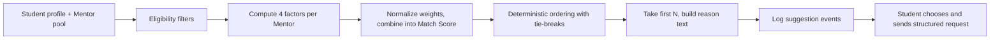

---
title: connect Matching Algorithm Specification (Phase 1)
status: Draft
owner: Owner / CTO
date: 2026-10-16
sources: README.md (sections 5.1, 5.2, 4.3, 13, 15); connect-research-report.md (Sections 3.1 #5, 5.6, 7 Doc 5); glossary.md; personas-and-user-journeys.md; reputation-and-verification-policy.md
---

# Matching Algorithm Specification (Phase 1)

**Purpose.** Define exactly how connect suggests Mentors to a Student in Phase 1: eligibility filters, the four-factor Match Score, ordering, explanations, edge cases, logging, and how weights are later evaluated. This is a pilot-gate document (README marks it P0; the research report promotes it to the pilot gate). Terms follow `glossary.md`.

**Label rules.** The four factors and their default weights come from the README and are **Proposed defaults**. Every other number in this file is also a **Proposed default**: editable, stored in one config file, **not validated**. Nothing here is Verified by pilot data. Better weights require pilot data (README 5.2).

**Owner decisions applied (16 Oct 2026).** Users are 18+ only. Product UI and documents are English only, so language is not a matching factor. Platform (not institution) owns disputes. Pilot partner type remains an Open decision (N5).

---

## 1. Principles

1. The **Match Score is a sort aid, never a predictor of success**. It must never be described in the UI or in documents as predicting or guaranteeing a good mentorship (README).
2. **No sensitive attributes** are used: religion, ethnicity, caste, gender, disability, health, nationality, region of origin, appearance, or any attribute listed as protected in `reputation-and-verification-policy.md`. All users are 18+, so age is not a factor either.
3. **Deterministic and explainable.** The same inputs and the same config always give the same ordered result, and every suggestion carries a plain-language reason built from the factors.
4. **Business rules are pure, unit-tested functions** (README 13). No database or network calls inside scoring.
5. **Mentor reputation is not a factor in v1** (Proposed; see question 2). This avoids early "rich get richer" effects before there is data.
6. **AI does not decide matches.** Embeddings and AI ordering come only after offline evaluation (section 13).

---

## 2. Phase 1 operating mode

**Phase 1 = concierge-assisted plus rule-based suggestions** (Recommendation, research report Doc 5).

| Part | Behavior |
|---|---|
| Rule-based suggestions | The algorithm in this document produces a sorted list for every Student who asks to see Mentors. |
| Concierge assist | the owner or a coordinator may manually suggest a Mentor to a Student (section 9). Coordinator staffing is an Open decision (see question 5). |
| Learning loop | Every suggestion shown, chosen, and decided is logged (section 11) so weights can be reviewed with real acceptance data in the measurement phase. |

AI is **not** used in matching in Phase 1. Phase 1b may use AI only to phrase the reason text from the rule factors (section 8.2).

---

## 3. Pipeline overview



---

## 4. Inputs

### 4.1 Data used

| From | Field | Used for |
|---|---|---|
| Student | Primary Field; up to 2 secondary Fields | Field overlap, Eligibility |
| Student | Target outcome type (one of Admission, Internship, Job offer, Skill milestone, Interview) | Goal alignment |
| Student | Department, program, batch band (from affiliation, optional) | Alumni connection |
| Student | Weekly availability slots with IANA time zone (optional) | Availability match |
| Mentor | Fields they guide in | Field overlap, Eligibility |
| Mentor | Outcome types they offer guidance on (their declared scope) | Goal alignment |
| Mentor | Department, program, batch band (from affiliation) | Alumni connection |
| Mentor | Weekly availability slots with IANA time zone | Availability match |
| Mentor | Controlled capacity (weekly cap), current load, Access state | Eligibility, tie-breaks |
| Mentor | Verification level, suspension status | Eligibility |

### 4.2 Data explicitly **not** used

Sensitive attributes (principle 2); free-text bios and request text; profile photos and names; Mentor reputation counts or confidence tier (v1); Students' Counted outcomes; payments or institutional billing status (neutrality firewall); private session feedback.

### 4.3 Required versus optional data

- **Mentor profile must be complete** (Fields, outcome types, availability slots, weekly cap) before the Mentor can appear in suggestions. An incomplete Mentor profile is not suggested.
- **Student profile** requires primary Field and target outcome type. Availability and affiliation are optional.
- A factor whose **Student-side** data is missing is **missing**, not zero (section 6.3). A factor where data exists on both sides but nothing matches is **zero**.

---

## 5. Eligibility filters (hard rules, applied before scoring)

A Mentor is **eligible for suggestion** only if all hold. Failing a filter removes the Mentor; it is not a low score.

| # | Rule | Reason |
|---|---|---|
| E1 | Mentor is at least **Level 1 affiliation-verified** and not suspended | Unverified Mentors cannot receive requests (reputation policy, section 11) |
| E2 | Mentor Access state is **Available** (not Full; **Application-only** Mentors are excluded from automatic suggestions and shown in browse with an application route) | Controlled capacity |
| E3 | Mentor's remaining weekly capacity is greater than zero, and the Mentor's open pending requests are below the pending cap | Prevent overload (cap values in section 12) |
| E4 | Mentor and Student are different Users (dual-role users cannot match with themselves) | Dual roles (N6) |
| E5 | The Mentor has not declined this Student within the re-request cooldown | Avoid repeated unwanted requests |
| E6 | Student is email-verified and has declared 18+ | Age policy (N1) |
| E7 | Field overlap is greater than zero | A Mentor with no shared Field is not a useful automatic suggestion; may still appear in manual browse |
| E8 | Student has fewer than the maximum pending requests | Limits request spam; enforced when sending, shown when browsing |

E8 does not remove Mentors from the list; it disables the "send request" action with a clear message.

---

## 6. The Match Score

### 6.1 Formula

```
Match Score = w1 × AlumniConnection
            + w2 × FieldOverlap
            + w3 × GoalAlignment
            + w4 × AvailabilityMatch
```

Each factor value `f` is in the range **0 to 1**. Weights `w1` to `w4` are non-negative numbers from config.

| Factor | Proposed default weight |
|---|---|
| Alumni connection (w1) | 30% |
| Field overlap (w2) | 30% |
| Goal alignment (w3) | 25% |
| Availability match (w4) | 15% |

### 6.2 Factor definitions (Proposed)

**FieldOverlap.** Uses the shared **dynamic Field list** (owner decision): students and mentors create or pick Fields, and `field_id` is the matching key. The Student's Fields are weighted: primary Field counts **2**, each secondary Field counts **1**.

```
FieldOverlap = (sum of weights of Student Fields that appear in Mentor Fields)
             / (sum of weights of all Student Fields)
```

Example (Illustrative): Student has primary "AI" and secondary "Data" (weights 2 and 1). A Mentor in "AI" only gives 2 ÷ 3 = 0.667. A Mentor in both gives 1.0.

**GoalAlignment.** Compares the Student's target outcome type with the outcome types the Mentor says they offer guidance on.

```
GoalAlignment = 1 if the Student's target outcome type is in the Mentor's declared scope, else 0
```

This is based on **declared scope only**. It does not use counted outcomes and does not imply the Mentor has achieved that result with others. The Student's timeframe is **not** part of the score in v1 (Proposed); it travels with the request and is shown to the Mentor.

**AlumniConnection** (redefined for a single-institution pilot, Recommendation). The README's plain "alumnus of the partner" would be constant when everyone is from one institution, so this factor uses closeness within the institution:

| Condition | Value (Proposed) |
|---|---|
| Same institution, same department, and batch band within the allowed distance | 1.0 |
| Same institution, same department, different batch band | 0.5 |
| Otherwise (including Mentors with no connection to the Student's institution) | 0 |
| Student has no affiliation | **missing** |

The batch band distance and department definitions are config values. In the pilot, the weight of this factor can be set to zero if departments or batches are not collected (Open decision, question 1).

**AvailabilityMatch.** Availability is stored as coarse weekly slots (for example 7 days × 3 blocks: morning, afternoon, evening) with an IANA time zone. Slots are converted to UTC before comparison, so a Mentor in another time zone is handled correctly.

```
AvailabilityMatch = overlapping slots / min(Student slot count, Mentor slot count)
```

If the Student gave no availability, the factor is **missing**. Overlap is capped at 1.0. Capacity limits are handled by eligibility filter E3, not by this factor.

### 6.3 Normalization, missing data, and weight safety

| Rule | Behavior |
|---|---|
| Weights not totaling 100 | Normalize: `w_i' = w_i / sum(w)`. |
| A weight equal to zero | That factor is ignored and never appears in reason text. |
| All weights zero | Treated as a config fault: fall back to the default weights, log an alert, and never divide by zero or return NaN. |
| Negative, NaN, or infinite weight | Config validation fails at load time; the previous valid config stays active. |
| Missing factor (Student-side data absent) | Exclude it and **renormalize over the remaining active factors**. Mark the suggestion "limited information" in the log. |
| No active factors left after exclusion | Score is undefined; use ordering rule O-fallback (section 7). |

**Final score:**

```
active = factors with weight > 0 and value not missing
Match Score = sum(w_i' × f_i for i in active)   with w_i' normalized over active
```

The Match Score is stored and compared at six decimal places to avoid floating-point noise.

### 6.4 Display

- Students see **ordered suggestions and plain-language reasons**, not a numeric Match Score (Proposed).
- An optional coarse label such as "Strong fit / Good fit / Possible fit" is an Open decision (question 4). If used, label thresholds must not imply prediction.
- The numeric score is internal, logged for analysis, and never shown to Mentors, Institution Admins, or Employers.

---

## 7. Ordering and tie-breaking

Ordering is deterministic. Mentors are sorted by:

1. **Match Score**, highest first.
2. **Remaining weekly capacity**, highest first (spreads load).
3. **Fewer requests received in the last 7 days**, lowest first.
4. **A stable hash of (Student ID, Mentor ID)**, so different Students see different orders among exact ties, while the same Student always sees the same order.

**O-fallback** (no active factors): sort by rules 2, 3, 4 only.

The first **N suggestions** (Proposed: 5) appear on the "Suggested for you" view; "Browse all eligible Mentors" shows the rest in the same order.

Mentors are never ordered by popularity, followers, likes, or any public ranking.

---

## 8. Reason text

### 8.1 Deterministic templates (Phase 1)

Reason text comes from templates, one per active factor with value greater than zero, ordered by weighted contribution (largest first), with a maximum of 3 reasons. Mentor names are not part of the templates.

| Factor | Template (English) |
|---|---|
| FieldOverlap = 1.0 | "Guides students in {Field}, your main interest." |
| FieldOverlap < 1.0 and > 0 | "Guides students in {Field}, one of your interests." |
| GoalAlignment = 1 | "Offers guidance on {outcome type}, the result you are aiming for." |
| AlumniConnection = 1.0 | "Studied in the same department, around the same years." |
| AlumniConnection = 0.5 | "Studied in the same department." |
| AvailabilityMatch > 0 | "Has time slots that overlap with yours." |

Reasons must not claim that the Mentor will help, has a record of success, or is "the best". They may only describe declared profile facts.

### 8.2 AI-written reasons (Phase 1b, optional)

A language model may rewrite the template facts into more natural English, subject to the AI boundary in `reputation-and-verification-policy.md` section 14:
- Input is limited to factor values and Field and outcome type names. No raw user text and no personal identifiers are sent.
- Output is labelled as AI-assisted and logged (purpose, model, input class, output id).
- If the model is unavailable, the deterministic template is shown. Matching never depends on the model.
- AI never changes the score, the filters, or the ordering.

---

## 9. Concierge suggestions

| Rule | Behavior |
|---|---|
| Who | the owner or an assigned coordinator (Open decision, question 5) |
| How | The coordinator picks a Mentor for a Student from the eligible pool and selects a **structured reason** (Field fit, goal fit, availability, other with short note) |
| Shown to Student as | "Suggested by the connect team" with the structured reason, alongside the algorithmic list |
| Constraints | The coordinator **cannot bypass** eligibility filters E1 to E7 (verification, capacity, suspension, cooldown, age) |
| Student still sends the structured request | Concierge suggestions never auto-create requests or mentorships |
| Logging | Logged with `source = CONCIERGE`, the coordinator ID, and the reason. These are analyzed separately from algorithmic suggestions |
| Match Score | Not altered by concierge actions |

---

## 10. Request lifecycle behavior affecting matching

| Event | Behavior (Proposed defaults) |
|---|---|
| Request sent | Request enters `PENDING` and counts toward the Student's pending cap and the Mentor's pending cap |
| Reminder | Mentor is reminded at **24 hours** |
| Expiry | Request expires at **48 hours** if undecided (owner decision) |
| Mentor accepts | Mentorship agreement flow starts; Mentor's weekly capacity count increases (transactional) |
| Mentor declines | Student is notified with the next suggestions; the pair enters the **re-request cooldown** |
| Mentor redirects or recommends an alternative | The recommended Mentor appears first, labelled "Recommended by a Mentor you contacted", **if** eligible under E1 to E7. Maximum redirect depth is an Open decision (question 6) |
| Expiry | Student is notified with the next suggestions; the Mentor's Response reliability reflects the missed decision |
| Mentor suspended while a request is pending | Request expires with notice, Student is notified and re-offered suggestions |

Timely declines are **not** penalized in Response reliability (reputation policy section 9). An expired request is a non-response and lowers reliability. Optional structured decline reasons (out of scope, no capacity, other) feed matching diagnostics only and carry no penalty.

---

## 11. Logging and quality measures

### 11.1 Events (append-only)

| Event | Fields (no sensitive text) |
|---|---|
| `suggestion_shown` | student_id, mentor_id, rank_position, factor values, weights version, active factors, "limited information" flag, source (ALGORITHM or CONCIERGE), timestamp |
| `suggestion_opened` | student_id, mentor_id, rank_position |
| `request_sent` | request_id, student_id, mentor_id, rank_position at the time |
| `request_decision` | request_id, decision (accept, decline, redirect, alternative, expired), time to decision |
| `session_held`, `outcome_counted` | links back to the request and mentorship |

Each event stores the **config version** so results can be reproduced.

### 11.2 Measures

| Measure | Definition | Target status |
|---|---|---|
| Match acceptance rate | Accepted requests ÷ requests sent to Mentors, per period | **Plan target: greater than 40%** (README) |
| Median time to first response | Request creation to Mentor decision | **Plan target: under 48 hours** (README) |
| Share of requests decided within 48 hours | Decided within 48 hours ÷ requests sent, per period. This is the **response-time KPI** | Diagnostic against the plan target |
| Completed mentorship rate | Mentorships reaching the agreed duration ÷ accepted | Measured; no target set |
| Outcome conversion | Counted outcomes ÷ Mentorships | Measured; no target set |
| Acceptance by rank position | Acceptance for position 1, 2, 3... | Diagnostic: position bias |
| No-result rate | Students with zero eligible suggestions ÷ Students who looked | Diagnostic |
| Concentration | Share of requests going to the Mentors who receive the most requests | Diagnostic: overload and fairness |
| Acceptance by factor value | Acceptance when each factor is high versus zero | Diagnostic: weight review input |

These are diagnostics for weight review. They are not proof that suggestions cause successful mentorships.

---

## 12. Configuration

All parameters live in one versioned config. A change creates a new version with a changelog entry, and only the owner approves production changes.

```yaml
# Illustrative structure. Values are Proposed defaults, not validated.
matching_config:
  version: 1
  weights:
    alumni_connection: 30
    field_overlap: 30
    goal_alignment: 25
    availability_match: 15
  field_weights:
    primary: 2
    secondary: 1
    max_secondary: 2
  alumni_connection:
    same_department_same_band: 1.0
    same_department_other_band: 0.5
    batch_band_distance_years: 3
  suggestions_shown: 5
  request:
    reminder_hours: 24
    expiry_hours: 48
    max_pending_per_student: 3
    pending_cap_multiplier_per_mentor: 2   # times weekly capacity
    re_request_cooldown_days: 30
  availability:
    blocks_per_day: 3
    timezone_policy: iana_convert_to_utc
  display:
    show_numeric_score: false
    show_fit_label: false
```

| Parameter | Status |
|---|---|
| Weights | Proposed default (README); pilot data needed |
| Alumni connection levels and batch distance | Proposed default |
| Suggestions shown, pending caps, cooldown | Proposed default; not validated |
| Reminder and expiry | **Decided (owner):** reminder 24 hours, expiry 48 hours |
| Field taxonomy contents | **Decided (owner):** fully dynamic; users create Fields, normalized slug prevents duplicates. No fixed list |
| Fit label and thresholds | **Open decision** |
| Maximum redirect depth | **Open decision** |

---

## 13. Evaluation plan and future AI

### 13.1 Reviewing weights after the pilot

1. Collect at least a Owner-set minimum number of requests before any review (the minimum is an **Open decision**; no number is invented here).
2. Compare acceptance and completed-mentorship rates across factor values and rank positions, correcting for **position bias** (higher positions get more attention regardless of fit).
3. Use **shadow ordering**: compute an alternative ordering offline from logged data, without showing it to users, and compare the results before any live change.
4. Never tune weights automatically. A weight change is a versioned config change approved by the owner.
5. Do not claim causality from acceptance data alone. Students choose whom to ask and Mentors choose whom to accept, so the data is subject to selection effects.

### 13.2 AI features later

| Layer | When | Rule |
|---|---|---|
| Reason phrasing | Phase 1b | Section 8.2 |
| Embedding similarity (for example `pgvector`) as **one more factor** | Phase 2 to 5, only after offline evaluation against real acceptance data | Must be explainable in plain language, must not use sensitive attributes, must be switchable off by config |
| AI-assisted matching in general | README Phase 5 gate: basic workflow validated and consent and retention policy approved | Human oversight; cost caps; model provider abstracted; PII stripped before external calls |

AI never produces a global Student ordering or an Employer-facing score.

---

## 14. Edge cases

| Case | Defined behavior |
|---|---|
| All weights zero | Default weights restored, alert logged (section 6.3) |
| One weight zero | Factor ignored and not mentioned in reasons |
| Negative or NaN weight | Config rejected at load; previous config stays active |
| Weights not summing to 100 | Normalized |
| Student has no affiliation | Alumni connection missing; renormalize over other factors |
| Student gave no availability | Availability match missing; renormalize |
| Mentor profile incomplete | Not suggested |
| Zero eligible Mentors | Show an empty state with: why (for example "no Mentors currently available in your Field"), a way to broaden Fields, and an option to be notified when a Mentor opens capacity. Never show an unrelated list as if it were a match |
| Exactly one eligible Mentor | Shown with the normal reason text |
| All Mentors in the Student's Field are Full | Same as zero eligible, with a clear "capacity full" message |
| Exact ties | Resolved by section 7 rules; fully deterministic |
| Floating-point near-ties | Compared at six decimal places |
| Two Students request the last capacity slot at once | Capacity decrement is transactional; the later request is told the Mentor just became Full and receives new suggestions |
| Student and Mentor are the same User | Excluded (E4) |
| Mentor changes weekly cap or availability mid-flow | Applies to future suggestions; existing accepted Mentorships are unchanged |
| Mentor time zone differs, or has daylight saving | IANA time zones converted to UTC before overlap |
| Student's Field missing from the taxonomy | Student prompted to choose the nearest Field; the missing Field name is logged for taxonomy review |
| Duplicate Fields in a profile | De-duplicated before scoring |
| Concierge suggests an ineligible Mentor | Rejected with the failing filter named |
| Mentor suspended or loses verification | Removed from suggestions immediately; pending requests closed (section 10) |

---

## 15. Interface (pure functions, Proposed)

```ts
type Factor = 'alumni_connection' | 'field_overlap' | 'goal_alignment' | 'availability_match';

interface FactorResult { value: number | 'missing'; weightApplied: number; }

interface MatchResult {
  mentorId: string;
  score: number | null;                 // null when no active factors
  factors: Record<Factor, FactorResult>;
  limitedInformation: boolean;
  reasons: string[];                    // max 3, from templates
}

function checkEligibility(student, mentor, state, config): { eligible: boolean; failed: string[] };
function computeMatchScore(student, mentor, config): MatchResult;
function orderMentors(student, mentors, state, config): MatchResult[];
```

No functions here read the clock, a database, or the network. `now` and all state (load, pending counts, cooldowns) are passed in. Lives in the `matching` module of the NestJS modular monolith.

---

## 16. Tests required

**Example-based tests:** default weights; weights not summing to 100; one zero weight; all zero; negative weight (rejected); each factor at 0, partial, and 1; missing factors with renormalization; each eligibility filter; Application-only exclusion; ties (stable across repeated runs); empty result; one result; time zone and daylight saving overlap; concierge suggestion rejected for an ineligible Mentor.

**Property-based tests:**
- Score is always between 0 and 1, or null when no active factors.
- Multiplying all weights by the same positive number does not change the order.
- Raising a factor value never lowers the score when its weight is non-negative.
- Shuffling the input order of Mentors does not change the output order.
- Same inputs and config always yield identical output.
- No eligibility filter result depends on a sensitive attribute (checked by a test that rejects such fields in inputs).

---

## 17. Out of scope for Phase 1

AI-driven matching; embeddings; Mentor reputation as a factor; group office hours matching; Employer-facing talent ordering; automatic weight learning; paid priority placement (forbidden by the neutrality firewall at any phase).

---

## Acceptance checklist

- [ ] Zero weights, all-zero weights, ties, and empty results each have defined behavior and a pure-function test.
- [ ] Every suggestion shows a plain-language reason.
- [ ] No sensitive attribute appears in inputs, config, or logs.
- [ ] The Match Score is never described as a prediction of success anywhere in the product or docs.
- [ ] Every weight and number is labelled Proposed default or Open decision, not validated.
- [ ] Suggestions shown, chosen, and decided are logged with the config version.
- [ ] Alumni connection is redefined or its weight is explicitly set to zero for the pilot.
- [ ] Terms match `glossary.md` (Match Score, Alumni connection, Access state, Controlled capacity, Response reliability).

## Questions for Owner

1. **Alumni connection in the pilot:** keep the redefined version (department and batch band, default weight 30%), or set the weight to zero until the partner can supply departments and batches? (Open decision; the redefined version is my Recommendation.)
2. **Mentor reputation as a factor:** keep it out of v1 (my Recommendation, to avoid early concentration), or include confidence tier as a small factor from the start?
3. **Field list:** fully dynamic (owner decision). You do not maintain a list; users create Fields and the normalized slug prevents duplicates. Revisit only if duplicates become a problem.
4. **Fit label:** show Students only ordered reasons (my Recommendation), or also a coarse label such as "Strong fit"?
5. **Concierge coordinator:** will you do this yourself, or is a coordinator assigned (same staffing question as Trust-and-Safety, N7)?
6. **Redirect depth:** how many times may a request be redirected before it ends?
7. **Request limits:** are 3 pending requests per Student and a pending cap of 2 × weekly capacity per Mentor acceptable for the pilot?
