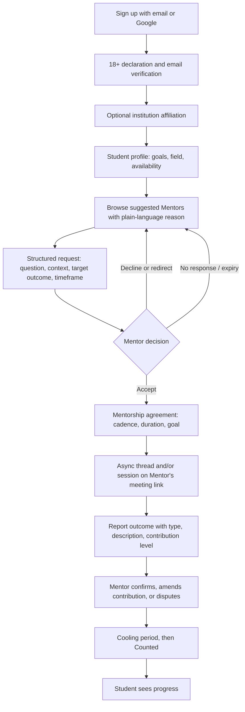
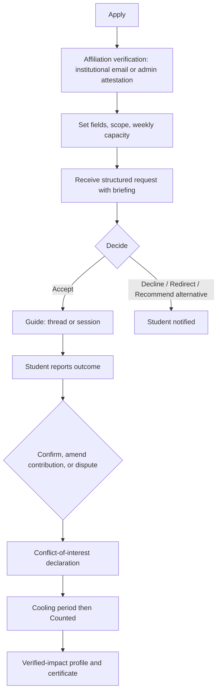

---
title: connect Personas and User Journeys (Phase 1)
status: Draft
owner: Owner / CTO
date: 2026-10-16
sources: README.md (sections 2, 5, 6, 15); connect-research-report.md (Sections 3.1, 4, 7 Doc 3, Doc 7)
---

# Personas and User Journeys (Phase 1)

**Purpose.** Pin down who Phase 1 is for and what happens from sign-up to first Mentor contact and first Outcome. Terms follow `glossary.md`.

**Status of personas.** Every persona below is a **hypothesis** and **Illustrative**. No demographics are asserted as fact. They must be replaced or confirmed after 10 to 15 interviews (section 7). No real institution, person, or statistic appears here.

**Owner decisions that shape these journeys (16 Oct 2026).**
- Users are **18+ only** in the pilot (N1).
- The product UI is **English only** (decision #13). This is a risk for some Students; see assumption A14.
- Phase 1 is a **mobile-first, installable web app (PWA)**. No native app, no WebSocket real-time, no Zoom API integration, and no AI features. Mentors paste their own meeting link (owner decision).
- Disputes and audits are owned by the **platform admin**, never the institution. Appeals are **Later**.
- A mentor must decide within **48 hours**; a request expires at 48 hours with a reminder at 24 hours.

---

## 1. Phase 1 users

| Role | In Phase 1? | Notes |
|---|---|---|
| Student | Yes (primary) | 18+ |
| Mentor | Yes (primary) | Volunteer in the pilot (Recommendation); affiliation-verified |
| Institution Admin | Yes (minimal) | Attests Affiliation; sees aggregates only |
| Platform Admin | Yes | Disputes, audits, moderation |
| Employer | No | Phase 3 (README) |

**Excluded in Phase 1:** Employers, Circles, paid office hours, group sessions, native mobile app, in-house audio and video, WebSocket real-time, AI matching, public star ratings.

---

## 2. Persona cards (Illustrative hypotheses)

### 2.1 Student

| | |
|---|---|
| **Goal** | Get clear, usable guidance from someone who has done the thing, and turn it into a concrete result (internship, admission, skill milestone, interview, job offer). |
| **Constraints** | Mostly on a phone browser; may have unstable connectivity (research report [S18]); limited time; English-only UI (A14). |
| **Fears** | Messages going unanswered; wasting a Mentor's time; being asked for personal documents; their data being shared with an institution or employer without consent. |
| **What success means** | A decision from a Mentor within the response target, a clear next step, and a Confirmed outcome that they can point to. |
| **Hypothesis to test** | Students struggle to write a good request; a structured form (and, in Phase 1b, an AI drafting assist) improves acceptance (A6, A13). |

### 2.2 Mentor

| | |
|---|---|
| **Goal** | Help in a way that is structured, bounded, and recognized. |
| **Constraints** | Busy; no structure today for how to help; worried about time load, harassment, and liability. |
| **Fears** | Being flooded with requests; confirming something that turns out to be false; unclear expectations. |
| **What success means** | A manageable queue (Controlled capacity), a verified-impact profile, and an institution-signed certificate or badge (Recommendation). |
| **Hypothesis to test** | Recognition plus bounded structure is enough motivation for volunteers (A2, A4, A15). |

### 2.3 Institution Admin

| | |
|---|---|
| **Goal** | Evidence of career outcomes and alumni engagement, with minimal admin work. |
| **Constraints** | Needs to attest Mentor Affiliation; cannot see individual Student data without consent; cannot edit or arbitrate Outcomes. |
| **Fears** | Reputational risk if a Mentor misbehaves; data-protection exposure. |
| **What success means** | An aggregate dashboard with small-cohort suppression and a credible, independently audited evidence layer. |
| **Hypothesis to test** | Institutions will pay for outcome evidence (A7). |

### 2.4 Platform Admin (Trust-and-Safety)

| | |
|---|---|
| **Goal** | Keep outcome evidence credible and users safe. |
| **Constraints** | Owner bandwidth in the pilot (N7 Open); limited tooling. |
| **Fears** | Dispute and audit backlog; gaming that they cannot detect. |
| **What success means** | Disputes resolved with written reasons and appeal paths; audits show low fabrication. |
| **Hypothesis to test** | A small audit sample plus anomaly signals is enough for pilot volumes (P1). |

---

## 3. Student journey

| Step | What the Student does | Failure point | Product response |
|---|---|---|---|
| 1. Sign up | Email plus password or Google; verifies email. | Under 18; unverified email. | Under-18 blocked with a clear message and minimal data retained. Unverified users cannot send requests. |
| 2. Profile | Goals, field, language, availability. | Abandoned form; poor connectivity. | Autosave drafts; retry safely; resume where left off. |
| 3. Discover | Browse suggestions with reason text. | Empty results. | Defined empty state with next-best options; no Mentor at Full capacity is shown. |
| 4. Request | Fills the four structured fields. | Vague or incomplete request; lost connection while drafting. | Field validation; autosave; (Phase 1b) AI drafting assist, labelled, never auto-sent. |
| 5. Decision | Waits for accept or decline. | **No response in 48 hours**; redirect loops (Phase 1b). | Reminder to Mentor at 24 hours; request expires at 48 hours; Student sees the next suggestions. |
| 6. Agreement | Acknowledges cadence, duration, goal. | Disagreement over cadence. | Either party can propose changes before the first session. |
| 7. Guidance | Thread messages and optional sessions. | Mentor goes quiet; abusive messages. | Response reliability is recorded; report-abuse path to the moderation queue. |
| 8. Report outcome | Chooses type, describes result, states Mentor's contribution; may attach evidence (optional, private). | Over-claiming or unrelated result. | Evidence tiers; contribution confirmed separately; audit sampling. |
| 9. Wait for confirmation | Sees status. | Mentor does not confirm. | Reminders on day 3 and 5; escalation on day 7 to platform review. |
| 10. Progress | Sees Counted outcomes. | Outcome disputed. | Written reason from the platform admin. Appeals are **Later**. |

---

## 4. Mentor journey

| Step | What the Mentor does | Failure point | Product response |
|---|---|---|---|
| Apply and verify | Applies; verifies Affiliation (Level 1; Level 2 for industry Mentors). | Cannot verify via institutional email. | Admin attestation route. Unverified Mentors cannot receive requests or build reputation. |
| Set capacity | Sets weekly cap and fields. | Over-commitment. | Access state moves to Full when the cap is reached. |
| Receive request | Reads structured request and a briefing (AI-drafted briefing arrives in Phase 1b only; human-reviewed, labelled). | Vague request. | Required fields; "incomplete request" flag. |
| Decide | Accept, decline, redirect, recommend alternative. | Silence. | Timely declines and redirects are not penalized in Response reliability. |
| Guide | Thread and sessions on the Mentor's own meeting link. | Time load; harassment risk. | Capacity control; report-abuse path; no recording or transcription by default. |
| Confirm | Confirms the outcome fact and confirms or amends the contribution level separately. | Pressure to confirm; relationship with Student. | Conflict-of-interest declaration; relatives, reports, and paying relationships cannot be confirmed (N9). |
| Recognition | Sees verified-impact profile (counts, confidence tier, response reliability). | Few outcomes yet. | Counts shown; no precise numeric score at low volume. |

### Incentives and disincentives

| Incentive (Recommendation) | How addressed |
|---|---|
| Recognition | Verified-impact profile; institution-signed certificate or badge |
| Bounded effort | Controlled capacity and access states |
| Structure reduces ghosting | Structured requests and agreement |

| Disincentive | How addressed |
|---|---|
| Time load | Weekly cap; Application-only state |
| Harassment risk | Report-abuse queue; suspension path |
| Liability worries | Volunteer agreement and terms drafted for counsel; outcome-verification disclaimer |
| Fear of confirming falsely | Evidence tiers; platform audits; clawback is a compensating entry, not a public shaming |

---

## 5. Institution Admin journey

1. Onboarded by the platform under a written MoU (the MoU itself is an Open decision; see N5).
2. Attests Mentor Affiliation for their own institution.
3. Views an aggregate dashboard (verified participation, requests, match acceptance, outcome reporting and confirmation rates, outcomes by field). **Small-cohort suppression** hides aggregates below **5** individuals (owner decision).
4. **Cannot** see individual Student data without Student consent, **cannot** edit Outcomes or reputation, **cannot** resolve Disputes.

| Failure point | Product response |
|---|---|
| Cohort too small | Aggregate suppressed with an explanation. |
| Admin asks for individual-level data | Requires separate, revocable Student consent and a stated purpose. |
| Admin pressure to alter an outcome | Not possible; platform owns audits and disputes. |

---

## 6. Platform Admin journey (dispute and audit)

1. Receives an escalation (Mentor dispute, no response by day 7, declared conflict, audit sample, or anomaly signal).
2. Opens the Platform review queue and reads outcome, evidence tier, thread context where needed (break-glass, audited).
3. Decides: outcome valid (Counted) or outcome not valid (Rejected), with a written reason.
4. Notifies both parties. **Appeals are Deferred (owner decision)**; in the MVP the decision stands unless a clawback is later justified.

| Failure point | Product response |
|---|---|
| Backlog | Time limits per step (Proposed); queue ordering by age; the owner covers this in the MVP (a named reviewer is Deferred). |

---

## 7. Interview plan (Phase 0.5 validation, Recommendation)

Run in parallel with documentation. Personas, assumptions, and the pilot plan are only as good as these conversations.

| Group | Number | Topics |
|---|---|---|
| Students | 5 | How they find help today; what blocked them; English-only UI comfort (A14); what would make them report an outcome |
| Alumni Mentors | 5 | Time available; what would make them confirm outcomes; incentives; fears |
| Career-office or alumni staff | 3 | Current tools; what evidence they report; budget owner; sign-in system (A9) |
| Employers | 2 | What talent signal they trust (informs Phase 3) |

---

## 8. Traceability: journey steps to proposed functional requirements

IDs below come from the research report's proposed requirements (Doc 7). They are **Proposed** until `functional-requirements.md` is approved.

| Journey step | Requirement IDs |
|---|---|
| Sign up, 18+, email verification | AUTH-1, AUTH-2 |
| Profiles | PROF-1, PROF-2 |
| Affiliation verification | VER-1 |
| Discovery and reasons | DISC-1 |
| Structured request | REQ-1 |
| Mentor decision, expiry, reminders | REQ-2, REQ-3 |
| Thread | THR-1 |
| Mentorship agreement | MEN-1 |
| Session record | SES-1 |
| Report outcome, confirm or dispute, evidence | OUT-1, OUT-2, OUT-3 |
| Reminders and escalation | OUT-4 |
| Impact view | REP-1 |
| Private feedback | FBK-1 |
| Institution dashboard | INST-1 |
| Platform review and moderation | ADM-1, ADM-2 |
| Consent, data rights, audit log | CONS-1, PRIV-1, AUD-1 |
| AI drafting assist (Later; not in the MVP) | — |
| English UI text via a single place | I18N-1 (see note below) |

**Note on I18N-1.** the owner chose English-only UI. Keeping UI strings in one place is decided: strings go through a string catalog, and no new language is added.

---

## Acceptance checklist

- [ ] Every Phase 1 functional requirement traces to a journey step.
- [ ] Each journey names its failure states and the product's response.
- [ ] All personas are labelled Illustrative; no invented demographics.
- [ ] No real institution, person, or statistic is named.
- [ ] Journeys agree with the permission matrix in `auth-and-access-control.md` (planned).

## Questions for Owner

1. Pilot partner type (university, bootcamp, or department) remains open (N5). It does **not** block Gate 0.
2. Should Student and Mentor onboarding be one flow with a role choice, or two separate flows?
3. Should redirect remain a Phase 1b feature, or be dropped entirely?
