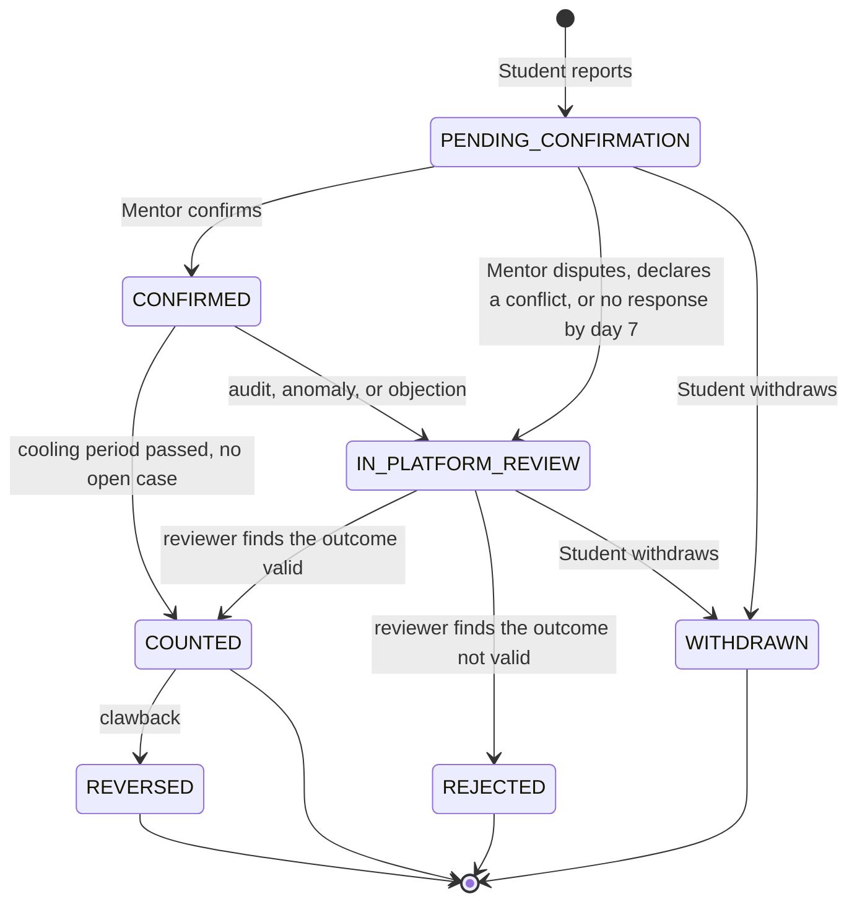

---
title: connect Reputation and Verification Policy
status: Draft
owner: Owner / CTO
date: 2026-10-16
sources: README.md (sections 1.1, 5.3, 5.4, 5.5, 12.3, 18); connect-research-report.md (Sections 3.1, 4.2, 4.3, 5.6, 5.7, 7 Doc 4)
---

# Reputation and Verification Policy

**Purpose.** Define how reputation is earned, protected from gaming, and challenged. This is the core of connect. Terms follow `glossary.md`.

**Label rules.** Every rule below is a **Recommendation** unless marked otherwise. Every number is a **Proposed default**: editable, stored in one config file, not validated. Nothing here is Verified by pilot data. No weight is presented as validated.

**Owner decisions applied (16 Oct 2026).**
- Platform Trust-and-Safety owns audits and disputes; Institution Admins attest Affiliation only.
- Public display uses confirmed counts and confidence tiers; numeric scores stay internal.
- Evidence tiers, contribution level, cooling period, pair factor, and clawback are adopted.
- Outcome types: Admission, Internship, Job offer, Skill milestone, Interview. Job offer's difficulty weight is Open.
- Users are 18+ only.
- Audit sampling rate, Tier 2 for Admission, and Trust-and-Safety staffing are **Open decisions** (P1, P2, P3).

**Owner decisions applied (29 Oct 2026).**
- A mentor must accept or decline a request within 48 hours; requests expire at 48 hours with a reminder at 24 hours. A decline within 48 hours is not penalized; expiry is a non-response.
- Disputes are decided by a Platform Admin with a written reason. Appeals and a second reviewer are **Later**.
- Mentors are volunteers and receive an institution-signed certificate; students are free; nobody pays to verify an outcome.
- Small-cohort suppression threshold is 5.

---

## 1. Principles (kept from the README)

1. Outcomes over activity.
2. Reputation is earned. Likes, followers, and stars never contribute.
3. **Unconfirmed means uncounted.** Pending outcomes never affect reputation.
4. Fields are separate. Scores in different Fields are not interchangeable.
5. Reputation is derived data. Recomputing from the ledger gives the same result.
6. Payments never influence reputation or verification (neutrality firewall).

---

## 2. Outcome types and difficulty

| Outcome type | Difficulty order (README) | Notes |
|---|---|---|
| Admission | Highest | |
| Internship | Second | |
| Job offer | **Open decision (P5)** | Added 16 Oct 2026. No position or weight is set. |
| Skill milestone | Third | |
| Interview | Fourth | |

README order: Admission > Internship > Skill milestone > Interview. Numeric difficulty weights are **Proposed defaults** and live in one config. Calibration happens after pilot data (decision #5).

---

## 3. Outcome lifecycle



This is the same machine as `data-model.md` section 4.4, which is authoritative. There are seven states; evidence and disputes are events and review cases, not states. **Deferred (owner decision):** appeals are **Later**; in the MVP a Platform Admin decides a case once with a written reason.

Differences from the README state machine: `AdminReview` is renamed **Platform review** and owned by the Platform Admin; a **cooling period** sits between Confirmed and Counted; **Reversed** (clawback) is added; the README's "Audited" step is a Platform review triggered by audit. `Reported`, `EvidenceAttached`, and `Escalated` are events.

### 3.1 Transition rules

Each rule has a trigger, actor, evidence, resulting state, and time limit.

| # | Trigger | Actor | Evidence required | Result | Time limit (Proposed default) |
|---|---|---|---|---|---|
| T1 | Student reports an Outcome | Student | Type, description, stated contribution level | `PENDING_CONFIRMATION`; a `REPORTED` event is appended | n/a |
| T2 | Student attaches evidence | Student | File or link, stored privately; hash recorded | No state change; an `EVIDENCE_ADDED` event and the evidence tier change | optional |
| T3 | Mentor confirms | Mentor | Conflict-of-interest declaration; contribution level confirmed or amended | `CONFIRMED` | Reminders on day 3 and day 5 |
| T4 | No Mentor response | System | Timestamps | `IN_PLATFORM_REVIEW` (a `NO_RESPONSE_ESCALATION` case) | Day 7 |
| T5 | Mentor disputes | Mentor | Written reason | `IN_PLATFORM_REVIEW` (a `MENTOR_DISPUTE` case) | n/a |
| T6 | Conflict declared or audit triggered | System or Platform Admin | Declaration, sample, or anomaly signal | `IN_PLATFORM_REVIEW` | Review decision within 7 days (Proposed default, P6) |
| T7 | Cooling period ends without an open case | System | Time elapsed | `COUNTED` | 14 days after confirmation (Proposed default) |
| T8 | Platform review decision | **Platform Admin** (never an Institution Admin) | Written reason | `COUNTED` or `REJECTED` | 7 days (Proposed default, P6) |
| T9 | Appeal (**Later**) | Student or Mentor | Written reason | Decided by a different reviewer | **Deferred (owner decision)** |
| T10 | Later disproof (clawback) | Platform Admin | Evidence of falsity | `REVERSED` with a compensating ledger entry | n/a |
| T11 | Student withdraws | Student | — | `WITHDRAWN`; never counts | Before `COUNTED` |

Reminder timings (days 3, 5, 7) are README **Proposed defaults**. Review and cooling timings are drafts, **not validated**, and are Open (P6).

---

## 4. Evidence tiers

| Tier | Definition |
|---|---|
| **Tier 0** | Student report plus Mentor confirmation. |
| **Tier 1** | Tier 0 plus a document or link (for example an offer letter, admission letter, or public profile), stored privately. |
| **Tier 2** | Tier 1 plus independent confirmation (for example the employer, program, or institution confirms through a one-time email link). |

**Rule of thumb (Proposed default):** Admission, Internship, and Job offer need at least Tier 1 to count fully. Skill milestone and Interview may count at Tier 0 with lower weight. Tier multipliers are config values.

**Open (P2):** whether Admission, and possibly Job offer, requires Tier 2.

Evidence handling: files private with signed URLs; hash and metadata kept; files deleted 90 days after the Outcome is Counted (Proposed default, confirm with counsel; see `data-privacy-and-retention.md`). No government ID numbers are collected.

---

## 5. Contribution attribution

"I got an internship" and "the Mentor helped me get it" are different claims. Mentoring effects are positive but modest on average (Verified, research report [S9]), so claiming full credit for every outcome would overstate impact.

- The Student states the Mentor's contribution: **Directly enabled**, **Helped**, or **Minor**.
- The Mentor confirms or amends it **separately** from confirming the outcome fact.
- If they disagree, the lower level applies until Platform review decides (Proposed default).
- Reputation weight uses the confirmed contribution level.

---

## 6. Anti-gaming mechanisms

1. **Pair factor.** Repeated Outcomes between the same Mentor and Student contribute less: `pair_factor = 1 / (1 + n)`, where `n` is the number of earlier **counted** outcomes between that pair. Distinct Students count more.
2. **Conflict-of-interest declaration** at confirmation: relatives, direct reports, paid relationships, same employer where relevant. A declared conflict triggers Platform review. Mentors cannot confirm Outcomes for relatives, direct reports, or paying relationships (N9, adopted).
3. **Cooling period** before an Outcome counts fully (Proposed: 14 days).
4. **Clawback.** A later disproof reverses the reputation effect through a compensating ledger entry. The original entries are never deleted.
5. **Audits.** Random sampling of Confirmed outcomes, plus all high-difficulty Outcomes, plus anomaly-triggered cases. The sampling rate is a config value. The report recommends starting high in the pilot because volumes are small. **Rate is Open (P1).**
6. **Anomaly signals for human review:** reciprocal confirmation rings; many Outcomes in a short window; same device or network among "different" users; templated evidence; one-sided concentration of confirmations.
7. **Rate limits and email-domain checks** against sock-puppet accounts.

Anomaly signals only route a case to a human. They never change reputation by themselves.

---

## 7. Reputation computation

A pure, unit-tested function with all parameters in one config file. Scores are recomputed from the append-only ledger.

```
reputation_event =
    difficulty_weight(outcome_type)
  × tier_multiplier(evidence_tier)
  × contribution_multiplier(contribution_level)
  × pair_factor(mentor, student)
```

There is **no cooling multiplier**. An outcome is either `COUNTED` (worth the full product above) or not (`0` points); the cooling period is a delay in the state machine, not a second discount. `pair_factor = 1 / (1 + n)`, where `n` is the number of earlier counted outcomes between the same mentor and student; the curve is a configurable function, and `1/(1+n)` is the Proposed default.

**Illustrative only (no numbers are set):** an Internship at Tier 1 with "Helped" contributes less than an Admission at Tier 2 with "Directly enabled". Real values come from pilot data.

Properties required:
- Same ledger in, same reputation out.
- A Reversed outcome produces a compensating negative entry.
- Reputation is computed **per Field**.
- Pending, Disputed, Escalated, Rejected, and not-yet-cooled outcomes contribute zero. (`Disputed` and `Escalated` are event words: such an outcome is `IN_PLATFORM_REVIEW` and contributes nothing while the case is open.)

---

## 8. Display rules

- Show **counts of Counted outcomes** by Field and outcome type, **Response reliability**, and a **confidence tier** (Emerging, Established, Proven).
- Keep a numeric 0 to 100 score **internal** until sample thresholds are met. Thresholds are an Open decision (P4).
- When a numeric score is eventually shown, shrink small samples toward a prior (Bayesian-style) so two outcomes cannot outrank twenty.
- Never show a global ranking, cross-Field comparison, or a precise number built on very few outcomes.
- Never show likes, followers, or stars.
- Counted-only: unconfirmed outcomes never appear in reputation figures.

---

## 9. Response reliability

- Computed from timestamps (objective, hard to game).
- **A mentor must accept or decline within 48 hours** (owner decision). Declining within 48 hours is **not** penalized.
- Expiry (ignoring the request) counts as a **non-response** and lowers reliability.
- The **response-time KPI is the share of requests decided within 48 hours**. Report it with the median time to decision; a mean alone hides a few very late decisions.

---

## 10. Private session feedback

- Both parties submit private feedback after a Session.
- **Simultaneous reveal:** neither sees the other's feedback until both submit or a timer ends. This reduces reciprocity and retaliation bias (Verified, research report [S10]).
- Used only for quality operations and matching diagnostics. **Never shown as stars** and never part of reputation.

---

## 11. Verification levels

### 11.1 Mentors

| Level | Meaning | Method |
|---|---|---|
| Level 0 | Email verified | Email confirmation |
| Level 1 | Affiliation verified | Institutional email or Institution Admin attestation |
| Level 2 | Employer check (industry Mentors) | Employer email check |

- All Mentors need **Level 1** to receive requests or build reputation. Level 2 applies to industry Mentors.
- **No government ID** is collected (Recommendation, ADR candidate). A professional profile link is optional.

### 11.2 Students

- Email verified and 18+ gate passed. **Level 1 affiliation through institution attestation** (owner decision), or an institutional email where available.
- Under-18 sign-ups are blocked; minimal data retained only to prevent re-registration (Recommendation; counsel to confirm).

---

## 12. Disputes, appeals, and ownership

- **Platform Trust-and-Safety owns audits and disputes.** The Institution Admin only attests Affiliation and never decides a dispute. Reason: the institution is a paying customer that benefits from outcomes being confirmed, so it must not judge them.
- Both parties are notified at each step. Decisions carry a written reason.
- **MVP:** a Platform Admin decides a case once. **Appeals and a second reviewer are Deferred (owner decision)** until after a successful pilot.
- **Who staffs Trust-and-Safety is Deferred (owner decision)** for the MVP; the owner covers it. Revisit before scaling.

### Suspension and removal triggers (criteria listed; evidence thresholds Open)

| Trigger | Typical evidence |
|---|---|
| Fabricated or templated outcome claims | Audit finding; evidence mismatch |
| Collusion or reciprocal confirmation rings | Anomaly signals confirmed by human review |
| Undeclared conflict of interest | Declaration versus facts |
| Off-platform payment for confirmations | Reports; messages; terms violation |
| Harassment | Reports; moderation record |
| Fake identity | Affiliation verification failure |

Evidence standards and sanction severity levels are an **Open decision** to define with counsel before the pilot.

---

## 13. Threat model

| Threat | Control |
|---|---|
| Fabricated outcome | Evidence tiers, audits, Platform review |
| Mentor-Student collusion | Pair factor, conflict declaration, ring detection, audit |
| Mentor farming easy outcomes | Difficulty and tier weights, contribution split |
| Claiming credit for unrelated results | Contribution confirmation, cooling period |
| Retaliation after a dispute | Private double-blind feedback, platform arbiter |
| Fake Mentor identities | Affiliation verification levels, Institution Admin attestation |
| Institution inflating outcomes | Institution cannot edit or arbitrate; platform audit |
| Bribery or off-platform payment for confirmations | Terms, reporting, anomaly signals |
| Sock-puppet accounts | Email-domain checks, rate limits, device and network signals |
| Harassment | Reporting, moderation queue, suspension path |

---

## 14. AI boundary

AI assists humans; verified humans attest (Recommendation, adopted as N4).

AI **may**: help a Student draft a structured request; draft a Mentor briefing; write a plain-language "why this match" from the rule factors; flag incomplete requests; (Phase 2) flag suspicious evidence and reciprocal-confirmation patterns for a human reviewer.

AI **must not**: confirm an Outcome; write an Outcome claim; change or recompute reputation; resolve a Dispute; revoke reputation; rank candidates for Employers.

Human review is mandatory for anything affecting reputation, verification, or access. All AI output is labelled in the UI and logged. All user text is untrusted input; model output never triggers privileged actions.

---

## 15. Verified-badge disclaimer

Required wording basis (README 12.3):

> connect confirms that a mentor countersigned and, where stated, that evidence or a third party supported it. It does not claim every outcome was independently audited.

The badge must not imply independent audit unless an audit occurred for that outcome.

---

## 16. Erasure and the ledger

On account deletion, identifiers are removed or pseudonymized and evidence files deleted, while ledger structure is kept with pseudonymous references so Counted outcomes stay auditable. Whether this satisfies the erasure right and its exceptions is an **Open decision for counsel** (see `data-privacy-and-retention.md`; PDPA 2026 rights are Verified through secondary sources only, research report [S1]).

---

## 17. Configuration parameters

| Parameter | Status |
|---|---|
| Difficulty weights per outcome type | Open (set after pilot data; Job offer position Open, P5) |
| Tier multipliers | Open |
| Contribution multipliers | Open |
| Pair factor curve | **Proposed default:** `1 / (1 + n)`; configurable |
| Cooling period | Proposed default: 14 days |
| Reminder and escalation | Proposed default: day 3, day 5, day 7 |
| Request expiry and reminder | **Decided (owner):** expiry at 48 hours, reminder at 24 hours |
| Platform review decision limit | Proposed default: 7 days (P6, not validated) |
| Appeal window and second reviewer | **Deferred (owner decision)** until after the pilot |
| Audit sampling rate | Open (P1) |
| Confidence tier thresholds | Open (P4); cautious Proposed defaults until pilot data |
| Reputation and difficulty weights | Cautious **Proposed defaults**, tuned from pilot data |
| Evidence retention | Proposed default: 90 days after Counted (counsel to confirm) |

---

## Acceptance checklist

- [ ] Each rule has a trigger, actor, evidence, resulting state, and time limit.
- [ ] Every threat in section 13 maps to a control.
- [ ] No weight or threshold is presented as validated.
- [ ] Recomputing from the ledger produces the same reputation.
- [ ] Every state in section 3 exists as a status in `glossary.md` and, later, in `data-model.md`.
- [ ] Platform review replaces `AdminReview` everywhere (README update needed).

## Questions for Owner

1. **P1:** audit sampling rate (start high in the pilot, or a fixed rate)?
2. **P2:** does Admission (and possibly Job offer) require Tier 2?
3. **P3 / N7:** **Deferred (owner decision)** - the owner covers trust and safety in the MVP.
4. **P5:** where does Job offer sit in difficulty?
5. **P4:** how many Counted outcomes define Emerging, Established, and Proven? Start with cautious Proposed defaults and tune from pilot data.
6. **P6:** are 7-day limits acceptable for Platform review? Appeals are later.
7. Should the README (sections 5.3, 5.4) be updated to match this policy? **Done 2026-10-29.**
