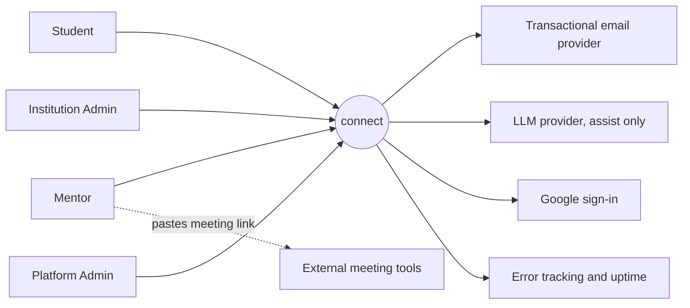
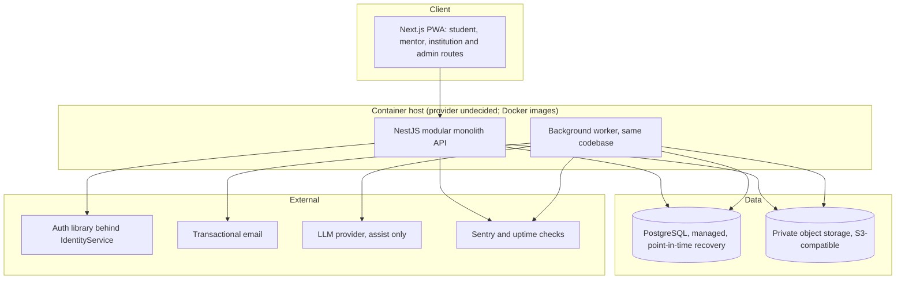
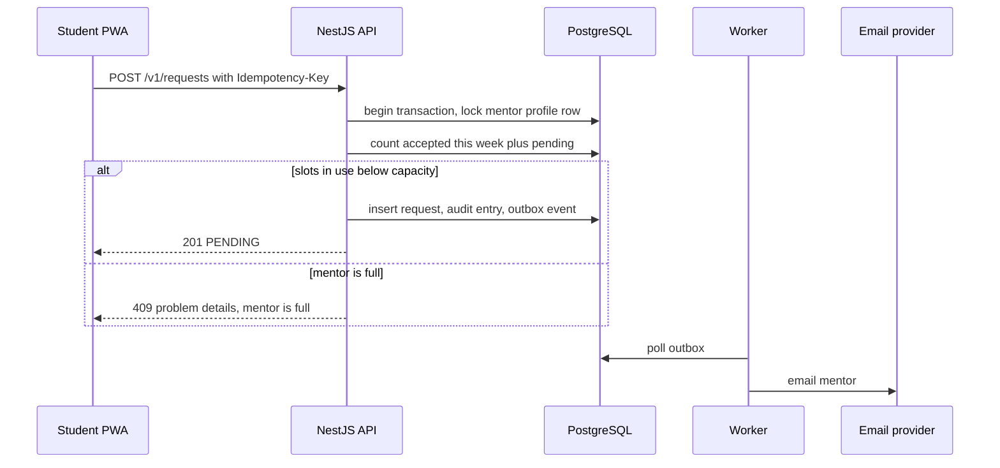
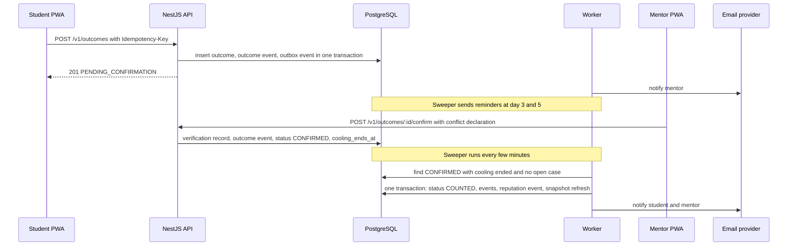
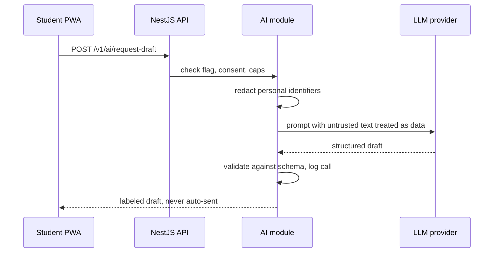

---
title: System Architecture
status: Draft
owner: Owner / CTO
date: 2026-10-28
version: 0.1
sources: [README.md (sections 6 to 10, 12, 14, 15), connect-research-report.md v1.1 (sections 5, 7 docs 10, 11, 12, 14, 20, 8, 10)]
---

# System Architecture

> **Purpose.** The components, boundaries, data flows, deployment views, and the explicit **Now versus Later** decisions for connect. The architecture is sized for one engineer working with AI agents and a pilot of 100 students and 30 mentors, but it keeps clean seams so growth is a redeployment, not a rewrite.

| | |
|---|---|
| **Authority** | Subordinate to [README.md](../README.md) section 7. Where this file departs from the README stack, section 20 lists each deviation so both can be updated. |
| **Companion documents** | [functional-requirements.md](functional-requirements.md), [non-functional-requirements.md](non-functional-requirements.md), [data-model.md](data-model.md), `architecture-decisions.md` (ADR log), `auth-and-access-control.md`, `security-requirements.md`, `api-contracts.md` |
| **Status** | **Proposed design.** Nothing here is built. Every technology choice is a **Recommendation** until its ADR is approved. |

---

## 0. How to read this document

### 0.1 Labels

| Label | Meaning |
|---|---|
| **Plan target** | A goal from the owner's plan. |
| **Owner decision** | Decided and recorded. |
| **Recommendation** | Reasoned proposal adopted as the draft default. Not policy until its ADR is approved. |
| **Proposed default** | Editable starting value, not validated. |
| **Open decision** | Not decided. |
| **Verified [S#]** | Confirmed in a source in research report section 12. |
| **Unverified** | Could not be confirmed. |

### 0.2 What does not change from the README

Postgres as the system of record, NestJS owning the product, contract-first OpenAPI, pure unit-tested business rules, outbox events, truth labels, and the outcome state machine. Everything that changes is listed in section 20.

---

## 1. Architectural drivers

| Driver | Consequence |
|---|---|
| **One engineer, many agents** | Few moving parts, boring and well-known technology, strong conventions, typed contracts |
| **Pilot-sized load** (1 university, 30 mentors, 100 students) | No distributed systems. One API process, one worker, one database |
| **Trust is the product** | Outcome and reputation data is an append-only, auditable ledger driven by pure, tested rule functions |
| **Mobile-first, unreliable networks** | About 89% of internet subscriptions are mobile [S18]; PWA, small payloads, resilient forms, email as the fallback channel |
| **Data law in flux** | Bangladesh's Personal Data Protection Act, 2026 [S1]; data-localization status is **Unverified** [S2][S3][S4]. Collect less, keep the region choice reversible |
| **AI assists, humans attest** | AI is a replaceable, optional, human-reviewed layer that can be switched off without breaking core flows |
| **Replaceable vendors** | Identity, email, storage, meeting links, LLM, and later payments sit behind interfaces |

### 1.1 Principles

1. **Modular monolith first.** Split into services only for a measured reason.
2. **Business rules are pure functions** in one package, with no I/O.
3. **State changes are explicit actions** with an audit trail, never generic updates.
4. **At-least-once processing with idempotent handlers.** Running anything twice is safe.
5. **Postgres is the only source of truth.** Anything that must survive lives there.
6. **Degrade, do not fail.** An optional dependency being down disables only its own feature.
7. **Collect less.** The cheapest compliance is not holding the data.

---

## 2. System context



External meeting tools (Google Meet, Zoom, and others) are **not integrated** in Phase 1. A mentor pastes a link; connect stores it.

---

## 3. Container view (Now)



**Deployables.** Three container roles built from **one repository and one backend image**: `web` (Next.js), `api` (NestJS HTTP), and `worker` (same NestJS codebase, a different entrypoint that runs the outbox consumer and the scheduled sweepers). A fourth short-lived container, `migrate`, runs database migrations before a release.

### 3.1 Component register

Each component has an owner, a purpose, and a replacement path (acceptance criterion from the research report).

| Component | Purpose | Owner | Replacement path |
|---|---|---|---|
| Next.js PWA | All Phase 1 user interfaces, including admin as a route group | Web app | Native Flutter client later against the same OpenAPI contract |
| NestJS API | Product rules, authorization, state machines, REST contract | Core API | Extract a module into a service only on a measured hot spot |
| Worker | Outbox consumer, timers, retention, snapshot and dashboard refresh | Core API | Move to a separate deployment or queue system when load demands |
| PostgreSQL | System of record | Core API (sole migrator) | Move to AWS RDS; read replica when measured |
| Object storage | Evidence uploads, export files | Core API | Any S3-compatible store (R2, S3, MinIO) |
| Auth library behind `IdentityService` | Sign-in, sessions, MFA, social login | Identity module | Keycloak, Auth0, or WorkOS behind the same interface |
| Email provider | Primary notification channel | Notifications module | Resend, Postmark, or AWS SES behind one interface |
| LLM provider | Assist features only | AI module | Any provider behind the `LlmProvider` interface |
| Sentry and uptime check | Errors and availability | Core API | OpenTelemetry stack later |
| CDN and proxy in front of the web app | TLS, static asset caching, basic protection | Web app | Choice is **Open** (see section 17.5) |

---

## 4. Now versus Later

Nothing in the **Later** column may be required by a Phase 1 requirement.

| Capability | **Now (Phase 1)** | **Later** | Trigger to move |
|---|---|---|---|
| Client | Installable PWA (Next.js, TypeScript, Tailwind) | Flutter mobile app (Phase 2) | Measured need: push reliability, store presence, institution request |
| Real-time | Async threads, refetch on focus and an interval on open threads, email notification | WebSocket (Socket.IO) behind the same notification interface | Demand for presence or typing; refetch load; multi-instance scaling |
| Cache, rate limits, queues | PostgreSQL-backed jobs and outbox; in-process rate limiting on a single API instance | Redis | Multiple API instances, measured cache need, WebSocket scaling |
| Secondary backend | None | FastAPI "intelligence" service | First measured AI or heavy-analytics workload after the pilot |
| Identity | Embedded TypeScript auth library (**better-auth**, ADR-003) behind `IdentityService` | Keycloak (self-hosted), WorkOS (SSO only), or Auth0 | First university requiring SAML or SCIM |
| Calls | Mentor-provided meeting link | Zoom API behind `VideoProvider`, then LiveKit | Zoom licensing verified; link friction or cost |
| Payments | None | `PaymentProvider` with SSLCommerz and Stripe adapters (Phase 3) | Entity decision (OD-5) and counsel review |
| AI | None | Assist only, flag-gated, then embedding similarity as one match feature | Offline evaluation on real acceptance data |
| Analytics | SQL views and scheduled refresh | PostHog or a dedicated store | Volume that views cannot handle |
| Observability | Sentry, structured logs, uptime check | OpenTelemetry, metrics, tracing | Multi-service tracing need |
| Hosting | Containerized PaaS, Singapore or Mumbai | AWS (ECS Fargate or App Runner, RDS, S3, CloudFront, SES) | Section 18 triggers |
| Institution SSO | Google sign-in and email-domain verification | SAML via identity provider | First SAML requirement |
| Community circles, employer portal | None | Phase 2 and Phase 3 | README roadmap gates |

---

## 5. Modular monolith design

### 5.1 Modules

The API is one NestJS application organized into modules. A module owns its tables and exposes a small public service interface. Only the owner writes a table (see [data-model.md](data-model.md) catalog).

| Module | Responsibilities | Owns (tables) | Publishes events | Consumes |
|---|---|---|---|---|
| `identity` | `IdentityService` boundary, users, roles, signup blocks, MFA enforcement | `users`, `role_assignments`, `signup_blocks` | `UserRegistered`, `RoleChanged` | Consent events |
| `institutions` | Institutions, domains, affiliation attestation | `institutions`, `institution_domains`, `affiliations` | `AffiliationVerified`, `AffiliationRevoked` | |
| `profiles` | Student and mentor profiles, fields, availability, capacity settings | `student_profiles`, `mentor_profiles`, `fields`, `availability_windows`, `*_fields` | `MentorActivated` | `AffiliationVerified` |
| `matching` | Discovery, rule-based suggestions, suggestion logging | `suggestion_logs` | | |
| `requests` | Structured requests, decisions, redirects, expiry, capacity | `mentorship_requests`, `request_alternatives` | `RequestCreated`, `RequestDecided`, `RequestExpired` | |
| `mentorships` | Mentorships, agreements, threads, sessions, private feedback | `mentorships`, `thread_messages`, `thread_read_states`, `sessions`, `private_feedback` | `MentorshipStarted`, `MessagePosted` | `RequestDecided` |
| `outcomes` | Outcome state machine, evidence, third-party confirmation | `outcomes`, `outcome_events`, `verification_records`, `evidence_items`, `third_party_confirmations` | `OutcomeReported`, `OutcomeConfirmed`, `OutcomeCounted`, `OutcomeReversed` | |
| `trust` | Disputes and audits, moderation, sanctions, break-glass access | `disputes`, `abuse_reports`, `account_sanctions` | `CaseOpened`, `CaseResolved` | `OutcomeDisputed` and others |
| `reputation` | Ledger, snapshots, response reliability | `reputation_events`, `field_impact_snapshots` | | Called by `outcomes` (section 5.3) |
| `notifications` | Email and in-app delivery, preferences, suppression | `notifications`, `notification_preferences`, `email_suppressions` | | Almost every event |
| `privacy` | Consent, data-rights requests, retention jobs, deletion and export | `consent_records`, `data_rights_requests` | `ConsentChanged` | |
| `config` | Versioned rules configuration | `config_versions` | `ConfigPublished` | |
| `audit` | Immutable audit log | `audit_logs` | | Called by all modules |
| `ai` | `LlmProvider` boundary, redaction, logging, cost caps, kill switch | `ai_interaction_logs` | | |
| `platform` | Health, idempotency keys, outbox plumbing, rate limiting | `idempotency_keys`, `outbox_events` | | |

### 5.2 Dependency rules (checked in CI)

1. **Everything may depend on `packages/domain`**, which has no framework or I/O imports.
2. A module never reads or writes another module's tables. It calls the other module's **public service interface** or consumes its events.
3. `reputation` must not import `notifications`, `ai`, or any payment code. `outcomes` and `reputation` must not import billing (BR-09).
4. `matching` inputs exclude payment state and sensitive attributes (FR-DISC-06).
5. The web app depends only on `packages/contracts`, never on API internals.
6. No cycles between modules. An automated dependency-rule test fails the build on a violation.

### 5.3 Ledger-critical consistency: synchronous call, asynchronous side effects

Counting an outcome must write the reputation ledger **atomically** with the status change, or integrity (INV-04, INV-06) can break. The pattern:

- `outcomes` performs the transition to `COUNTED` and appends its events.
- In the **same database transaction**, it calls the `reputation` module's public method (`appendCountedEvent`) which writes the `reputation_events` row and refreshes the affected snapshot. Ownership is respected because only `reputation` writes its tables.
- Everything non-critical (emails, notifications, dashboards) is driven by **outbox events** processed afterward.

---

## 6. Repository layout (trimmed from README 7.5)

```
connect/
  apps/
    web/                 # Next.js PWA with route groups: student, mentor, institution, admin
  services/
    api/                 # NestJS: main.ts (HTTP) and worker.ts (jobs), modules from section 5
  packages/
    domain/              # PURE rules: match, reputation, state machines, tiers, suppression
    contracts/           # OpenAPI spec, shared schemas, generated TypeScript client
    config/              # The one rules configuration source: weights, thresholds, timings
  infra/                 # Docker Compose, deployment notes (no Terraform until the AWS move)
  docs/                  # All planning documents
  AGENTS.md              # Short, constraint-only instructions for AI coding agents
  README.md
```

Not present in Phase 1: `apps/mobile` (Flutter) and `services/intelligence` (FastAPI). This repository currently contains documentation only; no application is present.

### 6.1 `packages/domain`: the pure core

| Function group | Examples |
|---|---|
| Matching | `matchScore(factors, weights)` with weight normalization and safe handling of zero and all-zero weights; ties; plain-language reason builder |
| Reputation | `reputationPoints(difficulty, tier, contribution, pairFactor)`; shrinkage of small samples; `confidenceTier(stats, thresholds)` |
| State machines | `transitionOutcome(state, event, guards)` returning the next state and side-effect descriptors; request, mentorship, and session transitions |
| Time rules | Reminder, escalation, expiry, and cooling schedules computed from configuration |
| Reliability | `responseReliability(timestamps)` that does not penalize timely declines |
| Reporting | Small-cohort suppression and complementary suppression |
| Authorization | `can(actor, action, resource)` policy functions over plain facts |

All inputs and outputs are plain data. Coverage target: at least 90% line and branch (NFR-MNT-02). The configuration (weights, multipliers, thresholds, timings, limits) lives in `packages/config` as **one source**; each ledger event records the `config_versions` row it used (NFR-INT-05).

---

## 7. Key runtime flows

### 7.1 Structured request with capacity control



The row lock on the mentor profile makes capacity race-safe (FR-REQ-06, INV-09). A repeated POST with the same `Idempotency-Key` returns the first result.

### 7.2 Outcome from report to reputation



If the mentor does not respond by day 7, the sweeper escalates the outcome to platform review instead. All transitions are defined in [data-model.md](data-model.md#44-outcome-state-machine).

### 7.3 Evidence upload

1. The student requests an upload through the API, which checks type and size and returns a **short-lived signed upload URL** to a **quarantine** location.
2. The file is uploaded directly to private object storage.
3. A worker job scans it for malware. Only a `CLEAN` result promotes the file; a file that is not clean is never reachable (INV-10).
4. The API records the SHA-256, size, and type; recomputes the evidence tier; and appends an outcome event.
5. Download links are signed and valid for at most 5 minutes (NFR-SEC-08). A retention job deletes the file after the retention window and keeps the hash.

### 7.4 AI-assisted request draft (Phase 1b)



If the flag is off, a cap is hit, or the provider times out (15 seconds or less), the endpoint returns a normal empty state and the student fills in the form by hand.

---

## 8. Asynchronous processing

### 8.1 Outbox and workers

- Every state change that has side effects writes an `outbox_events` row **in the same transaction**.
- **pg-boss owns scheduling and retries.** The worker (or the outbox relay) enqueues each unprocessed outbox row as a pg-boss job and marks it processed after the handler succeeds, so there is one retry mechanism, not two. Handlers are idempotent (de-duplicated by event id and `dedupe_key`).
- pg-boss creates its own `pgboss` schema. The migration step creates that schema and grants it to `app_rw`; without that grant the worker fails on first boot.
- Failures retry with exponential backoff. After a configured number of attempts, an event is marked failed and an alert fires.
- **Job library (decided, provisional):** `pg-boss`, the simplest Postgres-backed option. Recorded as **provisional** in ADR-006; revisit only if it blocks a requirement. No Redis.

### 8.2 Sweepers (scheduled, idempotent)

Timed behavior is driven by **sweepers** that query due timestamps, not by one delayed job per entity. This is more robust (a missed job is caught on the next run) and simpler to reason about.

| Sweeper | Schedule | Action |
|---|---|---|
| Request expiry | Every 5 minutes | Reminder at 24 hours, expiry at 48 hours (owner decision) |
| Outcome reminders | Every 5 minutes | Day 3 and day 5 reminders; escalation to platform review at day 7 |
| Cooling and counting | Every 5 minutes | `CONFIRMED` outcomes past `cooling_ends_at` with no open case become `COUNTED` |
| Third-party confirmation expiry | Hourly | Expire links; null the confirmer email after the grace period |
| Evidence and data retention | Daily | Purge files and data per [data-model.md](data-model.md) section 8 |
| Dashboard refresh | Hourly | Refresh institution materialized views (NFR-PERF-08) |
| Consistency check | Nightly | Verify INV-06 and INV-07; alert on any mismatch |
| Data-rights deadlines | Daily | Flag requests nearing `due_at` |
| Feedback reveal (1b) | Every 15 minutes | Reveal private feedback when both submitted or the timer ends |

Unique indexes on timer events guarantee that a reminder, escalation, or counting step happens **at most once** even if two workers race (INV-14). Target: timed jobs run within 15 minutes of their due time (NFR-PERF-07), with an alert on lateness.

---

## 9. API layer

| Topic | Decision |
|---|---|
| Style | REST over HTTPS, `/v1` prefix; **OpenAPI is the source of truth**; the TypeScript client is generated from it (ADR-011) |
| State changes | Explicit action endpoints (`/accept`, `/decline`, `/confirm`, `/dispute`), not generic PATCH, so each action has its own permission and audit entry |
| Idempotency | `Idempotency-Key` header on every retryable POST; results stored in `idempotency_keys` for about 48 hours |
| Pagination | Cursor-based |
| Errors | RFC 9457-style problem details (`type`, `title`, `status`, `detail`, `instance`, an application error code) plus `request_id` |
| Rate limiting | Per user and per IP; in-process on a single instance in Phase 1. **Known limit:** with more than one API instance the limits become per-instance, which is a trigger to add Redis |
| Versioning | Breaking changes require `/v2` |
| Auth | **BFF:** the browser uses a same-origin httpOnly cookie at the Next.js app; the BFF calls the API with a Bearer token. Non-browser clients may call the API with Bearer directly. See section 10 |
| Real-time | None in Phase 1. A WebSocket section in `api-contracts.md` is marked **Later** |

Core Phase 1 endpoints are listed in the research report (about 12 groups) and detailed in `api-contracts.md`.

---

## 10. Identity and authorization

### 10.1 Identity

- **`IdentityService` interface** hides the vendor. Domain code depends on the interface, never on the library.
- **Phase 1:** an embedded TypeScript auth library, **better-auth**, mounted in the API behind the `IdentityService` interface (ADR-003, **Approved**). Keycloak, WorkOS, or Auth0 are the fallback only if SAML is ever needed.
- Credentials, sessions, and MFA secrets live in a **separate database schema owned by the library**. `users.identity_subject` links to it and is **hard to change**, so the ADR must settle it before the first migration.
- Tokens follow OIDC conventions so any future identity provider is a configuration change: access tokens about 15 minutes, rotating refresh tokens, httpOnly Secure cookies on web (NFR-SEC-03).
- Login methods: email plus password with verification and forgot-password, and Google. Facebook and LinkedIn are **Later**. Microsoft is **not supported**; phone OTP is **not in the MVP**.
- **MFA** (TOTP first) is required for Mentors, Institution Admins, and Platform Admins.
- **18+ enforcement** happens at sign-up (FR-AUTH-03); the date of birth is not stored.

### 10.2 Authorization

- **Authorization is separate from authentication.** Roles come from `role_assignments`; fine-grained permissions are policy functions in `packages/domain` (for example, "this mentor may confirm this outcome" requires ownership and no declared conflict).
- NestJS guards load the facts (actor, role, object ownership, institution scope) and call the pure policy function. Controllers cannot skip a check because every endpoint declares its required action.
- A **permission-matrix test** generated from `auth-and-access-control.md` runs for every role and endpoint (FR-AUTH-07).
- Platform Admin access to threads and evidence is **break-glass**: a reason is required and an audit entry is written before data is returned. No shared accounts.

---

## 11. Data architecture

### 11.1 PostgreSQL

- One primary database, managed, with point-in-time recovery, daily backups, and a periodic logical dump stored elsewhere (NFR-DUR-01 to 05).
- Schema as in [data-model.md](data-model.md). The NestJS API is the **sole owner of migrations**.
- **ORM:** **Drizzle ORM** (decided, ADR-018, superseding the ORM choice in ADR-002). The schema is declared in TypeScript inside the API service; `drizzle-kit` generates the SQL migration files and the `migrate` container applies them. Triggers, role grants, and ledger immutability are hand-written SQL inside those migrations. The database choice is **hard to reverse**; the ORM is moderate.
- **Migrations** are forward-only and written to be backward compatible for one release (expand, then contract) so that rolling back the application image is always safe.
- **Roles:** `migrator`, `app_rw` (no UPDATE or DELETE on ledger tables), `app_ro` (views only), `backup`. Ledger immutability is enforced by the database, not only by code (NFR-INT-01).
- **Multi-tenancy:** `institution_id` scoping in application code, roles, and suppression views. Row-level security is an ADR candidate.

### 11.2 Object storage

Private buckets only; signed URLs of 5 minutes or less; quarantine prefix then promotion after a clean scan; file-type and size limits; deletion after retention. Provider: R2, S3, or MinIO locally (README). **Malware scanning is decided (owner decision, 2026-10-29): a ClamAV container in Docker Compose, called by the worker before a file is promoted.** It is the simplest self-hosted option; a managed scanning service is a Later replacement, not a blocker.

### 11.3 No Redis in Phase 1

Rate limiting runs in-process on a single API instance; the token deny-list is the auth library's concern; queues and timers use Postgres. **Losing the cache must degrade performance, never lose data**; with no Redis this holds trivially. Add Redis on the triggers in section 4 (your MCP configuration already has it disabled).

---

## 12. Notifications

- **Email is the primary channel** in Phase 1 because it works when connectivity is poor [S18]. Provider (Resend, Postmark, or AWS SES) is behind one interface; the choice is **Open**.
- Templates live in code with the trigger table in `notification-and-communication-spec.md` (Planned, not yet created). Each send has a `dedupe_key`, so a retry never double-sends.
- Thread messages are **batched** so that several quick messages produce one email (FR-THR-02).
- Bounces and complaints from provider webhooks add to `email_suppressions` and surface a prompt to the user (FR-NOT-04).
- SPF, DKIM, and DMARC are configured before the pilot (NFR-EML-01).
- In-app notification list (FR-NOT-02) is a table query. The client refetches on focus and on an interval while a thread is open. **No push notifications** until the mobile app exists.

---

## 13. AI architecture (**Later**)

**Deferred (owner decision).** No AI features or AI models ship in the MVP or the pilot build. The design below is kept for the later phase and must not be required by any Phase 1 or Phase 1b criterion.

**Principle: AI assists humans; attested humans confirm.** AI never confirms an outcome, changes reputation, decides a match, resolves a dispute, or ranks candidates for employers (ADR-009).

| Layer | When | Allowed | Forbidden |
|---|---|---|---|
| **Assist** | Phase 1b | Turn a vague need into a structured request draft; summarize an incoming request for a mentor; phrase a "why this match" explanation from the rule factors; flag incomplete requests | Decide matches, confirm outcomes, write outcome claims, alter scores |
| **Triage** | Phase 2 | Flag suspicious evidence or reciprocal-confirmation patterns for a human; summarize dispute threads | Resolve disputes or revoke reputation |
| **Rank assist** | Phase 2 to 5 | Embedding similarity as **one feature** in the match score, after offline evaluation | A global student ranking or an employer-facing score |

**Architecture of the `ai` module:**

1. `LlmProvider` interface with one adapter per vendor; the vendor is replaceable.
2. A **redaction step** strips personal identifiers before any external call; the provider is disclosed as a processor and a cross-border transfer in the privacy notice [S1].
3. Prompts treat all user text as **untrusted input** (prompt injection). The model has **no tools** and no ability to trigger actions. Output is validated against a schema and shown as text.
4. **Human in the loop:** output is labeled, never auto-sent, and the original text stays visible.
5. Every call is logged in `ai_interaction_logs` (purpose, model, input class, output id, tokens, cost) without raw sensitive text.
6. **Per-user and global cost caps** and a **kill switch** feature flag. If a cap is hit or the provider is down, assist features disappear and core flows continue (NFR-REL-04).
7. Free or retained-prompt models receive **no real user data and no secrets** (N12).
8. A small evaluation set is reviewed each release (NFR-AI-07).

Regulatory context: the EU AI Act's high-risk obligations for education and employment uses are deferred to 2 December 2027, but transparency duties were not deferred [S14]. Bangladesh's law lets people restrict automated decisions made with their data [S19]. Both support the assist-only boundary.

---

## 14. Security architecture

This summarizes the controls by layer; the threat model lives in `security-requirements.md`. This is an engineering checklist, **not legal advice**.

| Layer | Controls |
|---|---|
| **Edge** | TLS everywhere; secure headers and Content Security Policy; CDN or proxy; rate limits on sign-up, sign-in, reset, and request creation |
| **Web client** | Output encoding; CSRF protection for cookie sessions; no secrets in the client; meeting links displayed as untrusted |
| **API** | Input validation on every endpoint; role plus object-level authorization; idempotency keys; problem details without stack traces; request IDs |
| **Identity** | Breached-password check, MFA for privileged roles, short-lived tokens, rotating refresh tokens, session revocation |
| **Data** | Encryption at rest; least-privilege database roles; append-only ledgers enforced by grants and triggers; no production data in non-production environments |
| **Files** | Private storage, quarantine and scan, type and size limits, signed short-lived URLs |
| **Secrets** | Platform secret store; never in the repository, logs, prompts, or agent memory (NFR-SEC-07); secret scanning in CI |
| **Supply chain** | Dependency and container scanning in CI; pinned lockfiles; skills and agent plugins reviewed before install |
| **Privileged access** | Break-glass with reason and audit; no shared admin accounts; MFA required |
| **Logging** | Request IDs and pseudonymous ids; never message bodies, evidence content, tokens, or secrets (NFR-SEC-13) |
| **AI** | Redaction, no tools, schema-validated output, call logging, cost caps, kill switch |

---

## 15. Deployment and environments

### 15.1 Environments

| Environment | Composition | Data |
|---|---|---|
| **Local** | Docker Compose: PostgreSQL, MinIO (S3-compatible), a mail catcher, `api`, `worker`, `web` | Synthetic only |
| **Staging** | Production-like containers and managed Postgres | **Synthetic data only**; LLM calls disabled or pointed at a test provider |
| **Production** | Containerized PaaS with managed Postgres, private bucket, email provider | Real data; access via break-glass |

**Rule (Recommendation):** no production data is copied into staging or local without irreversible anonymization.

### 15.2 CI/CD

GitHub Actions. On every pull request: lint, type-check, unit tests (including `packages/domain`), contract tests, dependency and secret scan, build, and Lighthouse checks on core routes. On merge to `main`: build images, deploy to staging automatically, run smoke tests, then **manual approval** to promote to production. Migrations run as a separate release step before rollout. Rollback is redeploying the previous image (target 15 minutes or less, NFR-OPS-01).

### 15.3 Hosting path

- **Dockerize everything from day one** (ADR-016). The hosting provider is **undecided** (Heroku, Render, or Azure) and is chosen **after the MVP is ready**; it must not block Gate 0. A GitHub repository with CI (lint, type-check, tests, build) exists from the start. The domain comes from the GitHub Student Pack.
- Once the MVP is ready, run a one-day test across candidates: latency from Dhaka on real devices, price at pilot size, managed Postgres backups and point-in-time recovery, container support, secrets handling, logs, and support quality.
- Candidate classes from the research: Render, Fly.io, or Railway [S7]; Heroku and Azure are also candidates named by the owner. General guidance says Mumbai tends to give the best latency for South Asia, with Singapore a strong alternative [S7]. Prices are **Unverified** until checked on the live pricing pages.
- **Heroku** entered sustaining engineering on 6 February 2026: no new features, and no new Enterprise contracts for new customers; credit-card customers are unaffected for now [S5]. It still runs but is a poor strategic base for a company that plans to scale. If used at all, avoid Heroku-specific add-ons.
- Hosting provider and region remain an **Open decision**, to be taken after the MVP; they do not gate the build.

---

## 16. Observability

| Layer | Phase 1 |
|---|---|
| Logs | Structured JSON with request ID on every line (NFR-OBS-01) |
| Errors | Sentry for web, API, and worker with release tags (NFR-OBS-02) |
| Uptime | Health endpoint check at least every 5 minutes, plus a synthetic sign-in and read flow (NFR-OBS-03) |
| Alerts | Error-rate spike, job lateness above 15 minutes, overdue reviews, email failure rate, database storage, backup failure (NFR-OBS-04) |
| Product and KPI events | Written to the database in a privacy-respecting way, without selling data |
| Later | OpenTelemetry metrics and tracing when there is more than one service |

---

## 17. Failure behavior

| Failure | Behavior | Requirement |
|---|---|---|
| Email provider outage | Messages queue and retry with backoff; users are told delivery is delayed | NFR-REL-03 |
| LLM outage, cap reached, or kill switch | Assist features disappear; core request and outcome flows continue | NFR-REL-04 |
| Object storage outage | Evidence upload fails with a clear message; the outcome flow continues without evidence | NFR-REL-04 |
| Database outage | The API returns a maintenance response and makes no partial writes; the PWA shell and local drafts stay usable | NFR-REL-06 |
| Worker down | Timed behavior is late, not lost; a lateness alert fires; sweepers catch up idempotently | NFR-PERF-07, NFR-REL-05 |
| Duplicate delivery, retries, or double clicks | Idempotency keys, unique indexes, and de-duplication make repeats harmless | NFR-REL-01 |
| Auth library defect or vendor change | Contained behind `IdentityService`; fallback providers documented | NFR-MNT-07 |
| Ledger inconsistency detected | Nightly check alerts; the ledger is the truth and projections are rebuilt | NFR-INT-02, 03 |
| Compromised admin account | MFA, break-glass audit trail, session revocation, incident runbook | NFR-SEC-12, 14 |

---

## 18. Scaling path and AWS migration

Scale in this order, and only when a metric justifies it:

1. **Vertical:** larger instances for the API and worker.
2. **Database:** tuning and indexes, then a read replica for dashboards.
3. **Redis:** rate limiting across instances, selected caching, and WebSocket scaling.
4. **Worker split:** run the worker as its own deployment with its own scaling.
5. **FastAPI intelligence service:** for AI and heavy analytics, behind **read-only database roles and views** or internal HTTP to NestJS. The two systems never migrate the same tables.
6. **Analytics store:** only when SQL views cannot keep up.

**AWS move.** The same containers run on ECS Fargate or App Runner, with RDS PostgreSQL, S3 and CloudFront, SES, Secrets Manager, in the Mumbai or Singapore region. Add Terraform or CDK **at that time**, not before. **Triggers (Proposed defaults):** institutional security questionnaires that require a named cloud, sustained cost above the PaaS, or compliance demands including data residency.

**Data residency stance.** Until counsel confirms the localization rule, assume an in-country copy may be required for any "restricted" data [S2], and **store none**: no NID, passport, or tax ID (ADR-010).

---

## 19. Cost components

No monthly figures are stated. The owner sets a monthly cap (**Open decision**, OD-9; NFR-CST-01), with alerts at stated percentages.

| Component | Behavior |
|---|---|
| PaaS compute (web, API, worker) | Mostly fixed |
| Managed PostgreSQL and backups | Fixed, grows with data |
| Object storage | Variable, bounded by retention |
| Transactional email | Variable |
| LLM usage | Variable, hard-capped per user and globally |
| Sentry and uptime | Fixed |
| Domain and CDN | Fixed |
| Legal, accounting, tax | Lumpy |
| Trust-and-safety reviewer | Fixed, part-time |

See `business-model-and-pricing.md` section 6 and `cost-model-and-infrastructure-budget.md` (**Planned, not yet created**).

---

## 20. Deviations from the README

Per the README rule, conflicts are resolved explicitly and both documents are updated. These deviations follow the owner's acceptance of the research report's trimmed Phase 1; **all ten are applied to the README as of 2026-10-29**.

| # | README | This document | Why | Upgrade trigger |
|---|---|---|---|---|
| A1 | Flutter in Phase 1 | PWA only; Flutter in Phase 2 | One engineer; mobile is how users connect [S18] | Section 4 |
| A2 | FastAPI as a secondary backend | Not started in Phase 1 | No AI or heavy-analytics need before pilot data | First measured workload |
| A3 | Redis for cache, queues, rate limits | Deferred | A second data system adds operations with no benefit at pilot scale | Section 4 |
| A4 | Socket.IO WebSocket gateway | Deferred | Mentorship is asynchronous by design | Section 4 |
| A5 | Keycloak as Phase 1 identity provider | Embedded auth library behind `IdentityService` | Avoid operating a Java identity provider alone | First SAML requirement |
| A6 | Zoom API in Phase 1 to 3 | Mentor-provided link | Zoom licensing is an open decision (README #9) | Licensing verified |
| A7 | Separate admin console | Admin as a route group in the web app | README already allows it | Separate team or access model |
| A8 | Real-time delivery under 2 seconds | Refetch within 30 seconds and email within 5 minutes | Follows from A4 | WebSocket added |
| A9 | OpenTelemetry in Phase 1 | Sentry, structured logs, uptime check; OpenTelemetry later | Enough for a pilot | Multi-service tracing need |
| A10 | Repository layout includes `apps/mobile` and `services/intelligence` | Both absent until needed | Follows A1 and A2 | |

---

## 21. Architecture decision records (index)

The ADR log lives in `architecture-decisions.md`. All entries are **Proposed** until the owner approves them. Reversibility: **Hard** (database, ledger design, auth subject identifiers), **Moderate** (framework, API style), **Easy** (hosting, email vendor, meeting provider).

| ADR | Decision | Alternatives | Reversibility |
|---|---|---|---|
| 001 | Modular monolith in TypeScript (NestJS) | Microservices; Next.js-only full stack | Moderate |
| 002 | PostgreSQL with one ORM (Prisma default; the ORM choice is superseded by 018) | Drizzle; a document database | Hard (data) |
| 003 | Embedded auth library behind `IdentityService` | Keycloak; Auth0; Clerk | Easy if the seam is honored |
| 004 | Containerized PaaS now, AWS later | Heroku; AWS from day one | Easy if Dockerized |
| 005 | PWA first, Flutter later | Flutter in Phase 1 | Easy |
| 006 | No Redis or WebSocket in Phase 1 | README stack as written | Easy |
| 007 | Mentor-provided meeting links | Zoom API; LiveKit | Easy |
| 008 | Append-only outcome and reputation ledger | Mutable score columns | Hard |
| 009 | AI boundary: assist, never decide | AI scoring or ranking | Policy-level |
| 010 | No government ID collection | NID-based verification | Moderate |
| 011 | Contract-first REST with OpenAPI | GraphQL | Moderate |
| 012 | Pure domain package for rules | Logic inside controllers | Moderate |
| 013 | UI strings externalized (English only; no added languages) | Hard-coded text | Costly later |
| 014 | Monorepo layout from README 7.5, trimmed | Multi-repo | Easy |
| 015 | `PaymentProvider` interface with SSLCommerz and Stripe adapters, Phase 3 | Single gateway; direct SDK use in domain code | Moderate |
| 018 | Drizzle ORM: TypeScript schema, `drizzle-kit` migrations | Keep Prisma; hand-written SQL over a driver | Moderate |

**ADR candidates raised by this document (not yet numbered):** job library (pg-boss, Graphile Worker, or in-house poller); row-level security; malware-scanning approach; email provider; hosting provider and region after the one-day test; whether outcome-creating modules call reputation synchronously (section 5.3, recommended).

---

## 22. Open decisions

| # | Decision | Needed by |
|---|---|---|
| 1 | Hosting provider and region (README #14) | After the MVP is ready; **not** a Gate 0 blocker |
| 2 | Identity provider confirmation and `identity_subject` strategy (README #8, ADR-003) | **Decided:** better-auth; only the subject strategy is settled in Sprint 0 |
| 3 | ORM confirmation (ADR-018, superseding ADR-002) | **Decided:** Drizzle ORM with `drizzle-kit` |
| 4 | Job library (ADR candidate) | **Decided, provisional:** pg-boss |
| 5 | Email provider | Before pilot |
| 6 | Malware-scanning approach | **Decided:** ClamAV container in Compose (Later: managed service) |
| 7 | CDN or proxy in front of the web app | Before pilot |
| 8 | Monthly cost cap (OD-9) | Before Phase 1 build |
| 9 | Row-level security on institution-scoped tables | Before the first institution dashboard |
| 10 | Whether Phone OTP is supported | **Decided:** no |
| 11 | Agent git permissions (N11) | **Decided:** `AGENTS.md` minimal safe default |

---

## 23. Acceptance checklist

- [ ] Each component has an owner, a purpose, and a replacement path (section 3.1).
- [ ] The container diagram matches the **Now** column of section 4.
- [ ] No **Later** item is required by a Phase 1 requirement.
- [ ] Module dependency rules (section 5.2) are enforced by an automated test.
- [ ] Ledger-critical consistency follows section 5.3, with the reputation write inside the counting transaction.
- [ ] Every timed behavior is driven by an idempotent sweeper with a unique-index guard.
- [ ] Failure behavior (section 17) is covered by fault-injection tests.
- [ ] The README deviations A1 to A10 are applied to the README.
- [ ] ADR-001 to 015 exist in `architecture-decisions.md` with a status.

## 24. Questions for the owner

1. **Hosting:** can you run the one-day latency test from Dhaka on two or three PaaS candidates, with real phones on a partner-like network?
2. **Cost cap (OD-9):** what is the monthly ceiling you can carry?
3. **Identity:** are you comfortable with an embedded auth library for the pilot, accepting that a university may later require SAML through Keycloak or WorkOS?
4. **Synchronous counting (section 5.3):** do you accept that `outcomes` calls `reputation` inside one transaction, instead of a purely event-driven design? It protects integrity at the cost of tighter coupling inside the monolith.
5. **Agent permissions (N11):** do you approve "branch and commit on feature branches only; never push or merge to `main`; never touch secrets" as the default for your OpenCode agents?
