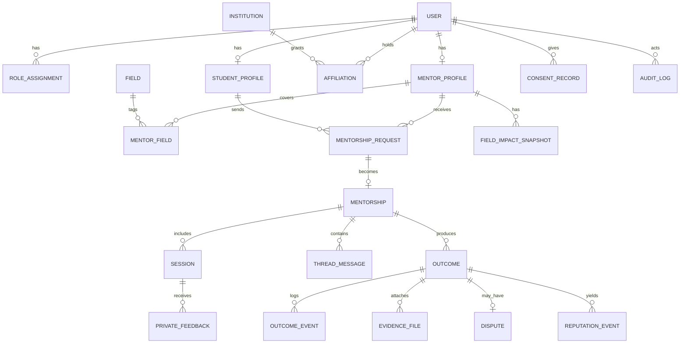
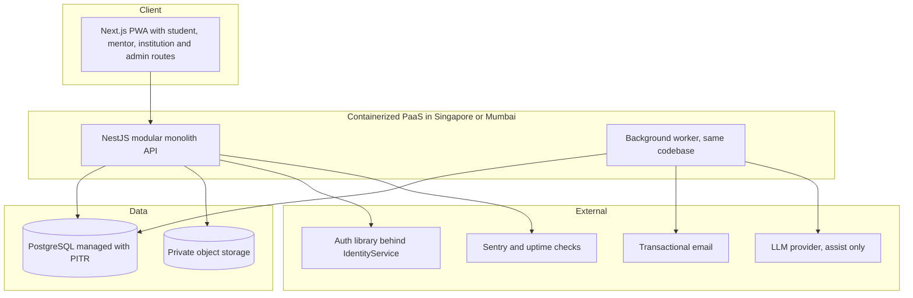

# Connect: Pre-Coding Documentation Research Report

**Version:** 1.1 (research pass 2, complete) · **Date:** 15 October 2026 · **Prepared for:** Founder / CTO of connect
**Inputs reviewed:** `README.md` (master source of truth), `connect-research1-chatgpt.md` (first research pass), your tool list (ponytail, compound-engineering, superpowers, gstack, claude-skills; OpenCode MCP servers), plus fresh web research (sources in Section 12).
**Purpose:** Be the evidence base from which you (with your agent) create the 13 minimum documents (and the deferred ones) without inventing facts.

---

## 0. How to read this report

Every statement carries one of these labels, matching your README's truth labels where possible.

| Label | Meaning |
|---|---|
| **Verified [S#]** | Found in a cited source (Section 12). Confidence is noted when a source is secondary or vendor-biased. |
| **Plan target** | Stated in your README. A goal, not a result. |
| **Recommendation** | My reasoned proposal. You approve or reject it; it is not policy until you do. |
| **Proposed default** | An editable starting value, not validated. |
| **Open decision** | Needs you (or counsel) before it can be written as policy. |
| **Unverified** | I could not confirm it. Do not treat it as fact. |

Rule carried over from your README: **never invent real university names, mentor identities, customer numbers, or validated statistics.** Nothing in this report does.

---

## 1. Executive summary

### 1.1 Bottom line

The first research pass (ChatGPT) is **not a safe base** for your documents. It describes a generic star-rating mentorship marketplace and quietly discards the three ideas that make connect different: **outcome-based reputation, field-specific scores, and institutional evidence**. It also adds an unsupported "16+" age policy that conflicts with Bangladesh's new data law, and its sources are mostly dictionary and Wikipedia entries.

Your README is much stronger, but it is sized for a team, not for one CTO working with agents. Phase 1 as written (web + Flutter + admin console + NestJS + FastAPI + Keycloak + Redis + WebSocket + Zoom API + SSO) is the single biggest execution risk I found. My recommendation is to **keep the README's product model and trim the Phase 1 technical surface** (Section 5).

### 1.2 Eleven findings that change the plan

1. **ChatGPT's report conflicts with the README on reputation, revenue model, stack, messaging, and age policy** (Section 2). Use it only for the small salvage list in 2.4.
2. **Heroku entered "sustaining engineering" on 6 February 2026**: no new features, no new Enterprise contracts for new customers; credit-card customers are unaffected for now **[S5]**. It still runs, but it is a poor strategic base for a company that plans to scale. Start on a containerized PaaS in a Singapore or Mumbai region and keep the AWS path open (Section 5.3).
3. **Bangladesh now has a permanent data law.** Parliament passed the **Personal Data Protection Act, 2026 (Law 63 of 2026)** in April 2026 **[S1]**. A "child" is anyone under 18, and processing a child's data needs verifiable parental consent **[S1]**. **Recommendation: 18+ only for the pilot.** ChatGPT's "16+" is not safe.
4. **Data-residency rules are unclear.** A February 2026 amendment requires a synchronized in-country copy of cloud data for "restricted" data or critical-infrastructure processing **[S2]**; an April 2026 industry paper says the March revision removed localization concerns **[S3]**. These conflict, so the status is **Unverified**. **Recommendation:** collect no government ID numbers, and get Bangladeshi counsel to read the primary text before the pilot.
5. **Payments: keep both SSLCommerz and Stripe (founder decision), but they need two different legal entities.** Stripe does not support Bangladesh-registered merchants, PayPal is unavailable, and Wise is restricted **[S8]**; SSLCommerz-type local gateways require a Bangladesh-incorporated entity and settle in BDT **[S8]**. A common route to Stripe is a foreign (for example Delaware) company, which Stripe Atlas can form **[S21]**. So the dual-gateway plan implies a **dual-entity structure** (Bangladesh entity for SSLCommerz, foreign entity for Stripe), which is a legal and tax decision for counsel, not a coding task. Phase 1 and 2 still contain no payment code; Phase 3 builds a `PaymentProvider` interface with both gateways behind it (Section 5.8).
6. **Do not build public mutual star ratings.** Two-sided ratings inflate through reciprocity and retaliation, and a simultaneous-reveal design reduces it **[S10]**. Your outcome-based model is the right instinct; add private, simultaneous-reveal session feedback for quality operations only.
7. **Outcome verification has three unaddressed weaknesses** (Section 3): the mentor and student can collude, "outcome happened" is not the same as "mentor caused it", and routing disputes to the **institution admin** creates a conflict of interest because the institution is also your paying customer.
8. **The market need is real but willingness to pay is untested.** More than 906,000 graduates are reported unemployed and graduate unemployment is reported at 12% to 13.5% **[S17]**. But incumbents (PeopleGrove, Graduway/Gravyty) already sell alumni-mentoring to universities on custom pricing **[S12]**, so there is no public price benchmark, and your README's $5,000/month example is **Illustrative only**.
9. **Mobile-first is non-negotiable; native-app-first is not.** About 89% of Bangladesh's internet subscriptions are mobile (120.84M of 135.94M, June 2026) **[S18]** and household smartphone ownership is 73.4% **[S18]**. A fast, installable web app (PWA) reaches the same users with one codebase. Defer Flutter.
10. **Keep `AGENTS.md` tiny.** A 2026 study found repository context files tend to lower task success and raise cost by over 20%, and recommends only minimal human-written requirements **[S15]**. Your README already plans AGENTS.md as P0; make it short and pointer-based (Section 8).
11. **AI should assist, not decide.** The EU AI Act's high-risk rules for education and employment uses were deferred to **2 December 2027** by the Digital Omnibus, but transparency duties were not deferred **[S14]**, and Bangladesh's law gives people rights over automated decisions **[S19]**. An AI-powered connect should use AI for drafting, summarizing, and triage, never for confirming outcomes or scoring reputation (Section 5.6).

### 1.3 What I need from you (consolidated in Section 6)

The five decisions that most change the documents: **(a)** accept the trimmed Phase 1 stack; **(b)** age policy (18+); **(c)** pilot partner profile (university vs bootcamp); **(d)** the legal entities behind SSLCommerz (Bangladesh) and Stripe (foreign), which can wait until Phase 3 but should start with counsel during the pilot; **(e)** whether Bangla UI is in Phase 1. Section 6 gives my recommended default for each, so you can reply "approve all" or override individually.

---

## 2. Review of the ChatGPT report

### 2.1 Scorecard

| Area | Verdict | Why |
|---|---|---|
| Fidelity to README | **Fail** | Treats connect as a rating marketplace; drops outcomes, verification state machine, field-specific reputation, institutional revenue, async threads, controlled capacity. |
| Evidence quality | **Weak** | Glossary definitions come from Merriam-Webster; reputation advice from Wikipedia; several citation markers (for example "[58†L115-L123]") do not resolve to any source in the file. I could not verify them. |
| Legal accuracy | **Fail** | Invents a 16+ age rule and justifies it with COPPA and GDPR. Bangladesh's own law (age 18, parental consent) is never mentioned. |
| Technical depth | **Weak** | Generic "React/Vue, Node or Flask, Auth0 or Firebase". Says "AWS advises against monoliths" and then recommends a modular monolith. Does not engage with your stated NestJS/Keycloak/Flutter choices. |
| Data model | **Flawed** | Integer IDs; `USER ||--|| VERIFICATION` allows one verification per user while the text says "multiple records"; role stored as a single string while asking if dual roles are allowed; no Outcome, Dispute, Consent, Audit, or Mentorship entity. |
| API design | **Flawed** | Custom `/auth/login` conflicts with an external identity provider; generic `PATCH /sessions/{id}` for "accept"; no idempotency, pagination, or error standard beyond a sample. |
| Effort/timeline | **Unsupported** | "150–250 hours" and "~6 months to pilot" have no basis shown. |
| Master prompt | **Unusable** | It is a prompt that asks another agent to write a prompt, and references "answers provided above" that do not exist. |
| Safety/ethics | **Missing** | No minors policy grounded in local law, no conflict-of-interest handling, no AI boundaries. |

### 2.2 Direct conflicts with your README

| Topic | README | ChatGPT |
|---|---|---|
| Reputation | Verified outcomes, mentor-confirmed, field-specific, 0–100, no likes | 1–5 star mutual ratings, simple average |
| Revenue | Institutional subscriptions primary | "Pilot free", institutions barely mentioned |
| Messaging | Async threads in Phase 1 | Chat explicitly excluded in v1 |
| Mobile | Flutter in Phase 1 | Web only |
| Stack | NestJS, FastAPI later, Keycloak, Postgres, Redis | "Node or Flask", Auth0 or Firebase |
| Verification | Outcome state machine with dispute and escalation | Credential upload for mentors only |
| Age | Open decision | Assumed 16+ |

### 2.3 Specific errors worth knowing about

- **Reciprocal star ratings are the known failure mode**, not a safe default. Evidence from large field experiments shows reciprocity and retaliation bias reviews, and hiding reviews until both sides submit reduces it **[S10]**.
- **"A simple average is acceptable under 20 reviews"** (as stated) is the opposite of good practice: with small counts you should show the count and avoid false precision (Section 7, doc 4).
- **Deleting a user "anonymizes reviews and keeps trust data"** is plausible but unexamined: connect's reputation is derived from an audit ledger, and the interaction between erasure rights and an append-only ledger needs an explicit design (Section 7, docs 9 and 19).

### 2.4 What is worth salvaging

- The five-part structure per document (purpose, key decisions, recommended content, acceptance criteria, open questions) is good. I reuse it in Section 7.
- Splitting "Student / Mentor / Institution Admin / Employer / System Admin" as roles is consistent with your README.
- The idea of listing "irreversible vs flexible decisions" in the ADR document is good (Section 7, doc 11).
- Requiring MFA for admins (NIST direction) is correct and matches your README.

---

## 3. Review of the README: fix these before writing documents

Your README is the right foundation. These are the places where I found a gap, a contradiction, or a risk. Each is labeled so you can decide.

### 3.1 Product and policy gaps

1. **Outcome fact versus mentor contribution are conflated.** "I got an internship" is one claim; "the mentor helped me get it" is another. Meta-analyses find mentoring effects are positive but modest **[S9]**, so many outcomes will have weak attribution. **Recommendation:** record both, with a contribution level the student states and the mentor confirms separately, and weight reputation by it.
2. **Collusion is not designed against.** A mentor gains reputation by confirming outcomes; a student has no cost to over-claiming. Friends or paid pairs can inflate each other. **Recommendation:** evidence tiers, diminishing returns per mentor-mentee pair, conflict-of-interest declarations, random audits, a cooling-off period before an outcome fully counts, and clawback (Section 7, doc 4).
3. **Institution admin as dispute arbiter is a conflict of interest.** The institution buys "evidence of career outcomes", so it benefits from outcomes being confirmed. **Recommendation:** institution admins handle *affiliation* attestation; **platform trust-and-safety** owns outcome audits and disputes. This is also a selling point: independent audit makes the evidence credible.
4. **A 0–100 score with small samples is false precision.** A mentor with two confirmed outcomes cannot be meaningfully "74". **Recommendation:** display confirmed counts and a confidence tier (Emerging, Established, Proven); keep a numeric score internal until sample thresholds are met.
5. **The `AlumniConnection` factor is constant in a single-university pilot.** If all 30 mentors are alumni of the one partner university, that 30% weight adds no signal. **Recommendation:** redefine it as same department, program, or batch band, or set it to zero in the pilot and say so.
6. **No "Mentorship" relationship entity.** The data model has Request → Session → Outcome, but the mentoring literature finds that expectations for contact frequency and relationship length, and mentor supervision, are associated with better results **[S9]**. **Recommendation:** add a `Mentorship` (the ongoing relationship) with a lightweight agreement (cadence, duration, goal).
7. **Missing policy topics:** age policy, data residency, legal entity and payments, AI usage boundary, moderation staffing, support/on-call, and mentor conflict-of-interest rules are not in the README's open-decisions list. Section 6 adds them.

### 3.2 Technical and operational risks

8. **Phase 1 is too large for one engineer.** It combines web, Flutter, admin, two backends, a self-hosted identity provider, Redis, WebSockets, Zoom integration, SSO, and generated API clients. **Recommendation:** Section 5 trims it without changing the product model.
9. **Keycloak is operationally heavy for a solo founder** (Java service plus its own database; one vendor source estimates production clusters at roughly $100–400/month, a vendor-biased figure) **[S11]**, and it is awkward on a PaaS such as Heroku. It is the right answer *if* a university demands SAML, not necessarily before.
10. **Payments:** the README treats paid office hours as Phase 2 or 3. Given Stripe's lack of Bangladesh support **[S8]**, this is blocked by the legal-entity decision, not by engineering.
11. **Revenue example is Illustrative, but easy to mistake for a plan.** Keep it labelled; validate with real buyer interviews (Section 7, doc 6).
12. **The brand name "connect" is a very common word**, which makes trademark protection and search discoverability harder. This is my reasoning, not a verified trademark finding. **Recommendation:** run a trademark and domain clearance before heavy branding for a global launch.

### 3.3 Document-priority conflict

Your topic list defers docs 5, 6, 8, 13, 15, 17 as "later or light", while the README marks `matching-algorithm-spec`, `business-model-and-pricing`, `pilot-plan`, and `legal-and-compliance-checklist` as **P0**. **Recommendation:** keep your 13 starred documents as the **coding gate**, and add a second **pilot gate** (Section 9) that requires docs 5, 6, 13, 15, 17, 18 before real users are onboarded. That honors both lists.

---

## 4. Evidence base (what the research says, and what it means for connect)

### 4.1 The problem is real in Bangladesh

- More than **906,000** university graduates are reported unemployed (July 2026), up from graduate unemployment of 4.9% in 2010 to about 12% in 2022; the UGC counts **163 universities (53 public, 110 private)** in that report **[S17]**. Another analysis cites 13.5% graduate unemployment and large differences by university type **[S17]**. UGC counts differ between sources (56/116 in others), so quote a count only with its source.
- **Implication:** the "academic-to-career transition" framing is well chosen. But these are national figures, not evidence that *your* product will reduce unemployment. Treat them as context, not proof.

### 4.2 Mentoring works modestly, and structure matters

- Meta-analyses of youth mentoring found a **positive but modest** average effect, with larger effects when programs include mentor supervision, expectations for contact frequency and relationship length, and mentors with helping-role backgrounds **[S9]**. Workplace and higher-education mentoring programs showed larger effects than youth programs **[S9]**.
- A broad interdisciplinary meta-analysis links interaction frequency and relationship quality to protégé outcomes **[S9]**.
- **Implication for connect:** structure (cadence, duration, goals, mentor training) is not decoration; it is the mechanism. Build a lightweight **mentorship agreement** and **mentor onboarding**. Do not promise outcomes you cannot show.

### 4.3 Reputation systems: known failure modes

- Field experiments on Airbnb show reviews are generally informative but biased by reciprocity and retaliation; a **simultaneous reveal** (neither side sees the other's review until both submit or a time limit passes) increased review rates and reduced retaliation, and slightly lowered average ratings **[S10]**.
- Public ratings on large platforms compress near the ceiling, losing discriminating power **[S10]**. Excess reciprocity distorts reputation on peer networks **[S10]**.
- **Implication:** public reputation should come from **verified outcomes and objective response reliability**, not stars. Keep private, double-blind session feedback for quality ops and for matching improvements.

### 4.4 Competitors exist; your wedge is verified outcomes plus market fit

- PeopleGrove combines mentoring and alumni management for higher education, with per-user pricing disclosed only on request, and reviewers note it can be costly for smaller institutions **[S12]**. Graduway (Gravyty) sells alumni engagement plus flash and formal mentoring on custom subscriptions, with a vendor claim of 2,750+ institutions across the Gravyty ecosystem **[S12]**.
- **Implication:** you cannot assume a vacant market. Your differentiators per the README (confirmed outcomes, field-specific reputation, independent audit, emerging-market fit and price point) are credible, but **price is unbenchmarked**. Make "who pays and how much" a pilot learning goal, not an assumption.

### 4.5 Verifiable credentials are the natural "evidence" format

- **Open Badges 3.0** is aligned with the **W3C Verifiable Credentials** model; VC Data Model 2.0 became a W3C Recommendation on 15 May 2025; 1EdTech's Comprehensive Learner Record 2.0 followed in March 2025 **[S13]**. Credentials carry cryptographic proof and do not require the issuer's server to verify **[S13]**.
- **Implication:** a *confirmed outcome* can later be exportable as a verifiable credential that a student carries to an employer, strengthening the "evidence layer" story. **Recommendation:** do not build it in Phase 1; design the `Outcome` and `VerificationRecord` schemas so issuance is possible later (Phase 3).

### 4.6 Connectivity and devices

- End of June 2026: **135.94M internet subscribers, 120.84M of them mobile** **[S18]**. Household smartphone ownership **73.4%**, household internet access 57.4% (Jan–Mar 2026) **[S18]**. Measurement differs across sources (a separate estimate puts individual internet penetration near 47% at end of 2025 **[S18]**), so use ranges, not a single number.
- Internet subscriptions fell in late 2024 and much of 2025 amid unrest and prolonged mobile internet disruptions, before recovering in 2026 **[S18]**.
- **Implication:** mobile-first design, small payloads, resilient forms (autosave drafts, retry), and **email notifications as a fallback** are requirements, not nice-to-haves.

### 4.7 Regulation snapshot (not legal advice)

| Topic | What I found | Label |
|---|---|---|
| Bangladesh data law | PDPA 2026 (Law 63 of 2026), passed April 2026 after the 2025 ordinance and a February 2026 amendment | **Verified [S1][S2]** (secondary summaries; read primary text) |
| Reach | Applies to entities outside Bangladesh offering services to people in Bangladesh | **Verified [S1]** |
| Children | Under 18; verifiable parental consent required | **Verified [S1]** |
| Rights | Access, rectification, erasure, consent withdrawal, portability; rights cannot be waived by contract | **Verified [S1]** |
| Records | Controllers keep a register of processing records for at least five years | **Verified [S1]** |
| Breach | Notify the authority when a breach is likely to cause significant damage | **Verified [S1]** |
| Officer | "Significant" controllers must appoint a Chief Data Officer | **Verified [S1]** |
| Penalties | Administrative fines up to 25 lakh Taka for protection failures and rights violations; up to 50 lakh for significant controllers | **Verified [S1]** |
| Automated decisions | People can restrict automated decisions made with their data | **Verified [S19]** |
| Data localization | Feb 2026 amendment: a synchronized in-country copy for restricted data or critical infrastructure **[S2]**; April 2026 paper says March revision removed concerns **[S3]**; another source says an 18-month compliance window runs from the November 2025 gazette **[S4]** | **Unverified (conflicting)** |
| EU AI Act | High-risk (Annex III education and employment) obligations now **2 December 2027**; transparency duties not deferred | **Verified [S14]** |

---

## 5. Cross-cutting recommendations (decide these before the documents)

All items here are **Recommendations** unless marked. They respect your README as the baseline and change only where evidence or solo-founder reality justifies it. If you prefer to keep the README stack exactly, each row lists the **README-compatible fallback**.

### 5.1 Design principles that drive every choice

1. **Pilot-sized, scale-ready.** 100 students and 30 mentors is a tiny load **(Plan target)**. Optimize for correctness, auditability, and speed of change, not throughput. But keep boundaries clean so scaling is a re-deployment, not a rewrite.
2. **One engineer, many agents.** Prefer fewer moving parts, strong conventions, typed contracts, and boring technology agents know well.
3. **Trust is the product.** Anything touching outcomes, reputation, or verification is built as an **append-only, auditable ledger** with pure, unit-tested rule functions.
4. **AI assists, humans attest.** AI never confirms an outcome or sets reputation.
5. **Collect less.** The cheapest compliance is not holding the data (no government ID, minimal evidence retention).

### 5.2 Phase 1 stack: README versus recommended

| Layer | README | Recommended for Phase 1 | Why | Upgrade trigger | README-compatible fallback |
|---|---|---|---|---|---|
| Web | Next.js, TypeScript, Tailwind | **Same, as an installable PWA**, mobile-first, i18n-ready | Mobile is how users connect **[S18]**; matches your existing Next.js work | Native push or offline demands that PWA cannot meet | Same |
| Mobile | Flutter in Phase 1 | **Defer Flutter to Phase 2** | Second client doubles testing and release work for one engineer | Measured need (push reliability, store presence, institution request) | Build Flutter in Phase 1 only if you can fund a second developer |
| Core backend | NestJS | **NestJS (keep), modular monolith** | Opinionated structure helps agent consistency; built-in OpenAPI; README-aligned | Measured module hot spots | Same |
| Secondary backend | FastAPI | **Do not start in Phase 1** | No ML or heavy analytics need until pilot data exists | First measured AI/analytics workload (post-pilot) | Same (it is already "later") |
| Database | PostgreSQL | **Same, managed**, point-in-time recovery on | Fits ledger design; supports vector search later | Read replicas or partitioning when measured | Same |
| ORM | not specified | **Pick one in an ADR** (Prisma or Drizzle). Default: Prisma | Mature migrations and agent familiarity | n/a | n/a |
| Cache/queues | Redis | **Defer Redis**. Use Postgres-backed jobs and an outbox table | At pilot scale a second data system adds ops with no benefit | Multi-instance WebSocket scaling, measured cache need | Add Redis when needed; your MCP config already has it disabled |
| Real-time | Socket.IO WebSocket | **Defer.** Async threads, email notifications, short polling or SSE | Mentorship is asynchronous by design **(README 5.1)** | Live presence/typing demand | Add Socket.IO behind the same notification interface |
| Auth | Keycloak (Proposed, ADR pending) | **Embedded TypeScript auth library behind an `IdentityService`** (Section 5.4) | Avoid running a Java IdP solo | First university that requires SAML/SCIM | Keycloak, or Auth0 for zero ops |
| Calls | Zoom API first | **Mentor-provided meeting link** in Phase 1 | Avoids Zoom licensing ambiguity (README open decision #9) | Need for auto-created meetings and attendance signals | Zoom behind `VideoProvider` after licensing is verified |
| Admin | Separate console | **Route group inside the web app** | README already allows this | Separate team or access model | Same |
| Storage | S3-compatible | **Same (R2 or S3)**, private bucket, signed URLs | Evidence uploads need access control | n/a | Same |
| Email | Resend/Postmark/SES | **Same**; email is the primary notification channel in Phase 1 | Works when connectivity is poor | Add push with the mobile app | Same |
| Observability | Sentry, OpenTelemetry | **Sentry + structured logs + uptime check**; OTel later | Enough for a pilot | Multi-service tracing need | Same |
| CI/CD | GitHub Actions, Docker | **Same** | Standard | n/a | Same |
| Repo | Monorepo | **Monorepo with a pure `packages/domain`** holding match, reputation, and state-machine logic | Rules stay testable and portable across web, API, and future mobile | n/a | Same |

**What does not change:** Postgres as system of record, NestJS ownership of the product, contract-first OpenAPI, pure unit-tested business rules, outbox events, truth labels, and the outcome state machine.

### 5.3 Hosting path: PaaS now, AWS later

- **Heroku:** sustaining engineering since 6 February 2026; existing credit-card customers unaffected near term **[S5]**. Published prices read in August 2026: Basic dyno $7, Standard-1X $25, Postgres Essential-1 $9 for 10 GB **[S6]** (**Unverified** until you check the live pricing page). **Recommendation:** acceptable as a short-term host only if you avoid Heroku-specific add-ons, but I would not choose it for a new company that expects to scale.
- **Alternatives with regions near Bangladesh:** Render has a Singapore region **[S7]**; Fly.io runs Singapore and Mumbai **[S7]**; Railway runs Southeast Asia (Singapore) and users have requested an India region **[S7]**. General guidance says Mumbai tends to have the best latency for South Asia, while Singapore is a strong alternative **[S7]**.
- **Recommendation:** **Dockerize everything from day one.** Choose a PaaS with a Singapore or Mumbai region after a one-day test (latency from Dhaka, price, Postgres backups/PITR, support). Keep Terraform or CDK out of scope until the AWS move.
- **AWS path (when triggers hit):** same containers on ECS Fargate (or App Runner), RDS PostgreSQL, S3 and CloudFront, SES, Secrets Manager, and an AWS region (Mumbai or Singapore). Triggers (**Proposed default**): institutional security questionnaires requiring a named cloud, sustained cost above PaaS, or compliance demands (including data residency).
- **Data residency:** until counsel confirms the rule, assume you may need an in-country copy of any "restricted" data **[S2]** and **store none**: no NID, passport, or tax ID (Section 5.7).

### 5.4 Authentication

- **Requirements** (from README 8.1): email plus password with verification, Google sign-in, institution sign-in, roles, MFA for mentors and admins, verified affiliation, web now and mobile later.
- **Options (summary):** Keycloak is free to license, supports OIDC and SAML, but requires DevOps; one vendor source estimates $100–400/month for a production cluster (vendor-biased) **[S11]**. Clerk is fast for Next.js but enterprise SSO is on custom plans **[S11]**. A comparison from May 2026 lists better-auth as open-source and self-hostable with SAML via a plugin **[S11]** (secondary, vendor-adjacent).
- **Recommendation:** Phase 1 uses an **embedded TypeScript auth library** (better-auth is my leading candidate; **verify** its JWT/JWKS, organization, and SSO plugin maturity before the ADR) behind an `IdentityService` interface. Emit standard OIDC-style tokens so any future IdP is a configuration change. **Google and Microsoft sign-in plus email-domain verification** will cover most university affiliation needs; **SAML** is added only when a university requires it (WorkOS for SSO-only, or Keycloak). Whether Bangladeshi universities mostly use Google Workspace or Microsoft 365 is **Unverified**; ask in partner interviews.
- **README-compatible fallback:** Keycloak self-hosted with the same `IdentityService` seam, or Auth0 if you prefer zero operations.

### 5.5 Calls and sessions

- **Recommendation (Phase 1):** the mentor pastes any meeting link (Google Meet, Zoom, etc.); connect records the link, time, and "session held" confirmations from both sides. No video SDK, no recording, no transcription.
- **Phase 2 option:** generate meeting links through a calendar API; verify terms and licensing first. **Phase 4:** LiveKit remains a sensible future direction per README.
- Recording and transcription remain **off by default with explicit consent from all participants** (README 9.3).

### 5.6 AI strategy: AI-powered without losing trust

**Principle:** AI assists humans; verified humans attest. This keeps the brand credible and keeps you outside the highest-risk regulatory tier.

| Layer | When | What AI does | What AI must not do |
|---|---|---|---|
| **Assist (Phase 1b)** | Pilot | Helps a student turn a vague need into a structured request; drafts a mentor briefing summary of a request; writes a plain-language "why this match" explanation from the *rule factors*; flags incomplete requests | Decide matches, confirm outcomes, write outcome claims, or alter scores |
| **Triage (Phase 2)** | After pilot data | Flags inconsistent or suspicious outcome evidence and reciprocal-confirmation patterns for a human reviewer; summarizes dispute threads | Resolve disputes or revoke reputation |
| **Rank assist (Phase 2–5)** | After offline evaluation | Embedding similarity (for example `pgvector`) as **one feature** in the match score, evaluated against real acceptance data | Produce a global student ranking or an employer-facing "score" |

**Guardrails (Recommendation):**
- Human review is mandatory for anything affecting reputation, verification, or access.
- Treat all user text as **untrusted input** (prompt injection); never let model output trigger privileged actions.
- Strip personal identifiers before sending text to an external model; disclose model providers as processors and as cross-border transfers (Section 7, doc 19).
- Log every AI call (purpose, model, input class, output id), without logging raw sensitive text longer than needed.
- Abstract the model provider behind an interface; set per-user and global cost caps; keep a small evaluation set and review it each release.
- Clearly label AI-generated text in the UI (also aligns with transparency duties that were not deferred **[S14]**).
- Do not use AI to rank candidates for employers. That would move you toward the EU's education/employment high-risk category (obligations from 2 December 2027) **[S14]** and contradicts README principle "not a global student ranking".

### 5.7 Identity data and "collect less"

- **Recommendation:** never collect or store NID, passport, driver's license, or tax ID. Verify mentors by **institutional or employer email, alumni-office or admin attestation, and optionally a professional profile link**. This lowers both breach impact and any residency exposure.
- Evidence uploads (offer letters, admission letters) are sensitive. Store the file privately, keep a hash and metadata, and delete the file after the verification window (**Proposed default: 90 days after the outcome is counted**; confirm with counsel).

### 5.8 Payments and legal entity (SSLCommerz + Stripe)

**Founder decision (15 October 2026): keep both SSLCommerz and Stripe.** This report treats that as settled and designs around it.

**What the research shows**
- Stripe does not support Bangladesh-registered businesses; PayPal is unavailable to Bangladesh-based accounts; Wise limits Bangladeshi residents; Payoneer is the common receiving route; local aggregators such as SSLCommerz require a Bangladesh-incorporated entity and settle in BDT **[S8]**. (Secondary and commercial sources; confirm in each provider's current merchant terms.)
- Stripe Atlas forms a Delaware C corporation or LLC, obtains an EIN, helps open a US bank account, and lets you activate Stripe payments afterward; approval for Stripe payments is **not guaranteed** and restricted business categories apply **[S21]**. A 2026 guide reports a one-time $500 fee **[S21]** (secondary; verify on Stripe's site).
- Regulators can treat incorporating a foreign company as a cross-border investment: Indian founders were warned that even the Atlas fee could count as overseas direct investment **[S21]**. Whether Bangladesh foreign-exchange rules restrict a resident from owning a foreign company, or from repatriating its revenue, is **Unverified** and must be answered by a Bangladeshi lawyer and accountant before you incorporate abroad.

**Recommended structure (Recommendation, needs counsel)**

| Payer | Gateway | Merchant entity | Currency | Typical use |
|---|---|---|---|---|
| Bangladeshi institution or individual | SSLCommerz | Bangladesh entity | BDT | Institution subscriptions, local paid features |
| International institution or individual | Stripe | Foreign entity (for example Delaware) | USD and others | Global institutions, diaspora, paid features |
| Large institutional deals (either side) | Bank transfer and invoice | Whichever entity contracts | Contract currency | Default for institutions in the pilot and Phase 2 |

**Engineering rules (apply from Phase 3, when payments are built)**
1. A single `PaymentProvider` interface with two adapters (`SslcommerzProvider`, `StripeProvider`). Domain code never imports a gateway SDK.
2. **Hosted checkout only.** Card and mobile-wallet details never touch your servers, which keeps PCI scope minimal.
3. Gateway webhooks are verified, idempotent, and written through the outbox; money state is an append-only ledger separate from the reputation ledger.
4. **Payments never influence reputation or verification** (Doc 6 neutrality firewall). Any fee-related feature is reviewed against that rule.
5. Routing rule: payer country and currency choose the gateway; the contracting entity is fixed by the gateway. Reconciliation and tax reporting are documented per entity.
6. Refund and dispute policy written before launch; chargebacks (Stripe) and gateway disputes (SSLCommerz) feed a support runbook.

**Still Open (does not block Phase 1 or 2):**
- Entity structure and ownership, with tax advice (N2).
- **Mentor payouts.** Paying Bangladeshi mentors from Stripe or any foreign entity raises licensing and foreign-exchange questions that I could not verify; do not promise paid mentoring until resolved. The pilot keeps mentors as volunteers.
- Whether to act as a marketplace taking a fee, or sell only institutional subscriptions and optional features. Institutional subscriptions are far simpler legally than marketplace payouts.
- SSLCommerz onboarding documents and fees, which I did not verify.

---

## 6. Decision register

### 6.1 README open decisions: my recommended default for each

| # | README decision | Recommended default | Label |
|---|---|---|---|
| 1 | Mentor compensation | **Volunteer in pilot**, with recognition: verified-impact profile and an institution-signed certificate or badge. Revisit stipends after pilot data | Recommendation |
| 2 | Office-hour payments | **Gateways decided: SSLCommerz and Stripe, behind a `PaymentProvider` interface, built in Phase 3.** Paid mentoring blocked until entities and payout rules are settled (Section 5.8) | Founder decision; entities Open |
| 3 | Student pricing | **Free for students**; never charge to verify an outcome | Recommendation |
| 4 | Verification responsibilities | **Platform trust-and-safety** audits outcomes and decides disputes; **institution admin** attests affiliation only | Recommendation |
| 5 | Score calibration | **After pilot.** Ship weights in one config file; show confidence tiers, not decimals | Recommendation |
| 6 | Institutional pricing | **Pilot free under a written MoU**; run buyer interviews to test three price hypotheses; do not write numbers until then | Recommendation |
| 7 | Outcome evidence | **Three evidence tiers** (Section 7, doc 4); delete files after the window; keep hashes | Recommendation |
| 8 | Identity provider | **Embedded TS auth behind `IdentityService`**; Keycloak/WorkOS only on first SAML need | Recommendation |
| 9 | Zoom account model | **Mentor-provided link in Phase 1**; no Zoom integration until licensing is verified | Recommendation |
| 10 | NestJS only, FastAPI later | **NestJS only** through the pilot; FastAPI after a measured AI/analytics need | Recommendation |
| 11 | Mentor identity verification | **Level 1** affiliation (institutional email or admin attestation) for all mentors; **Level 2** employer-email check for industry mentors; no government ID | Recommendation |
| 12 | Launch country | **Bangladesh**; PDPA 2026 governs; no active EU/US marketing until counsel advises | Recommendation |
| 13 | Languages | **English UI plus Bangla-ready i18n from day one**; Bangla for key student screens in Phase 1b | Open decision |
| 14 | Hosting | **Containerized PaaS in Singapore or Mumbai**, chosen by a one-day test; AWS later | Recommendation |

### 6.2 New decisions the README does not list

| # | Decision | Recommended default | Label |
|---|---|---|---|
| N1 | Age policy | **18+ only in the pilot**; no minors until parental-consent flows and counsel exist **[S1]** | Recommendation |
| N2 | Legal entities for SSLCommerz (Bangladesh) and Stripe (foreign) | Decide with counsel and an accountant before any monetization (Section 5.8) | Open decision |
| N3 | Data-residency interpretation | Counsel reads primary PDPA text; store no government IDs meanwhile | Open decision |
| N4 | AI boundary | Section 5.6 | Recommendation |
| N5 | Pilot partner profile | See criteria below | Open decision |
| N6 | Dual roles (student and mentor) | **Allowed**, via separate profiles on one user (README ER already allows it) | Recommendation |
| N7 | Trust-and-safety operator | Founder plus a named part-time reviewer; define response-time targets | Open decision |
| N8 | Brand and trademark clearance | Run before heavy branding | Recommendation |
| N9 | Mentor conflict-of-interest rule | Mentors cannot confirm outcomes for relatives, direct reports, or paying relationships; declared at confirmation | Recommendation |
| N10 | Final outcome taxonomy | README lists Admission, Internship, Skill milestone, Interview; decide whether to add Job offer | Open decision |
| N11 | Agent git permissions | Agent may branch and commit on feature branches; never push or merge to `main`; never touch secrets | Open decision |
| N12 | Free-model usage | If using free or possibly retained models, give them **no real user data** and no secrets | Recommendation |

**Pilot partner criteria (Recommendation; do not name institutions in documents until real):** an accessible decision-maker (career center, alumni office, or program head); at least 30 reachable potential mentors (alumni, including diaspora); a cohort of at least 100 adult students; willingness to sign an MoU on data use and verification roles; and a clear outcome the partner already cares about (placement, internships, admissions). **Hypothesis:** a **bootcamp or a single department** may give faster feedback loops and clearer outcomes than a whole university; validate in interviews. Private universities depend heavily on tuition **[S20]**, which may limit software budgets, another reason to test price early.

---

## 7. Document-by-document specifications

Format for each document: **Purpose · Recommended decisions · What the `.md` must contain · Acceptance criteria · Open questions for you.** Numbers and rules are **Proposed defaults** unless cited. Each final document should carry the README truth labels.

### Doc 1: `glossary.md` ⭐

**Purpose:** one meaning per term, one name per concept, used identically in docs, UI, database, and code.

**Recommended decisions**
- Use **Student** and **Mentor** everywhere (UI, docs, code). "Mentee" appears only when quoting research.
- **Split the overloaded word "verification"** into two terms: **Affiliation verification** (a mentor or student is who they say and belongs where they say) and **Outcome verification** (a reported result was confirmed). ChatGPT merged these; your README's "verified badge" semantics need them separate.
- Avoid "rating" and "ranking" in public product language (they imply stars and a global leaderboard). Use **Confirmed outcome**, **Impact (field-specific)**, **Response reliability**.
- Add terms the README lacks: **Mentorship** (the ongoing relationship), **Contribution** (how much the mentor helped), **Evidence tier**, **Cooling period**, **Clawback**, **Private feedback**, **Conflict-of-interest declaration**.

**Must contain:** a table `Term | Definition | Example | Not this | Code name | Owning document`; the five roles (Student, Mentor, Institution Admin, Employer, Platform Admin); the README truth labels; a list of **banned or discouraged terms** with the preferred term; a mapping of glossary terms to enum and table names; an optional Bangla-equivalents column (Open decision #13).

**Acceptance:** every term used in any other document appears here; no two terms share a meaning; every status in the data model maps to a glossary term; terms from the README Glossary are preserved or explicitly renamed with a note.

**Open questions:** do you want "Mentorship" visible to users, or only internal? Bangla translations: who reviews them?

---

### Doc 2: `assumptions-and-open-questions.md` ⭐

**Purpose:** make every unvalidated belief visible, owned, and tied to a validation date.

**What it must contain:** a register with columns `ID | Assumption | Label | Risk if false | What it blocks | How to validate | By when (gate) | Owner | Status`. Seed it with:

| ID | Starting assumption (all Unverified until tested) | Validate by |
|---|---|---|
| A1 | A pilot partner (university or bootcamp) will sign an MoU | Partner interviews before Phase 1 |
| A2 | At least 30 alumni or professionals will volunteer as mentors | Recruitment test before Phase 1 build is finished |
| A3 | Mentors respond within 48 hours often enough to reach the target | Pilot data (Plan target) |
| A4 | Mentors will confirm outcomes within 7 days | Pilot data |
| A5 | Students report outcomes honestly and completely | Pilot plus audit sample |
| A6 | Match acceptance can exceed 40% | Pilot data (Plan target) |
| A7 | Institutions will pay for outcome evidence | Buyer interviews and letters of intent after pilot |
| A8 | Students use mobile browsers more than desktops | Pilot analytics; supported by national data **[S18]** |
| A9 | Google or Microsoft sign-in covers university affiliation needs | Partner IT interviews |
| A10 | An 18+ cohort is large enough for the pilot | Partner enrollment data |
| A11 | PDPA obligations are met with the planned consent and retention design | Counsel review before pilot |
| A12 | Mentor-provided meeting links are acceptable to mentors and students | Pilot feedback |
| A13 | AI-assisted request drafting increases mentor acceptance | A/B within pilot |

Add: **blocking questions** (for example "No pilot partner means no real-world validation of any KPI"), **kill or pivot criteria** (for example "fewer than X mentors recruited after Y weeks, set before launch"), and a **review cadence** (weekly during pilot).

**Acceptance:** every Proposed default and Open decision from the README appears here with an owner and a due gate; nothing here is written as fact.

---

### Doc 3: `personas-and-user-journeys.md` ⭐

**Purpose:** pin down who Phase 1 is for and what happens from sign-up to first mentor contact.

**Recommended decisions**
- **Phase 1 primary users:** Student and Mentor, plus a minimal **Institution Admin** (approve mentors, view aggregates). Employers wait for Phase 3 (README). Platform Admin handles disputes.
- Personas are **hypotheses** until 10–15 interviews are done. Do not publish invented demographics as facts. Mark each persona **Illustrative**.

**Must contain**
- Four persona cards (Student, Mentor, Institution Admin, Platform Admin) with goals, constraints (mobile, language, time), fears, and what "success" means to them.
- **Student journey:** sign up and age/affiliation check → profile → browse suggested mentors with "why this match" → structured request (question, context, target outcome, timeframe) → mentor decision (accept, decline, redirect) → async thread or session → mentorship agreement (cadence) → report outcome → mentor confirms → see progress. Mark failure points: no response in 48 hours, redirect loops, unclear request, lost connectivity while drafting.
- **Mentor journey:** apply → affiliation verification → set capacity and fields → receive request with AI-drafted briefing (human-reviewed) → decide → guide → confirm or dispute outcomes → see verified impact. Include the **incentives** (recognition, verified-impact profile, institution certificate, capacity control, structure that reduces ghosting) and **disincentives** (time, harassment risk, liability worries) and how you address each.
- **Institution Admin journey:** onboarded by platform → approve mentors → see aggregate dashboard with small-cohort protection → cannot see individual student data without consent.
- **Excluded in Phase 1:** employers, circles, paid office hours, group sessions, native app, in-house calls.
- **Interview plan:** 5 students, 5 alumni mentors, 3 career-office or alumni staff, 2 employers. Topics: how they find help today, what blocked them, what would make them confirm outcomes, what a university would pay for.

**Acceptance:** every Phase 1 functional requirement traces to a journey step; each journey names its failure states and the product's response.

**Open questions:** pilot partner type (Section 6, N5); whether Student and Mentor onboarding happen in different tools or one.

---

### Doc 4: `reputation-and-verification-policy.md` ⭐ (the heart)

**Purpose:** define how reputation is earned, protected from gaming, and challenged.

**Recommended design (all Recommendation, all numbers Proposed defaults)**

**A. Keep from the README:** outcome-based, field-specific, unconfirmed never counts, likes never count, state machine with reminders on days 3 and 5 and escalation on day 7.

**B. Add these mechanisms**
1. **Evidence tiers.**
   - *Tier 0:* student report plus mentor confirmation.
   - *Tier 1:* Tier 0 plus a document or link (offer letter, admission letter, public profile), stored privately.
   - *Tier 2:* Tier 1 plus **independent confirmation** (for example the employer, program, or institution confirms through a one-time email link).
   - Rule of thumb (Proposed): Admission, Internship, and Job outcomes need at least Tier 1 to count fully; Skill milestone and Interview may count at Tier 0 with lower weight. Tier multipliers are config.
2. **Contribution attribution.** The student states the mentor's contribution (Directly enabled, Helped, Minor); the mentor confirms or amends it **separately** from confirming the outcome fact. Reputation weight uses it. Motivation: mentoring effects are modest on average **[S9]**, so claiming full credit for every outcome would overstate impact.
3. **Pair diminishing returns.** Repeated outcomes between the same mentor and student contribute less (a pair factor), and unique-student diversity counts.
4. **Conflict-of-interest declaration** at confirmation: relatives, reports, paid relationships, same employer where relevant. A declared conflict means platform review.
5. **Cooling period and clawback.** An outcome counts fully only after a short delay (Proposed: 14 days); a later disproof reverses its reputation effect via a compensating ledger entry.
6. **Audits.** Random sampling of confirmed outcomes plus all high-difficulty outcomes plus anomaly-triggered cases. Sampling rate is a config value; start high in the pilot because volumes are small.
7. **Anomaly signals for human review:** reciprocal confirmation rings, many outcomes in a short window, same device or network among "different" users, templated evidence, one-sided concentration of confirmations.
8. **Dispute ownership:** the **platform** decides disputes and audits; the **institution admin** only attests affiliation. This avoids the conflict where the buyer of "evidence" is also its judge.
9. **Private session feedback (not public stars):** both parties submit private feedback with **simultaneous reveal** logic used for quality operations and matching diagnostics, never shown as stars **[S10]**.
10. **Response reliability** is computed from timestamps (objective, hard to game) and does not penalize timely declines or redirects.
11. **Display rules:** show counts of confirmed outcomes by field and difficulty, response reliability, and a **confidence tier** (Emerging, Established, Proven by sample thresholds) rather than a precise 0–100 number at low volumes. Keep the numeric score internal until thresholds are met.
12. **Statistical care:** when a numeric score is shown, shrink small samples toward a prior (Bayesian-style) so two outcomes cannot outrank twenty.

**C. Reputation computation shape (pure function, one config file):**
`reputation_event = difficulty_weight × tier_multiplier × contribution_multiplier × pair_factor × (1 if past cooling period else 0)`; scores are recomputed from the append-only ledger. **Illustrative only** (fictional numbers for explanation): an Internship outcome at Tier 1 with "Helped" contribution counts less than an Admission at Tier 2 with "Directly enabled". Real values come from pilot data.

**D. Threat model (must appear in the document)**

| Threat | Control |
|---|---|
| Fabricated outcome | Evidence tiers, audits, platform review |
| Mentor-student collusion | Pair factor, conflict declaration, ring detection, audit |
| Mentor farming easy outcomes | Difficulty and tier weights, contribution split |
| Claiming credit for unrelated results | Contribution confirmation, cooling period |
| Retaliation after a dispute | Private double-blind feedback, platform arbiter |
| Fake mentor identities | Affiliation verification levels, institution attestation |
| Institution inflating outcomes | Institution cannot edit or arbitrate; platform audit |
| Bribery or off-platform payment for confirmations | Terms, reporting, anomaly signals |
| Sock-puppet accounts | Email-domain checks, rate limits, device and network signals |
| Harassment | Reporting, moderation queue, suspension path |

**E. Mentor verification levels:** Level 0 email verified; Level 1 affiliation verified (institutional email or admin attestation); Level 2 employer check for industry mentors. **No government IDs** (Section 5.7). Unverified mentors cannot receive requests or build reputation.

**F. Disputes and appeals:** states per README (Disputed, Escalated, AdminReview, Counted, Rejected) renamed in the glossary; add **Appeal** (one appeal to a different reviewer), time limits for each step, and notification rules. Suspension and removal criteria listed with evidence standards.

**G. The verified-badge disclaimer** (from README 12.3): "connect confirms that a mentor countersigned and, where stated, that evidence or a third party supported it; it does not claim every outcome was independently audited."

**Acceptance:** each rule has a trigger, actor, evidence, resulting state, and time limit; every threat above maps to a control; no weight is presented as validated; the same rules produce the same reputation when recomputed from the ledger.

**Open questions:** final outcome taxonomy (N10); who staffs trust and safety (N7); sampling rate; whether Tier 2 is required for Admission.

---

### Doc 5: `matching-algorithm-spec.md` (promote to pilot gate)

- **Decision:** Phase 1 = **concierge-assisted plus rule-based suggestions**. The founder (or a coordinator) can manually suggest matches while the rule-based sort learns from acceptance data.
- **Formula:** keep the README's four factors and normalization rules; **redefine `AlumniConnection`** (same department, program, or batch band) or set its weight to zero in a single-university pilot (Section 3.1 #5). Weights remain **Proposed defaults** in one config.
- **Behavior:** a request expires if undecided (Proposed: 72 hours with a reminder at 48); on decline, redirect, or expiry the student sees the next suggestions; mentors with full capacity are hidden; show the **plain-language reason** for each suggestion.
- **Principles:** the Match Score is a **sort aid, never a predictor of success** (README). No sensitive attributes (religion, ethnicity, etc.) are used. AI embeddings only after offline evaluation (Section 5.6).
- **Quality measures:** acceptance rate, median time to first response, completed mentorship rate, outcome conversion (README KPIs). Log suggestions shown, chosen, accepted.
- **Acceptance:** edge cases (zero weights, ties, empty results) have defined behavior and pure-function tests.

### Doc 6: `business-model-and-pricing.md` (promote to pilot gate)

- **Pilot is free** under a written MoU **(Recommendation)**.
- Present **three price-metric hypotheses** (per active student, per active mentor, flat institution fee) and the evidence each needs; **no numbers** until buyer interviews. Keep your README example labelled **Illustrative**, and note that incumbents price by custom quote **[S12]**.
- **Neutrality firewall:** no payer can buy reputation, badges, audit outcomes, or removal of an unfavorable outcome; institutions see aggregates only; revenue never touches verification decisions. Restate the README's refusals (no data sale, no banner-ad dependence, no engagement traps).
- **Payments:** SSLCommerz (Bangladesh entity, BDT) and Stripe (foreign entity) are both kept by founder decision, built in Phase 3 behind one interface; blocked on N2 (Section 5.8). Institutional invoices by bank transfer until then. Mentor payouts are not promised.
- **Willingness-to-pay metrics:** number of buyer interviews, letters of intent (README: 3 to 5 after pilot), stated budget owner.

### Doc 7: `functional-requirements.md` ⭐

**Purpose:** the exact Phase 1 feature set, with a "done" test each, and what is excluded.

**Recommended scope (trimmed Phase 1; changes from README are web-first PWA, no WebSocket, no Zoom API, no Flutter):**

| ID | Requirement | Roles | Priority | Done when |
|---|---|---|---|---|
| AUTH-1 | Sign up and sign in with email plus password and Google; email verification | All | Must | New user verifies email and signs in; unverified user cannot send requests |
| AUTH-2 | 18+ declaration with institution attestation where available | Student, Mentor | Must | Under-18 sign-up is blocked with a clear message |
| PROF-1 | Student profile (goals, field, language, availability) | Student | Must | Profile saves, validates, and appears in suggestions context |
| PROF-2 | Mentor profile (fields, scope, capacity cap, affiliation) | Mentor | Must | Capacity cap enforced at request time |
| VER-1 | Affiliation verification workflow (Level 1) | Mentor, Institution Admin | Must | Mentor can receive requests only after Level 1 |
| DISC-1 | Mentor discovery with filters and rule-based suggestions plus reason text | Student | Must | Suggestions follow the matching spec; empty states handled |
| REQ-1 | Structured request (question, context, target outcome, timeframe) | Student | Must | Required fields enforced; draft autosave survives reconnect |
| REQ-2 | Mentor decision: accept, decline, redirect, recommend alternative | Mentor | Must | Decision recorded with timestamp; student notified by email |
| REQ-3 | Request expiry and reminders | System | Should | Expiry and reminder timings follow config |
| THR-1 | Async thread (text only) inside a mentorship | Student, Mentor | Must | Messages persist; email notification on new message |
| MEN-1 | Mentorship agreement (cadence, duration, goal) | Student, Mentor | Should | Both parties acknowledge before first session |
| SES-1 | Session record with mentor-provided meeting link and "held" confirmation | Student, Mentor | Should | Both confirm; session appears in history |
| OUT-1 | Report outcome with type, description, contribution level | Student | Must | Creates Pending outcome; mentor notified |
| OUT-2 | Mentor confirm, amend contribution, or dispute | Mentor | Must | State machine enforced; unconfirmed never counts |
| OUT-3 | Optional evidence upload (private, signed URL) | Student | Should | File stored privately; hash recorded |
| OUT-4 | Reminders day 3 and 5, escalation day 7 | System | Should | Jobs run on schedule; idempotent |
| REP-1 | Mentor impact view (counts, response reliability, confidence tier) | All | Must | Shows only counted outcomes |
| FBK-1 | Private session feedback with simultaneous reveal | Student, Mentor | Could | Neither sees the other's feedback until both submit or timer ends |
| INST-1 | Institution dashboard with aggregates and small-cohort suppression | Institution Admin | Should | Aggregates under threshold are hidden |
| ADM-1 | Platform dispute and audit queue | Platform Admin | Must | Disputes resolved with reason, appeal path |
| ADM-2 | Moderation and report-abuse queue | Platform Admin | Must | Reports reach a reviewer with status |
| CONS-1 | Consent capture and withdrawal (institution sharing separate) | All | Must | Consent records are append-only and queryable |
| PRIV-1 | Data export and deletion requests | All | Must | Request tracked; completed within stated period |
| AUD-1 | Audit log for verification, disputes, admin actions, exports | System | Must | Entries immutable and searchable |
| AI-1 | AI request-drafting assistant and mentor briefing (labelled, human-reviewed) | Student, Mentor | Could (Phase 1b) | Output labelled; never auto-sent; logged |
| I18N-1 | Externalized strings; Bangla for key student screens | All | Should | No hard-coded UI text |

**Explicitly excluded in Phase 1:** payments, employer portal, circles, group office hours, native mobile, in-house audio/video, WebSocket real-time, AI matching, public star ratings.

**Acceptance:** each ID has a testable Given/When/Then in the final document; role permissions agree with Doc 12.

---

### Doc 8: `non-functional-requirements.md` (light)

All **Proposed defaults**:
- **Scale:** pilot sized for 1 university, 30 mentors, 100 students **(Plan target)**; headroom 10× without redesign.
- **Availability:** 99.5% monthly target means about 3.6 hours of allowed downtime per month. With one operator this is a **target, not an SLA**.
- **Performance:** p95 under 500 ms for reads, under 1 s for writes (README). Plus a mobile budget: key screens usable on a throttled slow connection and low-end Android (define test device and network profile).
- **Resilience:** forms autosave; failed writes retry safely (idempotency keys); email is the fallback channel; the app tolerates short outages **[S18]**.
- **Durability:** daily backups plus point-in-time recovery; restore tested before pilot (README).
- **Accessibility:** WCAG 2.1 AA (README). **Localization:** Unicode and Bangla fonts tested; no text baked into images.
- **Security baseline:** OWASP ASVS direction (README).
- **Maintainability:** typed contracts, test coverage on pure domain rules, ADRs for decisions.

---

### Doc 9: `data-model.md` ⭐

**Purpose:** entities, relationships, sensitivity, retention, and deletion behavior.

**Recommended decisions**
- **UUID primary keys**, `created_at` and `updated_at` everywhere; **UTC** timestamps.
- **One `User`, many roles** through `RoleAssignment` (supports dual Student and Mentor, and institution-scoped admins).
- **Append-only tables** for `OutcomeEvent`, `VerificationRecord`, `ReputationEvent`, `ConsentRecord`, `AuditLog`. **Derived tables** (`FieldImpactSnapshot`) can be rebuilt.
- Add entities missing from the README ER: `Mentorship`, `ThreadMessage`, `Dispute`, `EvidenceFile`, `Affiliation`, `Field`, `ConsentRecord`, `AuditLog`, `PrivateFeedback`, `AiInteractionLog`, `DeletionRequest`.
- **Multi-tenancy:** `institution_id` on institution-scoped records; consider Postgres row-level security for dashboards.



**Sensitivity classes (Proposed):**
- *High:* evidence files, thread messages, dispute content, consent records.
- *Medium:* profile details, affiliation, outcomes, feedback.
- *Low:* field taxonomy, aggregated metrics.
- *Never stored:* government ID numbers, payment card data, precise location.

**Deletion semantics (needs counsel, Section 7 doc 19):** on account deletion, remove or pseudonymize identifiers, delete evidence files, keep the **ledger structure** with pseudonymous references so counted outcomes remain auditable, and keep only aggregated institution metrics. Confirm that this satisfies the erasure right and its exceptions **[S1]**.

**Acceptance:** every state in Docs 4 and 7 exists as a status enum; each entity lists owner module, sensitivity, retention, and deletion behavior; a person can hold Student and Mentor roles simultaneously.

**Open questions:** final outcome types (N10); whether threads are retained after a mentorship ends.

---

### Doc 10: `system-architecture.md` ⭐

**Recommended decisions:** modular monolith (Section 5.2), single deployable API plus a worker (same codebase), web PWA, managed Postgres, private object storage, email provider, LLM provider used only for assist features.



**Must contain:** module list (identity, profiles, matching, requests, mentorships, outcomes, reputation, notifications, institutions, admin, audit, ai) with ownership; **outbox pattern**; idempotent write endpoints; **Now versus Later table** (WebSocket, Redis, FastAPI, Flutter, SSO, payments, in-house calls, AI ranking all "Later" with triggers); environments (local Docker Compose with Postgres, a local object store, and a mail catcher; staging; production); failure behavior (email outage queues retries; LLM outage disables assist features without blocking core flows); AWS migration path and triggers (Section 5.3); monthly cost envelope as a **founder-set cap** (Open decision), listing cost components without invented numbers.

**Acceptance:** each component has an owner, purpose, and replacement path; the diagram matches the Now table; no "Later" item is required by a Phase 1 requirement.

---

### Doc 11: `architecture-decisions.md` ⭐

Use the 10-line ADR template: *Context, Options, Decision, Reasons, Consequences, Reversibility, Revisit trigger, Status, Date, Owner.* Seed these ADRs (all **Proposed** until you approve):

| ADR | Decision | Alternatives | Reversibility |
|---|---|---|---|
| 001 | Modular monolith in TypeScript (NestJS) | Microservices; Next.js-only full stack | Moderate |
| 002 | PostgreSQL with one ORM (Prisma default) | Drizzle; document DB | Hard (data) |
| 003 | Embedded auth library behind `IdentityService` | Keycloak; Auth0; Clerk | Easy if the seam is honored |
| 004 | Containerized PaaS now, AWS later | Heroku; AWS from day one | Easy if Dockerized |
| 005 | PWA first, Flutter later | Flutter in Phase 1 | Easy |
| 006 | No Redis or WebSocket in Phase 1 | README stack as written | Easy |
| 007 | Mentor-provided meeting links | Zoom API; LiveKit | Easy |
| 008 | Append-only outcome and reputation ledger | Mutable score columns | Hard |
| 009 | AI boundary: assist, never decide | AI scoring or ranking | Policy-level |
| 010 | No government ID collection | NID-based verification | Moderate |
| 011 | Contract-first REST with OpenAPI | GraphQL | Moderate |
| 012 | Pure domain package for rules | Logic inside controllers | Moderate |
| 013 | i18n-ready UI | English-only | Costly later |
| 014 | Monorepo layout from README 7.5 (trimmed) | Multi-repo | Easy |
| 015 | `PaymentProvider` interface with SSLCommerz and Stripe adapters, built in Phase 3 | Single gateway; direct SDK use in domain code | Moderate |

Add a **reversibility map**: Hard (database choice, ledger design, auth subject identifiers), Moderate (framework, API style), Easy (hosting, email vendor, meeting provider).

---

### Doc 12: `auth-and-access-control.md` ⭐

- **Login:** email plus password with verification; Google (and Microsoft if the partner needs it). Phone OTP is an Open decision (SMS cost and deliverability).
- **MFA:** required for Mentors, Institution Admins, and Platform Admins (README); TOTP first.
- **Age:** 18+ only in pilot (N1). Enforce through declared date of birth plus institution attestation where available; an under-18 attempt is blocked with a clear message and no data retained beyond the minimum to prevent re-registration.
- **Sessions:** short-lived access tokens, rotating refresh tokens, httpOnly secure cookies for web.

**Permission matrix (Recommendation):**

| Action | Student | Mentor | Institution Admin | Platform Admin |
|---|---|---|---|---|
| View own profile and data | ✔ | ✔ | ✔ | ✔ |
| View mentor public profile | ✔ | ✔ | ✔ | ✔ |
| Send request | ✔ | – | – | – |
| Decide on request addressed to them | – | ✔ | – | – |
| Read a mentorship thread | participant only | participant only | ✗ | break-glass, audited |
| Report outcome | ✔ (own) | – | – | – |
| Confirm or dispute outcome | – | ✔ (own mentorships, no declared conflict) | – | – |
| Approve mentor affiliation | – | – | ✔ (own institution) | ✔ |
| Resolve dispute or audit | – | – | ✗ | ✔ |
| View institution aggregates | – | – | ✔ (own institution, small-cohort suppression) | ✔ |
| View student-level data for institution | – | – | only with student consent | only for support or dispute, audited |
| Change system configuration | – | – | – | ✔ (audited) |

**Rules:** object-level authorization everywhere (a mentor acts only on their own mentorships); platform-admin production access is logged and **break-glass**; no shared admin accounts; institution admins cannot edit outcomes or reputation.

---

### Doc 13: `security-requirements.md` (light, required before pilot)

Start from OWASP ASVS (README). Must include: data classification (Doc 9); threat model summary (Doc 4 table plus account takeover, upload abuse, scraping of mentor directory); secrets in a manager, never in the repository or in agent prompts; signed short-lived URLs and malware scanning for uploads; rate limits on sign-up and request creation; **AI-specific controls** (prompt-injection handling, no privileged actions from model output, redaction before external calls, call logging); dependency and container scanning in CI; incident response outline with severity levels; **breach notification** to the authority when a breach is likely to cause significant damage **[S1]** (timing set by regulation; confirm with counsel).

### Doc 14: `api-contracts.md` ⭐

**Conventions (Recommendation):**
- REST over HTTPS, versioned prefix `/v1`, **OpenAPI as the source of truth** with generated TypeScript client.
- **State transitions as explicit action endpoints**, not generic PATCH (clear permissions and audit).
- **Idempotency-Key** header on every retryable POST.
- **Cursor pagination**; **RFC 9457-style problem details** for errors (`type`, `title`, `status`, `detail`, `instance`, plus an app error code); consistent `request_id`.
- Authentication through the identity layer's tokens; rate-limit headers; timestamps in ISO 8601 UTC.

**Core endpoints (about 12, Phase 1):**

| Method and path | Purpose |
|---|---|
| `POST /v1/auth/*` | Delegated to the auth library; documented, not custom-built |
| `GET /v1/me` | Current user, roles, consent state |
| `PUT /v1/me/student-profile`, `PUT /v1/me/mentor-profile` | Profiles |
| `GET /v1/mentors?field=&language=&cursor=` | Discovery with suggestion reasons |
| `POST /v1/requests` | Create structured request |
| `POST /v1/requests/{id}/accept`, `/decline`, `/redirect` | Mentor decision |
| `GET`/`POST /v1/mentorships/{id}/messages` | Async thread |
| `POST /v1/mentorships/{id}/sessions` and `/sessions/{id}/confirm-held` | Session record |
| `POST /v1/outcomes` | Report outcome |
| `POST /v1/outcomes/{id}/confirm`, `/dispute`, `/evidence` | Verification actions |
| `GET /v1/mentors/{id}/impact` | Counted outcomes and confidence tier |
| `GET /v1/institutions/{id}/dashboard` | Aggregates (suppression applied) |
| `POST /v1/privacy/export`, `/privacy/delete` | Data rights requests |

**Must contain:** request and response schemas for each, error catalog, state-machine tables per resource, WebSocket section marked **Later**, and versioning rules (breaking changes require `/v2`).

---

### Doc 15: `production-requirements.md` (light, pilot gate)

Define "launchable": backups on and **a restore actually performed**; error tracking and uptime alerts; a one-page runbook (deploy, rollback, rotate keys, handle a dispute backlog); a support inbox with response targets; severity levels; who is on call (state honestly: founder, business hours, unless you add coverage); data-loss recovery steps; status communication to partners.

### Doc 16: `milestones-and-phases.md` ⭐

See Section 9 for the proposed gates. The document must define, per phase: scope, **exit criteria with evidence to review**, exclusions, and dependencies. Use README phases 0–5 and insert **Phase 0.5 (validation)** and **Phase 1a/1b** split. No dates unless you set them; use effort ranges labelled **Proposed**.

### Doc 17: `pilot-plan.md` (promote to pilot gate)

Cohort **Plan target:** 1 partner, 30 mentors, 100 students. Pilot duration: README measures outcome conversion over 90 days, so a pilot shorter than about 90 days cannot show that KPI; **Proposed default: 12 to 16 weeks** (your decision). Include recruitment plan for mentors, onboarding, a data-use MoU, success criteria (README KPIs: acceptance above 40%, response under 48 hours, outcome conversion 15% proposed), **exit criteria** (what failure looks like and what you will do), feedback loops (weekly pulse, exit interviews), ethics and safeguarding, and the plan to seek 3 to 5 letters of intent **(Plan target)**.

### Doc 18: `legal-and-compliance-checklist.md` (pilot gate; **not legal advice**)

Checklist with owner and review status: PDPA 2026 applicability **[S1]**; age policy; consent design; notices (purposes, retention, transfers, rights contact) **[S1]**; processor contracts (cloud, email, LLM) since processors' actions are attributed to the controller **[S1]**; cross-border transfers and residency (Unverified, N3); Chief Data Officer threshold **[S1]**; breach process; terms of use; community guidelines; **volunteer mentor agreement** (not employment); institution MoU; outcome-verification disclaimer; marketing claims discipline; trademark and entity (N2, N8); AI disclosure; any EU or US exposure if you market there. **Have Bangladeshi counsel review before real users.**

### Doc 19: `data-privacy-and-retention.md` ⭐

**Recommended decisions**
- **Data inventory table:** each data item, purpose, lawful basis (consent or contract), sensitivity, storage location, retention, who sees it, processors involved.
- **Collected:** name, email, institution affiliation, profile and goals, requests and threads, outcomes, optional evidence, consent records, security logs. **Never collected:** government ID numbers, payment card data, precise location, health, religion, political data.
- **Retention (Proposed defaults; confirm with counsel):** evidence files deleted 90 days after counting; threads retained for the life of the mentorship plus a short period; security and audit logs per a defined period; **processing records kept at least five years as the law requires for the register** **[S1]** (this is the register, not the underlying personal data).
- **Rights process:** access, rectification (controllers inform concerned parties within 30 days of a correction **[S1]**), erasure with its exceptions, consent withdrawal, portability, tracked in `DeletionRequest` and `ConsentRecord`.
- **Institutions and employers:** separate, revocable consent; aggregates by default; student-level only with consent and a stated purpose; small-cohort suppression (README 11.4).
- **Third parties:** cloud host, email provider, error tracker, and any LLM provider are processors; list them, sign agreements, and describe cross-border transfers in notices **[S1]**.
- **Children:** none in the pilot (N1). Do not build parental-consent flows until counsel scopes them.
- **DPIA:** do a short data-protection impact assessment before pilot (the regulator's procedures contemplate them **[S1]**).

**Acceptance:** every field in Doc 9 appears in the inventory with retention and deletion behavior; the deletion design reconciles with the append-only ledger.

### Doc 20: `AGENTS.md` ⭐

See Section 8.3 for a ready draft. The key design rule: **short, human-reviewed, constraint-only** **[S15]**.

### 7.21 Additional documents worth promoting

- `docs/decision-log.md` (P1 in README): record every decision in Section 6 as you approve it.
- `docs/kpis-and-metrics.md` (P0 in README): formulas, windows, denominators for each README KPI; needed by the pilot plan.
- `docs/ai-features-spec.md` (P2 in README): promote a **one-page** version because you want connect to be AI-powered; it should hold Section 5.6.
- `docs/research-log.md`: a dated list of sources and what each supported, so the evidence stays checkable.

---

## 8. Agentic development workflow (OpenCode, your five toolkits, and your MCP servers)

### 8.1 What each toolkit is, as far as I could verify

Descriptions come from each project's public pages and secondary write-ups **[S16]**. **Read each README and skill list before installing; skill libraries change often.**

| Toolkit | What it adds | OpenCode fit | Main risk for connect |
|---|---|---|---|
| **compound-engineering-plugin** | A plan-work-review loop with skills for brainstorming, planning, doing the work, code review, **document review**, and compounding lessons | Has an install path that targets OpenCode **[S16]** | Overlaps with the other workflow toolkits |
| **superpowers** | A disciplined workflow: brainstorm and design first with a gate before code, written plans, test-driven development, verification before completion | Documents OpenCode support **[S16]** | Overlaps with compound-engineering |
| **gstack** | Role-style slash commands (for example founder-style office hours, CEO and engineering plan reviews, code review, QA, shipping) | Built mainly around Claude Code, with other agent hosts supported; a setup step builds a browser tool, and native Windows behavior is **Unverified** **[S16]** | Strong opinions; may not run cleanly on your setup; telemetry is described as opt-in, so check |
| **ponytail** | A "write less code" discipline plus a review command, with an OpenCode plugin configuration **[S16]** | Yes | Minimizing code can conflict with security-critical or audit-critical code (ledger, auth, consent) if applied blindly |
| **claude-skills** (alirezarezvani) | A very large library of skills across engineering, product, compliance, and more, with an OpenCode install script **[S16]** | Yes | Context bloat; uneven quality; I saw references to security-scan concerns for some skills (**Unverified**, check before installing) |

### 8.2 Recommended use

**Principle: one workflow "spine", other tools as optional lenses.** Running three full methodologies at once makes the agent follow conflicting procedures and wastes context **[S15]**.

| Phase | Spine | Optional lenses | Avoid |
|---|---|---|---|
| **Docs (now)** | **compound-engineering**: brainstorm, plan, then **document review** on each draft | **gstack** office-hours and plan-review sessions to challenge scope and assumptions, only if they run in your environment; **claude-skills**: cherry-pick a product-requirements or compliance skill if its instructions are sound | ponytail (it is about code); installing the whole claude-skills library |
| **Build (later)** | compound-engineering: plan, work, code review | **superpowers** test-driven and verification skills where they do not duplicate the spine; **ponytail** for small diffs and its review pass, **excluded** from the reputation ledger, auth, consent, and audit code, where explicitness beats brevity | Letting any plugin override `AGENTS.md` or approved docs |

**MCP servers (from your list):**
- `context7`: current library documentation for NestJS, Next.js, Prisma, and others, which reduces outdated code.
- `fetch`: reading public pages for research; never paste real user data.
- `filesystem` and `github`: scope to the connect repository; keep write access to feature branches (N11).
- `memory`: do not store secrets or personal data.
- `next-devtools` and `playwright`: frontend debugging and end-to-end tests of core flows.
- `stitch` (pending): useful later for UI mockups; not needed for documents.
- `redis` and `supabase` (disabled): consistent with this report's recommendation to defer Redis and not adopt Supabase in Phase 1.

**Model quality:** the policy documents (4, 12, 19) are where a wrong claim is expensive. Draft them with your strongest available model and review them yourself; use cheaper or free models for mechanical documents (glossary formatting, table cleanup). If any model is free-tier or may retain prompts, **send it no real user data or secrets** (N12).

### 8.3 Draft `AGENTS.md` (copy, then edit; keep it short)

The 2026 study behind this design found that bloated or generated context files can hurt agent performance and raise cost, and that minimal human-written requirements work best **[S15]**. This draft states only what an agent cannot discover from the repository.

```markdown
# AGENTS.md: connect

## Source of truth (highest first)
1. README.md  2. docs/ files marked Approved  3. this file  4. plugin skills
If they conflict, follow the higher one and say so.

## Never
- Invent universities, people, customers, prices, KPIs, statistics, or legal claims.
- Present "Plan target", "Illustrative", or "Proposed" content as fact.
- Decide on your own: reputation formulas or weights, verification rules,
  privacy or retention rules, pricing, legal wording, or AI boundaries.
  Write them as "Open decision" and ask the founder.
- Put secrets, government IDs, card data, or real user data in code, prompts,
  logs, or the memory MCP.
- Push, merge to main, force-push, or rewrite history. Never edit .env*,
  CI secrets, or infrastructure credentials.
- Let AI output confirm an outcome, change reputation, or take a privileged action.

## Allowed
- Create a feature branch and commit to it. (Founder to confirm: N11.)
- Draft documents with status Draft. Only the founder sets Approved.

## Gates
- No code for a feature until its spec doc is Approved.
- Changing an Approved doc needs a new entry in docs/decision-log.md.
- Every rule or weight lives in one config file, never inline.

## Code conventions
- TypeScript strict. Business rules are pure functions in packages/domain
  with unit tests. State changes use explicit action endpoints.
- Write endpoints take an Idempotency-Key. Ledgers are append-only.
- UI text goes through i18n. API contract is OpenAPI; regenerate the client.
- Commands: fill in once the repo exists (do not guess them).

## When unsure
Ask one specific question. Do not guess.
```

### 8.4 Master prompt for OpenCode: document drafting run

This replaces the first report's "prompt that writes a prompt". Use it once per document.

```text
You are drafting ONE connect planning document. Do not write code.

Inputs: README.md, docs/research/connect-research-report.md (Section 7 spec for
this document, Section 6 decisions, Section 3 README issues), AGENTS.md.

Task: draft docs/<number>-<name>.md for: <DOCUMENT NAME>.

Rules:
1. Follow the report's Section 7 spec for this document: Purpose, decisions,
   contents, acceptance criteria.
2. Tag every claim with a truth label: Verified [source], Plan target,
   Proposed default, Recommendation, Open decision, or Unverified.
3. Do not invent names, numbers, customers, or legal claims. If a value is
   missing, write "Open decision" and list it under "Questions for founder".
4. Use glossary terms exactly (docs/01-glossary.md once approved).
5. Do not decide reputation formulas, privacy rules, pricing, legal wording,
   or AI boundaries; present options and your recommendation, then stop.
6. Keep it to 1 to 2 pages unless the spec says otherwise.
7. Set the front matter: status: Draft, owner, date, sources.
8. End with: Acceptance checklist (from the spec) and Questions for founder.

When finished, run the document-review step of the active workflow spine,
list any conflicts with README or earlier approved docs, and stop for review.
```

---

## 9. Documentation sprint, gates, and effort

### 9.1 Recommended drafting order (policy → model → architecture → contract)

`AGENTS.md` (short draft first) → 1 glossary → 2 assumptions → 3 personas and journeys → 4 reputation and verification → 7 functional requirements → 9 data model → 12 auth and access → 19 privacy and retention → 10 system architecture → 11 ADRs → 14 API contracts → 16 milestones.

Reason: policy decisions shape the data model; the data model and privacy rules shape architecture; architecture shapes the API.

### 9.2 Gates

| Gate | Must be true | Evidence |
|---|---|---|
| **Gate 0: coding may start** | The 13 starred documents are **Approved**; decisions #8, #14, N1, N5 resolved; `AGENTS.md` active; a counsel conversation booked | Approved docs; decision log |
| **Gate 1: walking skeleton** | Sign-in, profile, request, decision, thread, outcome report and confirm work end to end on staging; pure rules tested | Demo and test run |
| **Gate 2: pilot readiness** | Docs 5, 6, 8, 13, 15, 17, 18 done; counsel reviewed legal and privacy docs; consent flows and notices live; backup **restore performed**; support runbook; partner MoU signed; mentor verification operating | Checklist with owners |
| **Gate 3: continue or stop** | Pilot KPIs compared with the README's targets; letters of intent counted; kill criteria checked | Pilot report |

### 9.3 Effort

I cannot responsibly give a precise estimate. The first report's "150–250 hours" and "about 6 months" had no basis shown. **Proposed method:** draft the first three documents with your agent, time them, and extrapolate; then set dates. Run **Phase 0.5 validation** (partner conversation, 10–15 interviews, counsel introduction) **in parallel** with drafting, because several documents (personas, assumptions, pilot plan) are only as good as those conversations.

---

## 10. Top risks

| Risk | Likelihood and impact | Mitigation |
|---|---|---|
| No pilot partner, or one that stalls | High likelihood, high impact | Start partner talks now; allow a bootcamp or department as a smaller first partner |
| Not enough mentors, or mentors who do not confirm outcomes | Medium–high, high | Recruit through the partner's alumni office and diaspora; flash-mentoring entry; recognition incentives; test A2 and A4 early |
| Outcome gaming undermines credibility | Medium, very high | Doc 4 controls; platform-owned audits; start with a high audit rate |
| Solo-founder bandwidth | High, high | Trimmed Phase 1; defer Flutter, Redis, FastAPI, WebSocket, Zoom |
| Data-law misinterpretation (residency, minors, AI decisions) | Medium, high | 18+ only; no government IDs; counsel review before pilot |
| Payment setup delays monetization | Medium, medium | Institutional invoices first; start entity advice during pilot |
| Hosting platform decline or latency | Medium, medium | Dockerized services; test regions from Dhaka; AWS path |
| AI errors or manipulation (hallucination, prompt injection) | Medium, high | Assist-only boundary, human review, redaction, logging |
| Agent toolkits conflict or bloat context | High, medium | One spine; short `AGENTS.md`; selective skills |
| Institutions will not pay | Medium–high, high | Price-hypothesis interviews and letters of intent as pilot goals |
| Weak brand protection ("connect" is generic) | Medium, medium | Trademark and domain clearance early |
| Security or privacy incident | Low–medium, very high | Collect less, MFA for admins, break-glass access, breach runbook |

---

## 11. What I could not verify

- The **primary text** of the PDPA 2026 and its amendments; I relied on secondary summaries **[S1][S2][S3][S4]**. The **data-localization status conflicts** between sources.
- Live **Heroku, Render, Fly.io, Railway, and AWS prices**; figures cited are from third-party pages.
- The accuracy of **vendor-written auth comparisons** (cost and feature claims are vendor-biased) **[S11]**; better-auth's JWT/JWKS, organization, and SSO plugin maturity.
- **SSLCommerz onboarding terms, fees, and requirements**, and whether Stripe will approve a foreign-entity account for this business model **[S21]**.
- Bangladesh **foreign-exchange rules** on a resident owning a foreign company and repatriating revenue; **mentor payout** routes.
- Whether **Bangladeshi universities** mostly run Google Workspace or Microsoft 365; their willingness and budget to pay.
- **Native Windows behavior** of gstack and other toolkits; the contents and quality of individual claude-skills.
- Exact **UGC university counts** (sources differ) and the precise graduate-unemployment figure (sources differ).
- Most statements about **ChatGPT's citations**: several markers in its file did not resolve to a listed source, so I treated them as unverifiable.
- This report is **not legal, tax, or financial advice**.

---

## 12. Sources

URLs were transcribed from search results during this research pass; **open each link before relying on it.** "Type" shows reliability: **P** primary or official, **S** secondary summary, **V** vendor or commercial (potentially biased).

| ID | Source | Type | Supports |
|---|---|---|---|
| S1 | Securiti, Bangladesh Personal Data Protection Act overview: https://securiti.ai/bangladesh-personal-data-protection-act-overview/ | S | PDPA 2026 scope, child definition (under 18), parental consent, rights, five-year register, CDO, fines |
| S2 | Digital Policy Alert, Personal Data Protection (Amendment) Ordinance 2026: https://digitalpolicyalert.org/event/38601-president-implemented-personal-data-protection-amendment-ordinance-2026-ordinance-no-23-of-2026 | S | February 2026 amendment, in-country copy for restricted data |
| S3 | CCIA views on Bangladesh's data protection ordinance (April 2026): https://ccianet.org/wp-content/uploads/2026/04/CCIA-Views-on-Bangladeshs-Personal-Data-Protection-Ordinance.pdf | V | Industry view on March revision and localization |
| S4 | BD-SCL, Personal Data Protection Ordinance 2025 compliance: https://bd-scl.com/insights/personal-data-protection-ordinance-2025-compliance.html | V | Restricted data stored in Bangladesh; compliance window claim |
| S5 | Aptible, Heroku sustaining-engineering analysis: https://www.aptible.com/heroku-alternatives/should-you-migrate | V | Heroku sustaining engineering from 6 February 2026 |
| S6 | Findstack, Heroku alternatives: https://findstack.com/resources/heroku-alternatives | V | Published Heroku price points |
| S7 | Fly.io regions: https://fly.io/docs/regions/ · Render regions: https://render-web.onrender.com/blog/new-regions · Railway region request: https://station.railway.com/feedback/feature-request-add-an-india-infrastruc-fee82197 | P / V | Singapore and Mumbai availability |
| S8 | WorldFirst Stripe guide for South Asia: https://www.worldfirst.com/sasia/blog/business-banking-insights/stripe-guide-south-asia/ · NSave on PayPal in Bangladesh: https://www.nsave.com/bangladesh/paypal · PhotonPay on Bangladesh payment methods: https://www.photonpay.com/hk/blog/article/payment-methods-in-Bangladesh | V | Stripe, PayPal, Wise limits; local gateway entity requirements |
| S9 | DuBois et al. 2002 youth mentoring meta-analysis: https://dukespace.lib.duke.edu/server/api/core/bitstreams/3521ecbb-2783-4f5b-b412-c235681c9e92/content · Eby et al. mentoring meta-analysis: https://gs.ucdenver.edu/fobgapt2/workshops/Workshop_2/Eby_et_al_2012.pdf · Youth Today summary: https://youthtoday.org/?p=1071085 · https://en.wikipedia.org/wiki/Youth_mentoring | P / S | Modest effects; structure, frequency, duration matter |
| S10 | INFORMS summary: https://www.informs.org/News-Room/INFORMS-Releases/News-Releases/New-Research-Highlights-Motivations-of-Reviewers · BU summary: https://www.bu.edu/hic/?p=23577 · Fradkin, Grewal, Holtz Airbnb reviews: https://people.bu.edu/zg/publications/airbnbreviews.pdf · arXiv 2504.14053: https://arxiv.org/pdf/2504.14053 · arXiv 1606.02597: https://ar5iv.arxiv.org/html/1606.02597 | P / S | Reciprocity bias; simultaneous reveal; rating compression |
| S11 | Skycloak Keycloak vs Clerk: https://skycloak.io/blog/keycloak-vs-clerk-comparison/ · SSOJet comparison: https://ssojet.com/blog/enterprise-authentication-for-developers-10-tools-compared · Kolonell comparison: https://kolonell.com/en/blog/better-auth-clerk-auth0-saas-comparison-2026 | V | Auth options, ops burden, cost claims |
| S12 | PeopleGrove (FitGap): https://us.fitgap.com/products/peoplegrove · Gravyty Graduway: https://www.gravyty.com/graduway · RFP.wiki Graduway: https://www.rfp.wiki/education-training/university-advancement-software/graduway | V | Incumbent alumni-mentoring platforms and custom pricing |
| S13 | Fora Soft on credentials: https://www.forasoft.com/learn/elearning-video/articles-elearning/certificates-badges-verifiable-credentials · POK Open Badge 3.0 guide: https://www.pok.tech/blog/posts/open-badge-3-0-complete-guide-digital-credentials | V | Open Badges 3.0, W3C VC 2.0, CLR 2.0 |
| S14 | Mondaq, EU Digital Omnibus on AI: https://www.mondaq.com/eu-digital-omnibus-on-ai-enters-into-force/1825722 · Casrai: https://www.casrai.org/news/eu-ai-act-digital-omnibus-deadline-delay | S | High-risk deadline moved to 2 December 2027; transparency duties remain |
| S15 | Evaluating AGENTS.md (arXiv 2602.11988): https://arxiv.org/abs/2602.11988v1 · Upsun, AGENTS.md less is more: https://developer.upsun.com/posts/ai/agents-md-less-is-more | P / V | Context files can reduce success and raise cost; keep minimal |
| S16 | superpowers: https://github.com/obra/superpowers · compound-engineering-plugin: https://github.com/EveryInc/compound-engineering-plugin · ponytail: https://github.com/dietrichgebert/ponytail · gstack overviews: https://themenonlab.blog/blog/gstack-garry-tan-claude-code-virtual-tech-company and https://codex.danielvaughan.com/2026/03/30/gstack-garry-tan-production-skills-toolkit/ · claude-skills: https://pkg.go.dev/github.com/alirezarezvani/claude-skills | P / S | Toolkit scope and OpenCode support |
| S17 | Dhaka Tribune, graduate unemployment: https://www.dhakatribune.com/bangladesh/415371/graduate-unemployment-reaches-906-000-amid-skills · CPD: https://cpd.org.bd/?p=52552 | S | Unemployed graduates, rates, university counts |
| S18 | Financial Express, subscriber growth: https://thefinancialexpress.com.bd/trade/internet-subscriber-growth-outpaces-mobile-connections-in-h1 · Daily Star, internet use: https://www.thedailystar.net/business/news/internet-use-bangladesh-climbs-steadily-q3-4215671 · DataReportal Digital 2026 Bangladesh: https://datareportal.com/reports/digital-2026-bangladesh | S | Mobile share, smartphone ownership, disruptions |
| S19 | TBS News on the data protection ordinance: https://www.tbsnews.net/node/1281356 | S | Right to restrict automated decisions; child safeguards |
| S20 | TBS News on private universities: https://www.tbsnews.net/node/979891 | S | Tuition dependence of private universities |
| S21 | Stripe Atlas docs: https://docs.stripe.com/atlas · Atlas signup: https://edge-docs.stripe.com/atlas/signup · Atlas 2026 guide (third party): https://www.unilink.us/blog/stripe-atlas-2026 | P / V | Foreign-entity route to Stripe; approval not guaranteed; fee claim; outbound-investment caution |

---

*End of report. Next step: approve or edit the decisions in Section 6, then run the Section 8.4 prompt once per document in the Section 9.1 order.*
